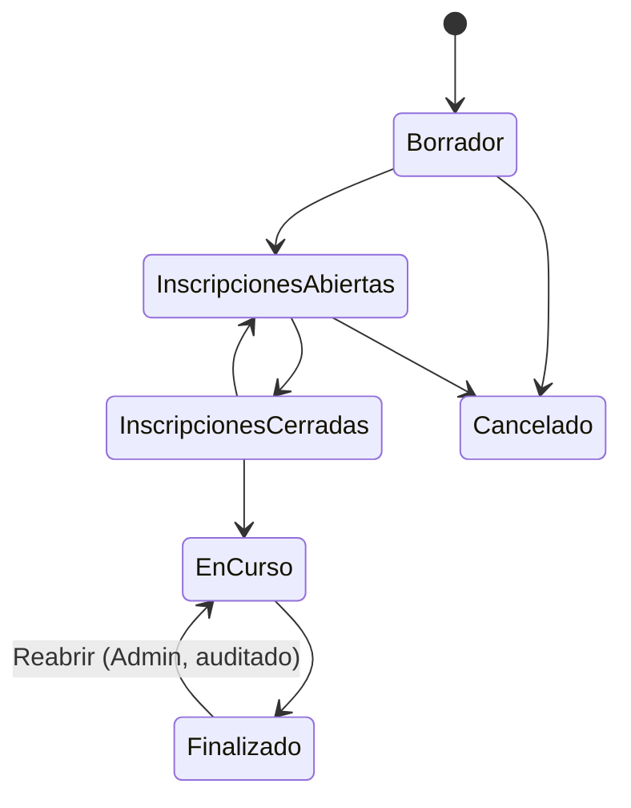
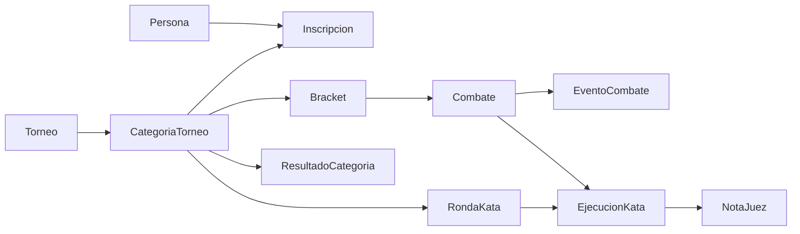
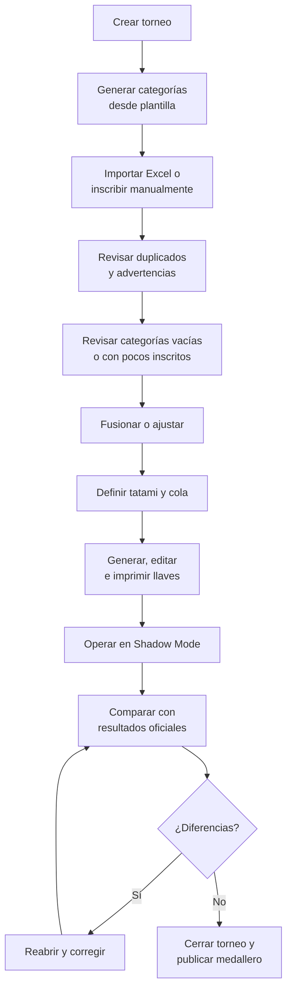

# Documento Maestro – Plataforma de Gestión de Torneos de Karate en Perú

BRD / PRD / Alcance MVP / Roadmap / Backlog · Versión 0.2 · Sep 24, 2026 · @Mariano Bottger

## 0. Control de versiones

La versión 0.2 cierra los vacíos detectados en la revisión de la v0.1 y deja el documento listo como base de construcción.

| Versión | Fecha | Cambios principales |
| --- | --- | --- |
| 0.2 | 24/09/2026 | Criterios de éxito; corte mínimo del MVP; operación con un tatami y torneo mock; deduplicación de personas; protección de datos y menores; estados por categoría; reglas de inscripción como advertencias; importación Excel; terceros lugares configurables; kata rediseñado (banderas/puntuación × llave/rondas); impresión de llaves; frontera SP/Python; eventos inmutables e idempotencia; preparación PWA offline; plan de pruebas; decisiones abiertas. |
| 0.1 | 08/07/2026 | Documento consolidado inicial. |

## 1. Resumen ejecutivo

La plataforma organiza torneos de karate en Perú, registra sus resultados y construye un historial deportivo confiable para competidores, dojos y organizadores. No es solo una app de llaves: es una herramienta operativa e histórica.

Nace operada por el equipo interno en Shadow Mode. El torneo sigue con papel y cronómetro, y la app registra en paralelo la misma operación. Así se valida en eventos reales sin afectar el tatami ni exigir que terceros adopten la herramienta.

La primera validación será en un torneo mock durante entrenamiento y luego en un torneo pequeño de un solo tatami, con un solo operador. El MVP cubre torneos, dojos, competidores, categorías desde plantilla, inscripciones (incluida importación desde Excel), fusiones, llaves inteligentes editables, kumite y kata básicos, resultados, medallero e historial.

Pagos, acreditación, ranking nacional, IA, IoT, app nativa y gestión de academia quedan en backlog.

## 2. Visión, objetivos y criterios de éxito

La plataforma empieza como herramienta interna para torneos locales y crece hasta ser la solución de referencia para torneos de karate en Perú. Debe dar orden sin imponer rigidez, porque en torneos amateur las categorías se fusionan, los competidores se retiran y los resultados se corrigen. El sistema sugiere, automatiza y ayuda; el organizador decide.

### Objetivos

- Digitalizar la organización de torneos sin romper el proceso actual.
- Reducir trabajo manual en llaves, registro de resultados y control de categorías.
- Validar en Shadow Mode antes de cualquier uso oficial.
- Registrar todo lo ocurrido para construir historial deportivo confiable.
- Soportar kumite y kata, individual y por equipos.
- Dejar la base lista para plataforma pública, mobile, analítica e IA.

### Criterios de éxito medibles

Cada fase avanza a la siguiente solo si cumple sus criterios. Los umbrales son iniciales y se ajustan tras el primer torneo mock.

| Criterio | Cómo se mide | Meta para salir de Fase 2 |
| --- | --- | --- |
| Coincidencia de resultados | Ganadores por combate y medallas vs. registro oficial en papel | 100 % tras correcciones; ≥ 95 % sin correcciones |
| Ritmo de mesa | El operador registra el combate sin retrasar al siguiente | 0 combates retrasados por la app |
| Tiempo de registro de puntos | Segundos entre la señal del árbitro y el registro | ≤ 3 s por evento |
| Preparación del torneo | Horas de trabajo desde inscripciones hasta llaves listas | ≥ 50 % menos que el proceso manual |
| Correcciones post-evento | Cambios en auditoría tras el cierre | Todas trazables; tendencia a la baja entre torneos |
| Incidentes bloqueantes | Fallas que impiden seguir registrando | 0 en dos torneos consecutivos |

## 3. Stakeholders y modelo de negocio preliminar

En el MVP el único usuario real es el equipo interno; el resto de stakeholders se incorpora por fases. El modelo de negocio no se define aún, pero se registra aquí para no tomar decisiones técnicas que lo cierren.

| Stakeholder | Interés | Fase en que usa la app |
| --- | --- | --- |
| Equipo interno | Operar y validar el producto | Fase 1 |
| Organizadores de torneos | Menos trabajo manual, resultados ordenados | Fase 3 |
| Dojos y senseis | Inscribir alumnos, ver historial del dojo | Fase 4 |
| Competidores y apoderados | Ver resultados e historial propio | Fase 5 |
| Ligas y federación | Datos consolidados, eventual ranking | Por definir |
| Público | Consultar llaves y resultados | Fase 5 |

Opciones de monetización a evaluar después de la Fase 3: cobro por torneo al organizador, suscripción por dojo, comisión por inscripción (requiere pasarela) o licencia a ligas. Ninguna condiciona el MVP.

## 4. Principios rectores del sistema

Estos principios guían decisiones de UX, base de datos, endpoints y arquitectura. Ante una duda de diseño, se aplica el principio antes que la preferencia.

| Principio | Qué significa en la práctica |
| --- | --- |
| La app nunca detiene un torneo | Si algo falla, el torneo sigue con el proceso físico. La app no es punto único de falla en el MVP. |
| El sistema sugiere, el humano decide | Categorías, llaves y recomendaciones siempre admiten intervención manual. |
| Todo se puede corregir | Puntos, ganadores, categorías, llaves, tiempos y resultados son rectificables por usuarios autorizados, con auditoría. |
| Advertir, no bloquear | Las reglas de negocio generan advertencias con override registrado, no bloqueos. Solo se bloquea lo que corrompe datos (p. ej. un combate sin dos participantes). |
| Todo lo histórico importa | Se guarda combate, resultado, llave, categoría, grado y dojo del competidor al momento del torneo. |
| Los eventos son la fuente de verdad | Marcadores y resultados se derivan de eventos inmutables; corregir es agregar un evento, no sobrescribir. |
| Configuración por datos | Plantillas, categorías, formatos y reglas se editan como datos, no en código. |
| API First | Toda acción es un endpoint; la web es un cliente más. |
| MVP operativo primero | Primero organización y resultados; lo demás va al backlog. |

## 5. Alcance MVP

El MVP se construye en tres incrementos. Cada uno es usable por sí solo en un torneo mock, así se valida temprano y se evita construir todo antes de la primera prueba.

| Incremento | Contenido | Prueba que lo valida |
| --- | --- | --- |
| MVP-1 (núcleo) | Torneo, dojos, competidores, plantilla y categorías, inscripciones manuales e importación Excel, fusión, llaves de eliminación directa con separación por dojo, edición de llave, impresión de llave, mesa de kumite individual, resultados por categoría | Torneo mock en entrenamiento, 1 tatami |
| MVP-2 | Kata individual (banderas en llave y puntuación en ronda única), final directa, round robin, terceros lugares configurables, medallero por dojo, cierre y reapertura con auditoría | Torneo pequeño real en Shadow Mode, 1 tatami |
| MVP-3 | Equipos temporales (kata y kumite), registro opcional de árbitros, historial de competidor y dojo en pantalla, varios tatamis con varios operadores concurrentes | Torneo real multi-tatami en Shadow Mode |

### Incluido en el MVP (al completar MVP-3)

- Creación de torneos uno por uno, con arquitectura lista para varios torneos simultáneos.
- Registro manual e importación de dojos, sedes, competidores, senseis y árbitros.
- Modelo persona-roles: una persona puede ser competidor, sensei, organizador, árbitro y administrador.
- Plantillas editables copiadas al torneo; categorías vacías se ignoran.
- Inscripción por el operador, con varias inscripciones por competidor.
- Equipos temporales por torneo.
- Fusión de categorías con trazabilidad.
- Llaves inteligentes, editables, regenerables e imprimibles.
- Asignación de categorías a tatamis, modificable durante el evento.
- Mesa de kumite y kata con correcciones.
- Cierre reabrible, medallero por dojo, historial completo.

### Fuera del MVP

- Pasarela de pagos, cobranza, facturación.
- Acreditación, QR, check-in.
- Ranking nacional o histórico.
- Gestión de academia.
- App móvil nativa publicada.
- Modo offline (el modelo queda preparado, ver sección 23).
- IA, IoT, pesaje oficial.
- Optimización automática de horarios.
- Gestión obligatoria de árbitros por combate.
- Portal público.

## 6. Modelo de operación inicial

Las primeras pruebas usan un solo operador y un solo tatami: primero un torneo mock en entrenamiento y después un torneo pequeño real. Multi-tatami requiere varios operadores de mesa concurrentes y se habilita recién en MVP-3.

### Torneo mock

Se simula un torneo completo en un entrenamiento, con alumnos reales como competidores. Permite repetir combates y provocar casos difíciles a propósito: retiros, empates, punto de oro, hantei, walkover, correcciones de marcador y fusiones de último minuto. Es el primer entorno de prueba y no depende de ningún organizador externo.

### Shadow Mode

En torneos reales la app corre en paralelo al proceso oficial. El puntero oficial usa papel y cronómetro; el operador interno registra lo mismo en la app. Al final se comparan los resultados y cada diferencia se registra como hallazgo.

### Operador centralizado

Una sola persona puede crear el torneo, los dojos, los competidores, las categorías, las inscripciones, las llaves y los resultados. No se asume que los dojos usarán la app.

### Ecosistema futuro

Los dojos registrados administrarán sus alumnos e inscripciones. El sistema soporta dojos registrados y dojos creados manualmente, y un dojo manual podrá ser reclamado por su administrador real.

## 7. Usuarios, personas y roles

La entidad base es Persona, y una persona puede tener varios roles a la vez. En karate un sensei también compite, un árbitro fue competidor y un organizador pertenece a un dojo.

No existe un rol "Testing". En el MVP el Admin Global cumple esa función y la separación se hace por ambientes (DEV, TEST, PROD) y por la marca `es_prueba` en torneos mock.

| Rol | Permisos | Fase |
| --- | --- | --- |
| Admin Global | Todo: reabrir torneos, corregir resultados, configurar, operar | MVP |
| Organizador de Torneo | Torneos, categorías, tatamis, llaves, inscripciones, resultados | MVP |
| Operador de Mesa | Registrar combates, puntos, faltas, tiempos, kata; sin cambiar configuración | MVP-3 |
| Administrador de Dojo | Dojo, sedes, competidores e inscripciones propias | Fase 4 |
| Árbitro | Registro opcional; no requiere dojo | MVP (opcional) |
| Competidor | Persona sin cuenta obligatoria | MVP (sin login) |
| Consulta / Público | Ver llaves, resultados y medallero | Fase 5 |

Los permisos se asignan por ámbito: global, por torneo o por dojo. Un Organizador lo es de torneos específicos, no de todos.

## 8. Identidad y deduplicación de personas

La identidad se basa en un tipo y número de documento, no solo en el DNI, y el documento es opcional al registrar. Con un operador digitando rápido habrá duplicados, así que el sistema debe detectarlos y permitir fusionarlos.

- **Documento:** tipo (DNI, carné de extranjería, pasaporte, otro) + número. Único por tipo cuando existe.
- **Sin documento:** se permite registrar con nombres, apellidos, fecha de nacimiento y dojo; queda marcado como "identidad incompleta".
- **Detección de duplicados:** al registrar o importar, el sistema busca coincidencias por documento o por nombre normalizado (sin tildes ni mayúsculas) + fecha de nacimiento, y muestra una advertencia con los posibles duplicados.
- **Fusión de personas:** el Admin Global puede fusionar dos personas. Todo el historial (inscripciones, combates, grados, dojos) pasa a la persona que se conserva, y la fusión queda en auditoría y es reversible.
- **Identificador interno:** todas las relaciones usan el ID interno de Persona, nunca el documento, para que corregir un documento no rompa nada.

## 9. Dojos, sedes y competidores

Todo competidor pertenece a un dojo en cada torneo, y el vínculo dojo-competidor se guarda con fechas para preservar el historial.

- **Dojo:** organización con historial colectivo, administradores y competidores. Puede ser registrado o creado manualmente por el organizador, con estado "reclamado" o "no reclamado".
- **Sede:** subunidad de un dojo (p. ej. sede San Isidro y sede San Miguel). El historial se consulta por dojo y, opcionalmente, por sede.
- **Dojo temporal:** si un competidor no tiene dojo, se usa un dojo "Independiente" o uno temporal que se corrige después.
- **Cambio de dojo:** un competidor puede cambiar de dojo. El historial personal lo acompaña; los resultados anteriores quedan con el dojo anterior.
- **Competidor sin cuenta:** puede existir sin usuario de acceso, lo que permite registrar menores. Más adelante podrá reclamar su perfil.
- **Registro:** se registra principalmente al competir. Registrar a todos los alumnos de un dojo es posible pero no obligatorio.

## 10. Historial deportivo

Cada inscripción guarda una foto del competidor en ese momento: dojo, sede, grado, categoría de peso y edad. Un torneo pasado muestra siempre esa foto, no los datos actuales.

- **Competidor:** torneos, categorías, puesto, combates, rivales, marcadores, notas de kata, dojo/sede y grado al momento, formato y categoría (incluida la fusión si la hubo).
- **Dojo:** resultados de sus competidores mientras estuvieron asociados. Un cambio de dojo no transfiere resultados antiguos.
- **Graduaciones:** historial de kyu/dan con fecha. El grado de la inscripción se toma del historial vigente a la fecha del torneo, y el operador puede corregirlo si el dato está desactualizado.

## 11. Protección de datos personales y menores

La plataforma guardará datos de muchos menores de edad, así que debe cumplir la Ley 29733 de Protección de Datos Personales y su reglamento desde antes de tener datos reales en PROD. Los detalles legales (edades de consentimiento, inscripción del banco de datos ante la autoridad) deben validarse con un asesor legal.

- **Minimización:** solo se guarda lo necesario para competir: nombres, fecha de nacimiento, sexo, documento, dojo, grado y categoría de peso. No se guarda el peso exacto, dirección ni datos médicos en el MVP.
- **Consentimiento:** cada persona tiene un registro de consentimiento (quién lo dio, fecha, medio). Para menores lo otorga el padre, madre o apoderado. En el MVP puede registrarse como declaración del dojo inscriptor.
- **Visibilidad por niveles:** el documento de identidad y la fecha de nacimiento completa nunca son públicos. Para resultados públicos (Fase 5), los menores se mostrarán con nombre abreviado salvo autorización expresa.
- **Acceso:** solo Admin Global y organizadores del torneo ven documentos. Los operadores de mesa ven nombre, dojo y categoría.
- **Derechos ARCO:** debe existir un procedimiento para atender solicitudes de acceso, rectificación, cancelación y oposición. La cancelación anonimiza a la persona sin borrar los combates, para no romper el historial de sus rivales.
- **Datos de prueba:** DEV y TEST usan datos ficticios o anonimizados, nunca copias de PROD con datos reales.

## 12. Torneos y ciclo de vida

El torneo y cada categoría tienen estados propios, porque una categoría puede terminar mientras el torneo sigue en curso. La reapertura es una acción auditada, no un estado.

Un torneo contiene datos generales, tatamis, categorías copiadas de plantilla, inscripciones, llaves, combates, resultados y reportes. El primer alcance opera un torneo a la vez, pero el modelo aisla todo por `torneo_id` para soportar varios simultáneos. Los torneos mock llevan la marca `es_prueba` y se excluyen de historial y estadísticas.

### Estados del torneo

Reabrir un torneo finalizado lo devuelve a En curso y registra quién, cuándo y por qué.

### Estados de la categoría

| Estado | Significado |
| --- | --- |
| Abierta | Recibe inscripciones |
| Vacía | Sin inscritos; no genera llave ni aparece en programación |
| Fusionada | Sus inscritos pasaron a otra categoría; se conserva para historial |
| Lista | Llave generada, pendiente de competir |
| En curso | Al menos un combate iniciado |
| Finalizada | Resultados definidos (oro, plata, bronces) |
| Cancelada | Decisión del organizador; se conserva el motivo |

Una categoría finalizada también puede reabrirse con auditoría, sin reabrir el torneo completo.

## 13. Plantillas y categorías

El torneo nace de una plantilla editable que se copia al crearlo; cambiar la plantilla después no afecta torneos existentes. No se construye generación dinámica compleja en el MVP.

- **Generación:** al crear el torneo se copian todas las categorías de la plantilla. Las que queden sin inscritos pasan a estado Vacía.
- **Atributos de categoría:** modalidad (kumite/kata), individual o equipos, sexo (masculino, femenino, mixto), rango de edad, categoría de peso, rango de kyu/dan, formato, método de decisión (kata), regla de terceros lugares, duración del combate, tipo de tiempo, regla de empate y estado.
- **Edad:** se calcula a una fecha de referencia configurable por torneo (normalmente el día del torneo o el 31 de diciembre del año).
- **Herencia de configuración:** el torneo define valores por defecto (p. ej. eliminación directa, dos bronces) y cada categoría puede sobrescribirlos.
- **Categorías con pocos inscritos:** se advierte al organizador, que decide entre mantener, final directa, round robin, fusionar o cancelar.
- **Fusión:** crea o elige una categoría destino, mueve las inscripciones y marca las de origen como Fusionada, guardando el vínculo origen-destino. Se puede deshacer mientras no haya combates iniciados.
- **Categorías manuales:** el organizador puede crear una categoría fuera de la plantilla para un caso puntual.

## 14. Inscripciones

El operador elige manualmente las categorías de cada competidor; el sistema solo sugiere las que encajan con su edad, sexo y grado. Las reglas generan advertencias con override, nunca bloqueos.

### Reglas

- Un competidor puede tener varias inscripciones en el mismo torneo (p. ej. kumite y kata).
- **Subir de nivel:** permitido si el organizador lo autoriza.
- **Bajar de nivel** (kyu menor al mínimo de la categoría): genera advertencia. Si el organizador la acepta, el override queda registrado con usuario y motivo.
- Lo mismo aplica a edad o peso fuera de rango.
- **Peso:** no hay pesaje oficial. Se registra solo la categoría de peso declarada (p. ej. -84 kg).
- **Retiro:** una inscripción puede marcarse como retirada antes o durante el torneo; si ya tiene llave, el organizador decide si regenerar o dar walkover.
- Los pagos no forman parte del modelo MVP.

### Importación desde Excel

Los dojos envían hoy sus listas en Excel o por WhatsApp. Importarlas es el mayor ahorro de tiempo para un operador único.

1. El sistema ofrece una plantilla Excel descargable con columnas fijas: dojo, sede, tipo y número de documento, nombres, apellidos, fecha de nacimiento, sexo, grado, categoría de peso, modalidades.
2. El operador sube el archivo y el sistema muestra una vista previa fila por fila.
3. Cada fila se marca como nueva, posible duplicado (sección 8) o con error (dato faltante o inválido).
4. El sistema sugiere categorías por fila; el operador confirma o corrige.
5. Solo al confirmar se crean personas, vínculos con dojo e inscripciones. Nada se guarda si se cancela la vista previa.

## 15. Equipos

Los equipos de kata y kumite son temporales: existen solo dentro de un torneo. Un dojo puede inscribir equipos A, B y C, y sus integrantes pueden cambiar de un torneo a otro.

- El equipo tiene nombre, dojo, categoría e integrantes (titulares y suplentes).
- En kumite por equipos, cada enfrentamiento entre equipos contiene varios combates individuales; gana el equipo con más victorias y, si hay empate, se aplica el criterio configurado (puntos totales o combate extra).
- El resultado del equipo se guarda en el historial de cada integrante que participó.

## 16. Tatamis y operación del evento

Los tatamis se configuran antes del torneo según el local y pueden cambiar durante el evento. El MVP no resuelve conflictos de horario automáticamente.

- Cada categoría se asigna a un tatami y a una posición en su cola; ambas cosas se pueden cambiar en cualquier momento.
- Cada tatami muestra su cola: combate actual, siguiente y en espera.
- Si un competidor está en dos tatamis a la vez, la solución es operativa: postergar, buscarlo o dar walkover si no se presenta. El sistema solo muestra una advertencia cuando detecta que el mismo competidor tiene combates pendientes en dos tatamis.
- Cada combate guarda hora de inicio y fin. Esa data alimentará más adelante la estimación de tiempos y la optimización de horarios.

## 17. Llaves y brackets

La llave se genera separando competidores del mismo dojo en las rondas iniciales, y el organizador puede editarla, regenerarla e imprimirla. El objetivo es minimizar conflictos, no garantizar separación perfecta.

### Formatos

| Formato | Uso | Incremento |
| --- | --- | --- |
| Eliminación directa | Por defecto | MVP-1 |
| Final directa | 2 inscritos | MVP-2 |
| Round robin | 3 a 5 inscritos, a criterio del organizador | MVP-2 |
| Rondas de kata por puntuación | Ver sección 19 | MVP-2 |
| Grupos + eliminación | Categorías grandes | Implementado (`groups_knockout`, configurable) |
| Doble eliminación | A evaluar | Fuera de alcance por ahora |

### Algoritmo de generación (eliminación directa)

1. Tamaño de llave = siguiente potencia de 2 ≥ inscritos. Byes = tamaño − inscritos.
2. Las posiciones se ordenan con la secuencia estándar de siembra (1, 16, 8, 9, 4, 13…) para que las posiciones consecutivas caigan en mitades y cuartos opuestos.
3. Se ordenan los dojos de mayor a menor cantidad de inscritos y sus competidores se reparten en esa secuencia, de modo que dos del mismo dojo caigan en mitades distintas, luego cuartos distintos, y así sucesivamente.
4. Los byes se reparten en ambas mitades de forma equilibrada; si hay cabezas de serie, los reciben primero.
5. Dentro de cada restricción, el orden es aleatorio con semilla guardada, para poder reproducir la misma llave.
6. El sistema informa cuántos cruces del mismo dojo quedaron en primera ronda.

### Edición y regeneración

- Mover o intercambiar competidores entre posiciones, agregar o quitar byes.
- Regenerar la llave completa solo si no hay combates iniciados; si los hay, la edición es manual y se advierte.
- Retiro después de publicada: regenerar (si no empezó) o walkover al rival.
- Inscripción tardía con la llave generada: ocupa un bye de primera ronda no disputado (el que mejor separa dojos); quitar de la llave deja bye o walkover; el cambio de categoría el día del torneo combina ambas con advertencia.
- Cada versión de la llave queda guardada.

Todas las opciones configurables de llaves, round robin, repechaje, separación y categorías (cupo, división, rango de peso, modo de edad) están en [reglas-configurables.md](reglas-configurables.md).

### Terceros lugares

La regla se configura por torneo y se puede sobrescribir por categoría. Cambia la estructura de la llave y el medallero.

| Regla | Cómo funciona | Medallas |
| --- | --- | --- |
| Dos bronces (por defecto) | Los dos perdedores de semifinal reciben bronce | 1 oro, 1 plata, 2 bronces |
| Combate por el tercer puesto | Los perdedores de semifinal se enfrentan | 1 oro, 1 plata, 1 bronce |
| Repechaje | Quienes perdieron ante cada finalista compiten en dos llaves de repechaje; cada ganador recibe bronce | 1 oro, 1 plata, 2 bronces |

### Round robin

Todos contra todos. Clasificación por victorias; desempate configurable (por defecto: enfrentamiento directo, luego diferencia de puntos, luego puntos a favor; también menos sanciones y sorteo). Opción de dos bronces desde 5 inscritos.

### Impresión

Toda llave se puede exportar a PDF imprimible, en blanco o con resultados parciales. Esto da valor inmediato incluso en Shadow Mode, porque la mesa oficial puede usar la llave impresa por la app.

## 18. Kumite

La mesa de kumite registra cada acción como un evento inmutable, y el marcador se calcula a partir de esos eventos. Corregir es agregar un evento de corrección, nunca editar uno anterior.

### Flujo en tatami

La mesa revisa la llave y llama a rojo (aka) y azul (ao), avisa el siguiente combate, los competidores entran, el referee revisa equipo, indica saludo e inicia con Hajime. La mesa registra tiempo, puntos y faltas; al final indica el ganador y la llave avanza sola.

### Reglas configurables (torneo, con override por categoría)

| Parámetro | Valores | Por defecto |
| --- | --- | --- |
| Puntos | Yuko 1, Waza-ari 2, Ippon 3 | Los tres |
| Duración | Minutos y segundos | Según edad en plantilla |
| Tipo de tiempo | Efectivo o corrido | Efectivo |
| Pausa automática al marcar punto | Sí / No | Sí si es efectivo |
| Victoria por diferencia | N puntos o desactivado | 8 puntos |
| Criterio de empate | Punto de oro, hantei, senshu + hantei | Hantei |
| Escala de sanciones | Lista editable de niveles | Chui 1, Chui 2, Chui 3, Hansoku-chui, Hansoku |

Además: escaleras de faltas en dos categorías con tipo de falta, senshu perdido automáticamente, punto de oro con periodo extra y opciones de kumite por equipos. Ver [reglas-configurables.md](reglas-configurables.md).

### Tipos de evento

Punto (color, valor), sanción (color, nivel y tipo de falta opcional), inicio de punto de oro, inicio, pausa, reanudación, ajuste de tiempo, anulación de evento, decisión de hantei, kiken (abandono), shikkaku (descalificación), walkover y fin de combate con ganador.

### Correcciones

- **Deshacer último evento:** agrega un evento de anulación que apunta al anterior.
- **Corregir marcador o ganador:** evento de corrección con motivo; si el combate ya avanzó la llave, el sistema muestra qué combates siguientes se ven afectados y el organizador decide.
- **Ajuste manual de tiempo:** siempre disponible. La precisión de segundos no es prioritaria; importa el orden y el registro.

### Pantalla de mesa

Botones grandes por color para cada valor de punto y sanción, cronómetro visible, botón de deshacer siempre a mano y confirmación de ganador antes de cerrar. Debe funcionar en tablet horizontal y en laptop.

## 19. Kata

Cada categoría de kata se configura con dos ejes independientes: el método de decisión (banderas o puntuación) y la estructura (llave o rondas). Así un mismo modelo cubre los formatos locales y los tipo WKF.

|  | Estructura: llave | Estructura: rondas |
| --- | --- | --- |
| **Decisión: banderas** | Rojo vs azul, gana por mayoría de votos. MVP-2 | No aplica |
| **Decisión: puntuación** | Rojo vs azul, cada uno recibe nota y gana la mayor. Futuro | Todos ejecutan y se ordenan por nota; los mejores pasan de ronda o reciben medalla. MVP-2 (ronda única) |

### Banderas

- Número de jueces configurable: 3 o 5.
- Cada juez vota rojo o azul; gana la mayoría.
- Con número impar no hay empate. Si un juez no vota, decide el juez principal.

### Puntuación

- Número de jueces configurable: 3, 5 o 7.
- Notas con un decimal dentro de un rango configurable (por defecto 5.0 a 10.0).
- Con 5 o 7 jueces se descartan la nota más alta y la más baja y se suman las restantes. Con 3 jueces se suman las tres.
- Desempate configurable. Por defecto: 1) mayor nota mínima descartada, 2) mayor nota máxima descartada, 3) nueva ejecución o decisión del juez principal.
- Se guarda cada nota individual, no solo el total, para poder auditar y corregir.

### Rondas

- Ronda única (MVP-2): todos ejecutan en el orden definido y se genera la clasificación; oro, plata y bronces según la regla de terceros lugares.
- Rondas múltiples: los N mejores de cada grupo pasan a la siguiente ronda; N es configurable (`rounds`, `first_round_groups`, `round_order`). Puntuación en llave, preset WKF (7 jueces, técnico/atlético) y catálogo de katas: ver [reglas-configurables.md](reglas-configurables.md).

### Registro del kata ejecutado

Cada ejecución puede guardar el nombre del kata (de un catálogo editable). Es opcional en el MVP, pero sirve después para validar que no se repita kata cuando el reglamento lo exige.

### Kata por equipos

Igual que el individual; el participante es un equipo temporal (sección 15).

## 20. Árbitros

El registro de árbitros es opcional y nunca impide operar el torneo. Un árbitro es un rol de Persona y no necesita dojo.

- Puede asignarse opcionalmente a un tatami, a una categoría o a un combate.
- En kata puede registrarse qué juez dio cada voto o nota; si no se registra, el voto queda como "Juez 1, Juez 2…".
- Esta data servirá más adelante para estadísticas de arbitraje, pero no es requisito del MVP.

## 21. Resultados, medallero y reportes

El MVP entrega resultados por categoría y medallero por dojo del torneo; no hay ranking global.

- **Resultados por categoría:** oro, plata y bronce(s) según la regla configurada, llave completa, combates, marcadores, walkovers y correcciones.
- **Medallero por dojo:** oros, platas y bronces del evento, ordenado por oros, luego platas, luego bronces. Los torneos `es_prueba` no cuentan.
- **Reporte de comparación (Shadow Mode):** lista de combates con resultado de la app y campo para el resultado oficial; marca las diferencias y alimenta los criterios de éxito.
- **Exportaciones:** llaves en PDF, resultados y medallero en PDF y Excel.
- **Sin ranking:** la data se guarda completa para definir un ranking cuando haya reglas y experiencia suficientes.

## 22. Arquitectura tecnológica

El stack es Angular + FastAPI + SQL Server, con una regla clara: la lógica de negocio vive en Python y los stored procedures se usan para persistencia y consultas pesadas.

| Capa | Tecnología | Responsabilidad |
| --- | --- | --- |
| Frontend | Angular (SPA, preparada como PWA) | Pantallas; ninguna regla de negocio |
| API | FastAPI | Validación, permisos, lógica de negocio, orquestación |
| Dominio | Módulos Python puros (sin dependencia de BD) | Generación de llaves, cálculo de marcadores, desempates, sugerencia de categorías, detección de duplicados |
| Persistencia | SQL Server / Azure SQL + stored procedures | Transacciones, CRUD, reportes y consultas agregadas |

### Frontera entre Python y stored procedures

- **Van en Python:** algoritmo de llaves, avance de ganadores, reglas de empate, puntuación de kata, validaciones de inscripción y todo lo que necesite pruebas unitarias.
- **Van en SP:** guardar entidades de forma transaccional, consultas del medallero, historial y reportes.
- Un SP nunca decide un resultado deportivo; solo guarda lo que el dominio ya decidió.

Esta separación permite probar la lógica con tests rápidos sin base de datos y, si algún día conviene, cambiar de motor sin reescribir las reglas.

### Notas técnicas

- La mayoría de drivers de SQL Server en Python son síncronos. Se usan endpoints síncronos de FastAPI (que corren en un pool de hilos) en lugar de forzar async.
- Todas las fechas se guardan en UTC y se muestran en hora de Lima.
- Ambientes DEV, TEST y PROD desde el inicio; CI/CD cuando el proyecto madure.
- Despliegue inicial en Azure: frontend como sitio estático, API en App Service o Container Apps, Azure SQL en tier económico.
- Backups automáticos de la base de datos antes de cada torneo real.

## 23. API First, idempotencia y preparación offline

Toda acción es un endpoint versionado (`/api/v1`), y los eventos de mesa se diseñan desde ya para poder sincronizarse sin conexión más adelante.

### Reglas de diseño de la API

- La web Angular es un cliente más; futuras apps Android/iOS o PWA usan la misma API.
- **IDs generados por el cliente:** cada evento de combate lleva un UUID creado en el dispositivo y la hora del dispositivo.
- **Idempotencia:** si el mismo evento llega dos veces (reintento por red), el servidor lo ignora sin error.
- **Concurrencia:** las entidades editables (llave, categoría, combate) llevan un número de versión. Si dos operadores editan a la vez, el segundo recibe un conflicto y recarga, en lugar de sobrescribir.
- Errores con formato uniforme y códigos claros; las advertencias de negocio se devuelven como `warnings` que el cliente puede aceptar reenviando con `override` y motivo.
- Documentación OpenAPI generada automáticamente por FastAPI.

### Preparación offline (fuera del MVP)

Una app web sí puede funcionar sin conexión si se publica como PWA: un service worker guarda la pantalla de mesa y los eventos se almacenan en IndexedDB hasta que vuelve la red. Con IDs de cliente e idempotencia, habilitarlo después es trabajo de frontend y no un rediseño. Se prioriza antes de la Fase 3 (uso oficial).

### Endpoints principales

| Método y ruta | Acción |
| --- | --- |
| POST /tournaments | Crear torneo |
| POST /tournaments/{id}/generate-categories | Copiar categorías desde plantilla |
| PATCH /tournaments/{id}/status | Cambiar estado o reabrir |
| POST /dojos, POST /persons | Crear dojo, crear persona |
| POST /persons/merge | Fusionar personas duplicadas |
| POST /tournaments/{id}/registrations | Inscribir |
| POST /tournaments/{id}/imports | Subir Excel y obtener vista previa |
| POST /imports/{id}/confirm | Confirmar importación |
| POST /categories/merge | Fusionar categorías |
| POST /categories/{id}/bracket | Generar o regenerar llave |
| PATCH /brackets/{id}/slots | Editar posiciones |
| GET /brackets/{id}/pdf | Llave imprimible |
| POST /matches/{id}/events | Registrar evento (punto, sanción, tiempo, anulación) |
| POST /matches/{id}/finish | Cerrar combate con ganador |
| POST /kata-rounds/{id}/scores | Registrar notas o votos |
| GET /tournaments/{id}/medal-table | Medallero |
| GET /tournaments/{id}/comparison-report | Reporte Shadow Mode |

## 24. Modelo conceptual de datos

Este modelo es la base para el ERD en SQL Server. Toda entidad lleva `id`, fechas de creación y modificación y usuario que modificó; las entidades editables llevan además `version`.

| Entidad | Descripción |
| --- | --- |
| Persona | Base de todo individuo. Nombres, fecha de nacimiento, sexo, marca de identidad incompleta |
| DocumentoIdentidad | Tipo y número de documento de una persona |
| ConsentimientoDatos | Quién consintió, fecha, medio, alcance |
| Usuario | Cuenta de acceso ligada a una Persona (opcional) |
| PersonaRol | Roles de la persona con su ámbito (global, torneo, dojo) |
| Dojo | Organización; estado reclamado / no reclamado |
| Sede | Subunidad de un dojo |
| HistorialDojoCompetidor | Vínculo persona-dojo-sede con fecha de inicio y fin |
| HistorialGraduacion | Kyu/dan con fecha |
| FusionPersona | Registro de fusiones de duplicados, reversible |
| Torneo | Evento; estado, fecha de referencia de edad, marca es\_prueba, configuración por defecto |
| Tatami | Área de competencia de un torneo |
| PlantillaCategoria | Categorías base reutilizables |
| CategoriaTorneo | Instancia en el torneo; configuración propia, estado, tatami y orden en cola |
| FusionCategoria | Vínculo categoría origen → destino |
| Inscripcion | Persona o equipo en una categoría; foto de dojo, sede, grado y peso; estado (activa, retirada) |
| OverrideRegla | Advertencia aceptada: regla, usuario, motivo |
| ImportacionLote / ImportacionFila | Archivo Excel subido y resultado por fila |
| EquipoTorneo / EquipoIntegrante | Equipo temporal y sus integrantes |
| Bracket / BracketVersion | Llave de la categoría, sus versiones y la semilla usada |
| BracketSlot | Posición en la llave: participante o bye |
| Combate | Encuentro de kumite o kata en llave: participantes, ronda, siguiente combate, estado, horas de inicio y fin |
| EventoCombate | Evento inmutable con UUID de cliente, tipo, color, valor, hora, referencia a evento anulado |
| RondaKata | Ronda de kata por puntuación con N participantes |
| EjecucionKata | Presentación de un participante en un Combate o una RondaKata; kata ejecutado |
| NotaJuez / VotoJuez | Nota o voto individual por juez (árbitro opcional) |
| AsignacionArbitro | Árbitro en tatami, categoría o combate |
| ResultadoCategoria | Puestos finales de la categoría |
| AuditoriaCambio | Quién cambió qué, cuándo, valores antes y después, motivo |

El diagrama muestra solo el eje competitivo; las entidades de persona, dojo y auditoría cuelgan de Persona y Torneo.

## 25. Módulos del sistema

| Módulo | Función principal | Incremento |
| --- | --- | --- |
| Autenticación y roles | Login, roles múltiples por ámbito | MVP-1 (Admin y Organizador) |
| Personas e identidad | Registro, documentos, duplicados, fusión, consentimiento | MVP-1 |
| Dojos y sedes | Crear y administrar dojos y sedes | MVP-1 |
| Torneos | Crear, configurar, estados, reapertura | MVP-1 |
| Plantillas y categorías | Copia desde plantilla, fusión, estados | MVP-1 |
| Inscripciones e importación | Manual, Excel, advertencias y overrides | MVP-1 |
| Llaves | Generar, editar, regenerar, versionar, imprimir | MVP-1 |
| Mesa de kumite | Eventos, marcador, tiempo, correcciones | MVP-1 |
| Mesa de kata | Banderas, puntuación, rondas | MVP-2 |
| Resultados y medallero | Puestos, medallero, reporte de comparación | MVP-2 |
| Auditoría | Registro de cambios y overrides | MVP-1 (básica) |
| Equipos | Equipos temporales | MVP-3 |
| Árbitros | Registro y asignación opcional | MVP-3 |
| Historial | Competidor, dojo, graduaciones | MVP-3 |
| Portal dojo | Autogestión de dojos | Fase 4 |
| Portal público y dashboards | Consulta pública, métricas | Fase 5 |
| Mobile / PWA offline | Operación sin conexión, app | Antes de Fase 3 (offline); Fase 6 (app) |

## 26. Flujos operativos principales

### Flujo MVP con operador único

Cada diferencia encontrada en la comparación se registra como hallazgo, sea error de la app o del papel.

### Flujo futuro del ecosistema

1. Los dojos registrados administran a sus competidores.
2. El dojo inscribe competidores al torneo.
3. El organizador revisa y cierra inscripciones.
4. El sistema genera categorías y llaves.
5. La mesa opera el torneo oficialmente desde la app.
6. Competidores y público consultan resultados.

## 27. Plan de pruebas y criterios de aceptación

Cada incremento se prueba primero con tests automatizados del dominio y luego en un torneo mock con un guion de casos difíciles.

### Tests automatizados mínimos

- Generación de llaves de 2 a 64 participantes, con y sin byes, con distintas concentraciones por dojo.
- Reproducibilidad: misma semilla, misma llave.
- Cálculo de marcador a partir de eventos, incluidas anulaciones.
- Avance de ganador y efecto de una corrección en combates siguientes.
- Puntuación de kata con 3, 5 y 7 jueces y cada criterio de desempate.
- Terceros lugares en sus tres modalidades.
- Idempotencia: el mismo evento enviado dos veces se guarda una vez.

### Guion del torneo mock

| Caso | Qué se provoca | Resultado esperado |
| --- | --- | --- |
| Duplicado | Importar dos veces al mismo alumno con nombre escrito distinto | Advertencia y fusión correcta |
| Override | Inscribir a un alumno por debajo de su nivel | Advertencia aceptada y registrada |
| Fusión | Juntar dos categorías de 2 inscritos | Llave nueva; origen queda como Fusionada |
| Mismo dojo | Categoría con 4 de 8 del mismo dojo | Ningún cruce del mismo dojo en primera ronda |
| Retiro | Retirar a un competidor tras publicar la llave | Walkover o regeneración según decisión |
| Empate | Terminar un combate empatado | Hantei o punto de oro según configuración |
| Error de mesa | Registrar un punto al color equivocado | Deshacer y marcador correcto |
| Corrección tardía | Cambiar el ganador de un combate ya avanzado | El sistema muestra combates afectados |
| Reapertura | Reabrir el torneo cerrado y corregir un resultado | Auditoría con motivo; medallero actualizado |
| Kata | Ronda única con 5 jueces y un empate | Desempate por nota descartada |

### Criterio de aceptación de cada incremento

El incremento se acepta cuando pasan todos sus tests, se completa el guion del mock sin incidentes bloqueantes y el reporte de comparación cuadra con el registro en papel.

## 28. Roadmap

| Fase | Objetivo | Entregables | Condición de salida |
| --- | --- | --- | --- |
| 0 – Diseño técnico | Pasar de este documento a diseño | ERD, SPs, catálogo de endpoints, pantallas MVP-1, historias de usuario | Diseño revisado |
| 1 – MVP interno | Construir MVP-1 y MVP-2 | Núcleo de torneo, llaves, kumite, kata, medallero | Guion del mock completo sin incidentes bloqueantes |
| 2 – Pruebas reales | Shadow Mode en torneo pequeño de 1 tatami; luego MVP-3 en multi-tatami | Hallazgos, ajustes de UX, reporte de comparación | Criterios de éxito de la sección 2 en dos torneos seguidos |
| 3 – Go live controlado | App como soporte oficial en torneos pequeños | Modo offline PWA, roles diferenciados, reportes | Un torneo oficial sin volver al papel |
| 4 – Ecosistema dojo | Dojos gestionan sus competidores | Portal dojo, dojos reclamados | Dojos inscribiendo sin intervención del equipo |
| 5 – Plataforma pública | Resultados e historial públicos | Portal público, búsqueda, dashboards | Política de datos de menores validada |
| 6 – Mobile | App para competidores y organizadores | Apps que consumen la misma API | — |
| 7 – Analítica e IA | Aprovechar el histórico | Estimación de tiempos, análisis deportivo | — |

## 29. Backlog

| Idea | Descripción | Motivo para esperar |
| --- | --- | --- |
| Modo offline (PWA) | Mesa funcionando sin red, sincronización posterior | Prioridad antes de Fase 3; el modelo ya queda preparado |
| Pasarela de pago | Cobro por inscripción, comprobantes | No aporta al MVP operativo |
| Acreditaciones y QR | Credenciales y check-in | Fuera del problema actual |
| IoT / balanza | Pesaje oficial conectado | Operación física compleja; no aplica a torneos amateur |
| Ranking nacional | Puntos acumulados entre torneos | Requiere data real y reglas acordadas |
| IA deportiva | Rivales previos, patrones, consejos | Requiere data granular y confiable |
| Gestión de academia | Asistencia, mensualidades, exámenes | Es otro producto |
| Autoinscripción | Competidores se inscriben solos | Primero el ecosistema debe adoptar la app |
| Optimización de horarios | Resolver conflictos y asignar tatamis | Primero hay que medir duraciones reales |
| Registro detallado de técnicas | Identificar tipo de técnica por punto | Aumenta la carga de la mesa |
| Streaming / video review | Registro audiovisual de combates | Complejidad alta |
| Marcador en pantalla grande | Vista pública del marcador en el local | Útil en Fase 3; bajo esfuerzo con la API existente |
| Grupos + eliminación, doble eliminación | Formatos avanzados | Poco frecuentes en torneos locales |
| Kata por puntuación en llave y rondas múltiples | Formatos tipo WKF completos | El modelo ya lo soporta; falta UI |

## 30. Decisiones abiertas

Estas decisiones no bloquean el inicio de la Fase 0, pero deben cerrarse antes de construir el módulo que afectan.

- [ ] Regla de terceros lugares por defecto para torneos locales (propuesta: dos bronces). Afecta llaves.
- [ ] Escala de sanciones por defecto según el reglamento que usan los torneos objetivo. Afecta mesa de kumite.
- [ ] Rango de notas de kata por defecto (propuesta: 5.0 a 10.0 con un decimal). Afecta mesa de kata.
- [ ] Fecha de referencia para calcular la edad (día del torneo o 31 de diciembre). Afecta plantillas.
- [ ] Validación legal de consentimiento de menores y registro del banco de datos. Afecta Fase 2 con datos reales.
- [ ] Autenticación: cuentas propias o proveedor externo (Microsoft Entra ID, Google). Afecta MVP-1.
- [ ] Dispositivo de mesa principal: tablet o laptop. Afecta diseño de la pantalla de mesa.
- [ ] Contenido inicial de la plantilla de categorías (edades, pesos, grados). Afecta MVP-1.

## 31. Conclusión y siguiente paso

El producto queda definido como una plataforma que se adapta al caos real de los torneos amateur: permite editar, regenerar, fusionar y corregir, y guarda un historial completo. Con Angular + FastAPI + SQL Server bajo enfoque API First, la lógica en Python y los eventos como fuente de verdad, sirve para web, mobile y analítica sin rehacer el núcleo.

El siguiente paso es la Fase 0, en este orden:

1. Cerrar las decisiones abiertas que afectan a MVP-1.
2. Diseñar el ERD detallado en SQL Server a partir de la sección 24.
3. Implementar y probar el módulo de dominio de llaves y marcador, sin UI.
4. Diseñar las pantallas de inscripción e importación, llave y mesa de kumite.
5. Construir MVP-1 y correr el primer torneo mock.
