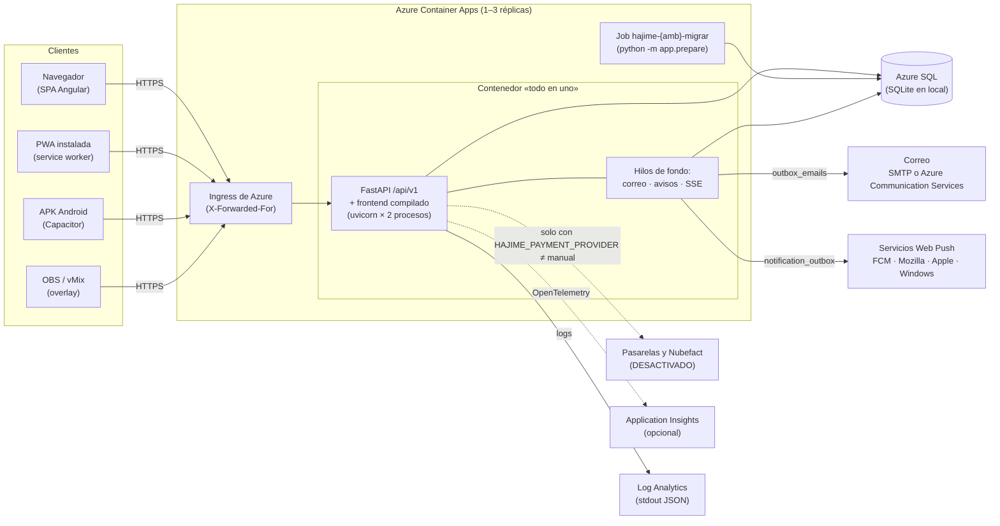
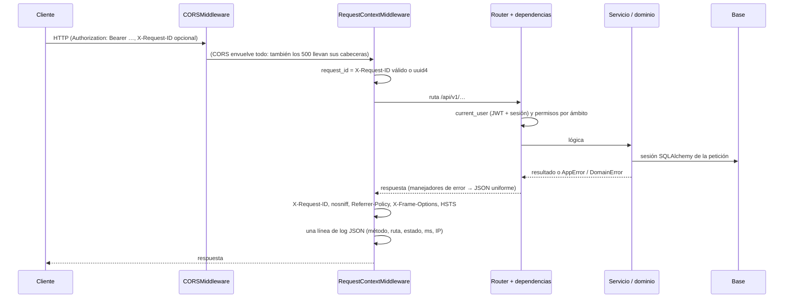
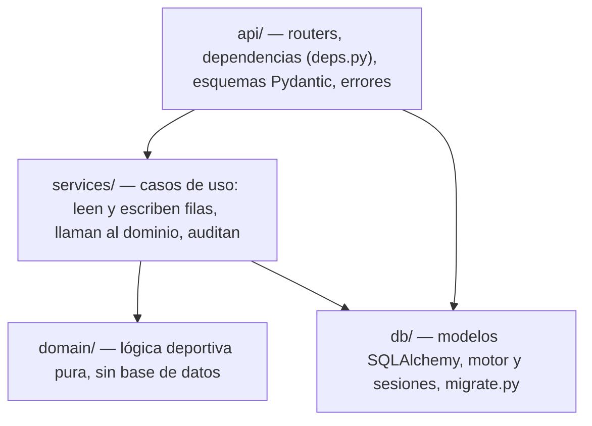
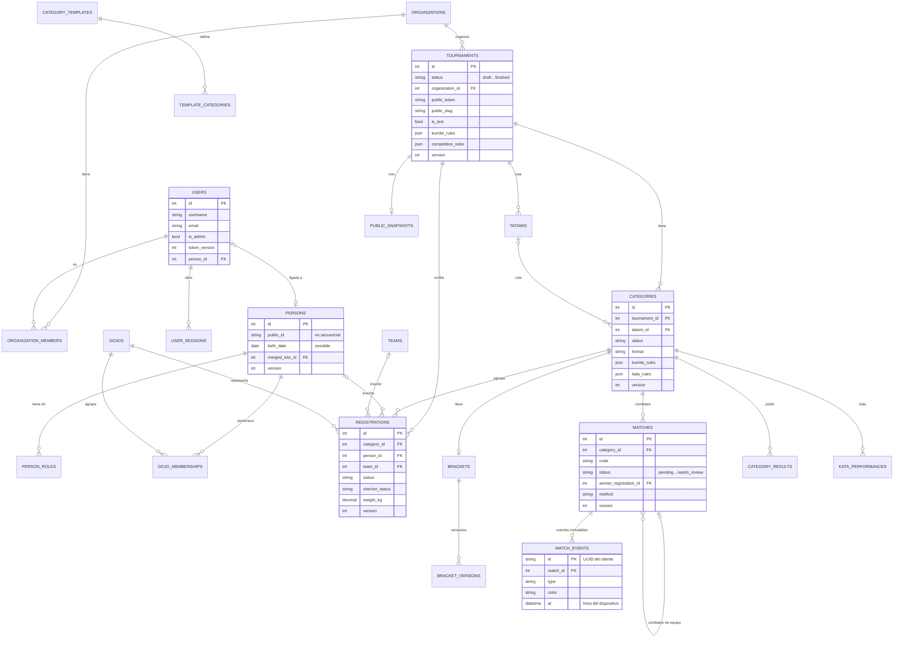
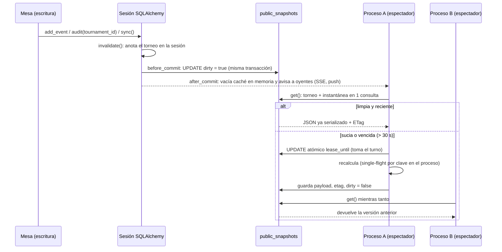
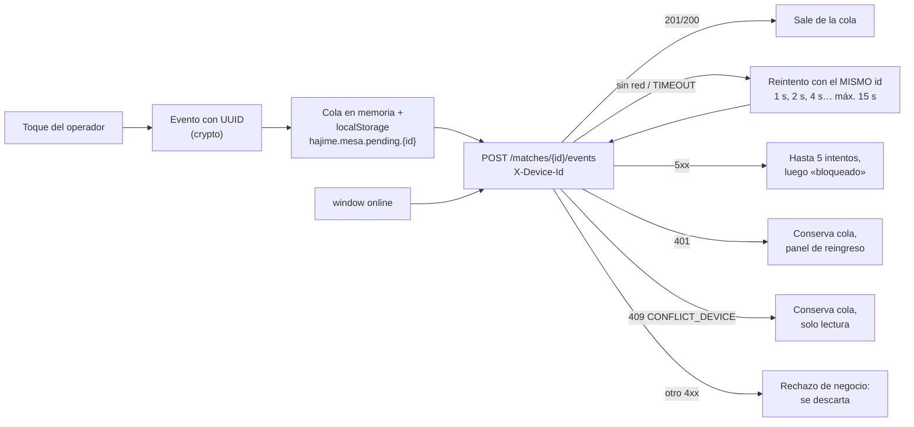

# Documento técnico de Hajime

Guía para quien se incorpora al proyecto como desarrollador u operador. Describe
cómo está construido Hajime, cómo se despliega y opera, y qué queda pendiente.
Cada afirmación cita el archivo donde se puede comprobar. Versión del código:
`0.2.0` (`VERSION`) más lo anotado en `## [Sin publicar]` de `CHANGELOG.md`.

Cifras verificadas el 27/09/2026 sobre este commit (no copiadas de otros
documentos): pruebas del backend ejecutadas con `pytest`, consultas del vivo
medidas con el mismo contador de `backend/tests/api/test_public_consultas.py`,
tablas contadas en `backend/app/db/models.py` y `sql/001_schema.sql`, rutas
contadas en `docs/openapi.json`.

## Índice

1. [Resumen](#1-resumen)
2. [Arquitectura](#2-arquitectura)
3. [Backend](#3-backend)
4. [Modelo de datos](#4-modelo-de-datos)
5. [API](#5-api)
6. [Seguridad y privacidad](#6-seguridad-y-privacidad)
7. [Tiempo real y rendimiento](#7-tiempo-real-y-rendimiento)
8. [Frontend](#8-frontend)
9. [Subsistemas](#9-subsistemas)
10. [Calidad](#10-calidad)
11. [Despliegue y operación](#11-despliegue-y-operación)
12. [Desarrollo local](#12-desarrollo-local)
13. [Limitaciones conocidas y deuda técnica](#13-limitaciones-conocidas-y-deuda-técnica)
14. [Anexos](#14-anexos)

---

## 1. Resumen

### Propósito

Hajime organiza torneos de karate en Perú, registra sus resultados y construye
un historial deportivo confiable por persona y dojo (`README.md`). Nace para
operarse en **Shadow Mode**: el torneo sigue con papel y cronómetro y la app
registra lo mismo en paralelo; el reporte de comparación está en
`GET /tournaments/{tid}/comparison-report` (`backend/app/api/routers/competition.py`).
La especificación funcional es `docs/documento-maestro-v0.2.md`.

### Alcance actual

| Área | Qué cubre | Dónde |
| --- | --- | --- |
| Torneo | Plantillas de categorías, inscripciones (manual, Excel, autoinscripción por dojo), fusión y división de categorías, acreditación y pesaje | `services/tournaments.py`, `registrations.py`, `self_registration.py`, `checkin.py` |
| Competencia | Llaves (eliminación, round robin, grupos + eliminación, kata por rondas), terceros lugares configurables, mesa de kumite y kata, equipos, resultados, medallero | `domain/*`, `services/brackets.py`, `bracket_changes.py`, `teams.py` |
| Día del torneo | Varios tatamis y mesas, «Mi tatami», dos tablets con «Tomar la mesa», verificación previa, horarios estimados | `services/operation.py`, `organizer.py`, `schedule.py` |
| Público | Vivo con dirección fija, «¿Cuándo pelea?», llaves públicas, pantalla grande, overlay para OBS, SSE, directorio, perfil público, ranking público, vista previa al compartir | `services/public*.py`, `share_preview.py` |
| Cuentas | Roles por ámbito, organizaciones, sesiones con renovación, correo transaccional, cuentas de competidor y tutela de menores | `api/deps.py`, `services/sessions.py`, `accounts.py`, `claims.py` |
| Extras | Avisos Web Push, ranking por temporada, diplomas en PDF, estadísticas e insignias | `services/push*.py`, `ranking.py`, `certificates.py`, `stats.py` |
| Cobros | Existe pero **desactivado** por decisión del dueño (sección 9.14) | `services/payments.py`, `checkout.py`, `invoicing.py` |

### Principios de diseño

| Principio | Qué significa en el código |
| --- | --- |
| **La app nunca detiene un torneo** | Todo error deja seguir con papel. La mesa funciona sin red: cola local de eventos con reintentos (`frontend/src/app/features/mesa/mesa-logic.ts`). La base en pausa responde 503 con `Retry-After`, no 500 (`backend/app/api/errors.py`). |
| **API First** | Toda acción es un endpoint de `/api/v1`; la interfaz no tiene lógica que la API no tenga. Contrato en `docs/openapi.json` (verificado en CI). |
| **Advertir, no bloquear** | Las reglas de negocio responden `409` con `code: "WARNINGS"` y la lista en `details.warnings`; el cliente reenvía la petición con `override: {"reason": "…"}` y cada advertencia aceptada queda en `rule_overrides` (`services/audit.py::apply_warnings`). Solo se bloquea lo que corrompe datos. |
| **Eventos inmutables e idempotentes** | El marcador nunca se guarda: se calcula plegando los eventos (`domain/kumite.py`). Corregir es agregar un evento (`annul`, otro `finish`). Cada evento lleva un UUID del cliente; reenviarlo devuelve 200 sin duplicar (`services/brackets.py::add_event`). |
| **Auditoría total** | Toda escritura relevante pasa por `audit()` (quién, cuándo, antes, después, motivo) en `audit_log`; las advertencias aceptadas, en `rule_overrides`. |
| **Privacidad de menores** | Ley 29733: solo Admin y organizadores ven documento y fecha de nacimiento; lo público abrevia nombres de menores («Diego R.») y nunca publica ids internos (sección 6). |

---

## 2. Arquitectura

### Componentes



- Una sola imagen sirve la API y el frontend compilado en la misma URL
  (`Dockerfile`, `backend/app/main.py::mount_frontend`). Las rutas de Angular
  que no son archivos devuelven `index.html` (modo SPA); `/api`, `/docs` y
  `/openapi` siguen siendo de la API.
- La base es Azure SQL en la nube (imagen `-azure`, con el driver ODBC 18) y
  SQLite en WAL en la instalación local (`backend/app/db/base.py::make_engine`).
- Correo, avisos push y cobros son salidas a terceros; ninguna se hace dentro
  de una petición de la mesa (correo y push van por bandejas en la base).

### Procesos e hilos

| Pieza | Cuántos | Configuración | Dónde |
| --- | --- | --- | --- |
| Preparación de la base | 1 vez por arranque de contenedor (y el job de migraciones) | — | `backend/docker-entrypoint.sh` → `python -m app.prepare` |
| Procesos uvicorn | 2 por contenedor | `HAJIME_WORKERS` | `docker-entrypoint.sh` |
| Hilos que atienden rutas síncronas | 4 por proceso | `HAJIME_WORKER_THREADS` | `main.py::lifespan` (limitador de anyio) |
| Hilos propios de `/public` | 2 por proceso | `HAJIME_PUBLIC_THREADS` | `api/routers/public.py::_limiter` |
| Hilos de `/health/ready` | 2 por proceso | fijo | `main.py::health_ready` |
| Despachador de correo (+ recordatorios de cobro cada hora) | 1 hilo por proceso | `HAJIME_MAIL_DISPATCHER` | `services/mail.py::MailDispatcher` |
| Servicio de avisos push | 1 hilo por proceso (solo con claves VAPID) + hasta 8 hilos de envío por lote | `HAJIME_PUSH_DISPATCHER` | `services/push.py::PushService`, `dispatch_once` |
| Sondeo SSE compartido | 1 hilo por torneo con espectadores conectados, por proceso | `HAJIME_PUBLIC_SSE_*` | `services/public_stream.py::_Hub` |

Por qué pocos hilos: con los 40 hilos por defecto de FastAPI el intérprete
pasaba el tiempo cambiando de hilo (medido: de 31 a 120 req/s al pasar a 4
hilos × 2 procesos; `docs/pruebas-carga.md`, comentario en `config.py`). Los
hilos de correo y push no arrancan con SQLite en memoria (las pruebas), porque
compartirían la única conexión (`main.py::_start_mail_dispatcher`).

### Flujo de una petición



- **Orden de middlewares** (`main.py::create_app`): el último agregado envuelve
  a los demás; CORS queda por fuera de `RequestContextMiddleware`.
- **`RequestContextMiddleware`** (`backend/app/observability.py`) es ASGI puro
  (no `BaseHTTPMiddleware`, para no romper descargas en streaming). Acepta un
  `X-Request-ID` que cumpla `^[A-Za-z0-9._:-]{1,128}$`; si no, genera uno. Lo
  devuelve en la respuesta, lo sella en cada registro de log y va en el cuerpo
  de los errores. Cualquier excepción no controlada se registra con su traza y
  se responde 500 con el formato uniforme. Las sondas `/health*` se registran
  en nivel DEBUG.
- **Manejadores de error** (`backend/app/api/errors.py`): ver sección 5.

### Stack y versiones

Versiones exactas de los lockfiles (`backend/requirements-mssql.txt`,
`frontend/package-lock.json`):

| Capa | Tecnología | Versión |
| --- | --- | --- |
| Lenguaje backend | Python | 3.12 en imagen y CI (`requires-python >= 3.11`) |
| API | FastAPI / Starlette / uvicorn | 0.141.1 / 1.7.0 / 0.54.0 |
| ORM y migraciones | SQLAlchemy / Alembic | 2.1.1 / 1.20.0 |
| Validación y configuración | Pydantic / pydantic-settings | 2.13.5 / rango `>=2.3` |
| JWT | PyJWT | 2.15.0 |
| Excel y PDF | openpyxl / reportlab | 3.1.5 / 5.0.1 |
| Web Push | cryptography / http-ece | 50.0.1 / 1.2.1 |
| SQL Server | pyodbc + ODBC Driver 18 | 5.3.0 (solo imagen `-azure`) |
| Telemetría | azure-monitor-opentelemetry | solo en `requirements-mssql.txt` |
| Frontend | Angular (standalone, signals) / RxJS / TypeScript | 21.2.24 / 7.8.2 / 5.9.3 |
| Móvil | Capacitor (Android) | 8.5.2 |
| Pruebas frontend | Vitest / Playwright + axe-core | 4.1.11 / 1.63.0 |
| Node | Node 22 (imagen `node:22-alpine`, CI) | — |

---

## 3. Backend

### Capas



- **`domain/`**: Python puro. Trabaja con identificadores opacos y devuelve
  estructuras inmutables (`domain/brackets.py`). Errores de validación con
  `DomainError` (400 con el mensaje tal cual; un `ValueError` cualquiera es un
  error de programación y responde 500, `domain/errors.py`). Se prueba sin
  base (`tests/domain`).
- **`services/`**: orquestan. Por ejemplo `services/brackets.py` lee filas,
  llama a `domain.brackets` / `domain.kumite` y guarda lo que el dominio
  decidió.
- **`api/`**: rutas finas; comprueban permisos (`api/deps.py`) y delegan.

### Módulos y responsabilidades

| Módulo | Responsabilidad |
| --- | --- |
| `app/main.py` | Crea la app, middlewares, routers, `/health*`, arranque de hilos, sirve el frontend |
| `app/config.py` | Toda la configuración `HAJIME_*` (tabla más abajo) |
| `app/security.py` | Hash PBKDF2, JWT con `kid`, token de renovación |
| `app/prepare.py` | Espera la base, migra con candado entre procesos, crea admin, planes y plantilla |
| `app/observability.py` | Logs JSON, `request_id`, cabeceras de seguridad, Azure Monitor opcional |
| `app/seed.py` | CLI: `admin`, `template`, `demo`, `purge-imports`, `vapid-keys` |
| `app/mail_worker.py`, `push_worker.py`, `billing_reminders.py` | Mismos despachadores como proceso aparte (para un Container Apps Job) |
| `db/base.py` | Motor (pool, WAL en SQLite, `pool_pre_ping`), `wait_for_database`, mixins `Timestamped` y `Versioned` |
| `db/models.py` | 56 modelos / tablas |
| `db/migrate.py` | `upgrade_database` y marcado de bases antiguas (`LEGACY_MARKERS`) |
| `domain/brackets.py` | Siembra, byes, separación por dojo (partición recursiva), eliminación, repechaje, round robin, grupos |
| `domain/kumite.py` | Marcador derivado de eventos, reloj, senshu, sanciones, sugerencia de ganador |
| `domain/kata.py` | Banderas y puntuación (descartes, preset WKF 70/30) |
| `domain/teams.py` | Enfrentamientos por equipos |
| `domain/categories.py` | Grados, edad, sugerencias, advertencias de inscripción, estados del torneo |
| `domain/identity.py` | Documentos y detección de duplicados |
| `domain/stats.py` | Línea de tiempo, índice, premios e insignias |
| `services/tournaments.py` | Torneos, estados, categorías, fusión, tatamis |
| `services/registrations.py` | Inscripciones, sugerencias, importación Excel |
| `services/brackets.py` | Llaves, sincronización, marcador de la mesa, kata, cola del tatami |
| `services/bracket_changes.py` | Cambios con llave generada: entrar, salir, descalificar, mover |
| `services/teams.py` | Equipos y kumite por equipos |
| `services/operation.py` | Presencia de tablets y «mesa principal» (`CONFLICT_DEVICE`) |
| `services/organizer.py` | Walkover, cola editable, verificación previa, corrección de importación |
| `services/schedule.py` | Horarios estimados por tatami |
| `services/checkin.py`, `credentials.py` | Acreditación, pesaje y credenciales con QR |
| `services/referees.py` | Árbitros opcionales |
| `services/reports.py` | Resultados, medallero, Shadow Mode, Excel y PDF |
| `services/history.py`, `stats.py` | Historial y estadísticas |
| `services/people.py` | Personas, fusión, consentimientos, anonimización, registro de lecturas sensibles |
| `services/templates.py` | Plantillas editables e intercambio con Excel |
| `services/audit.py` | `audit`, `apply_warnings`, `check_version`, `bump` |
| `services/sessions.py`, `login_guard.py` | Sesiones y bloqueo de intentos |
| `services/accounts.py`, `claims.py`, `mail.py` | Correo, recuperación, registro, reclamo de perfiles |
| `services/organizations.py`, `entitlements.py` | Organizaciones, planes y derechos |
| `services/self_registration.py` | Autoinscripción por dojo |
| `services/public*.py`, `share_preview.py` | Portal público, instantánea compartida, SSE, perfil público, vista previa |
| `services/push.py`, `push_eval.py`, `webpush.py` | Avisos Web Push |
| `services/ranking.py`, `certificates.py` | Ranking y diplomas |
| `services/payments.py`, `checkout.py`, `invoicing.py`, `gateways/`, `gateway_http.py`, `billing_mail.py` | Cobros (desactivado, sección 9.14) |

Routers (`api/routers/`): `core`, `accounts`, `templates`, `tournaments`,
`competition` (incluye `sports`), `organizer`, `checkin`, `certificates`,
`ranking`, `history`, `horarios`, `organizations`, `billing`, `dojo_portal`,
`public_profiles`, `public`, `push`. Todos con prefijo `/api/v1`
(`main.py::create_app`).

### Convenciones

**Errores.** `AppError` y sus subclases (`api/errors.py`) llevan `status_code`
y `code`: `NotFound` 404, `Forbidden` 403, `Unauthorized` 401,
`TooManyRequests` 429 `TOO_MANY_ATTEMPTS`, `PlanRequired` 402, `Conflict` 409,
`VersionConflict` 409, `InvalidState` 409, `WarningsRequireOverride` 409
`WARNINGS`. Se lanza el error; nunca se arma una respuesta a mano.

**Advertencias.** El servicio junta una lista `[{code, message}]` y llama a
`apply_warnings(db, user, warnings, override_reason, entity, id_getter)`
(`services/audit.py`): sin motivo lanza `409 WARNINGS`; con motivo inserta una
fila en `rule_overrides` por advertencia. Ejemplos: `GRADE_BELOW_MIN`,
`CATEGORY_FULL`, `MATCH_FINISHED`, `ABSENT_ENTRANTS`, `WEIGHT_OVER`.

**Versión optimista.** Las entidades editables heredan `Versioned` (columna
`version`, `db/base.py`). El cliente manda la versión que leyó;
`check_version` responde `409 VERSION_CONFLICT` con `details.current_version`
si otro la cambió, y `bump` la incrementa y fija `updated_by_id`.

**Auditoría.** `audit(db, user, entity, entity_id, action, before, after,
reason, tournament_id)` guarda solo los campos que cambiaron (`snapshot()`
excluye `password_hash` y fechas). Con `tournament_id`, además invalida la
instantánea pública del torneo (sección 7).

**Unidad de trabajo.** Una sesión SQLAlchemy por petición (`db/base.py::get_session`,
`expire_on_commit=False`, `autoflush=False`). Hoy los servicios confirman con
`db.commit()` al final de cada caso de uso (hay `commit` en 30 módulos de
`services/` y en 3 routers). No hay un patrón formal de unidad de trabajo;
está anotado como deuda en `docs/plan-producto.md` §3.6. Dos ganchos de sesión
dependen de ese `commit`: `public_snapshots._mark_dirty` (`before_commit`) y
`_forget_local` (`after_commit`).

**Fechas.** UTC sin zona en la base (`utcnow()`), `DATETIME2` en SQL Server.

**Compatibilidad con SQL Server.** `tests/conftest.py` compila cada consulta
del ORM de la suite con el dialecto de SQL Server y falla si aparece algo que
Azure SQL rechaza (`IS 1`, `LIMIT`, `NULLS FIRST`, `ILIKE`).

### Configuración (`backend/app/config.py`)

Variables de entorno con prefijo `HAJIME_` (también se leen de `.env`). Las
marcadas **secreto** van como secreto del Container App o Key Vault, nunca en
el código (`SecretStr` en las de cobros).

**General y arranque**

| Variable | Defecto | Efecto |
| --- | --- | --- |
| `HAJIME_ENVIRONMENT` | `dev` | `dev`, `test` o `prod`. Fuera de dev/test exige secreto JWT de 32+ caracteres (la app no arranca); en `prod` oculta `/docs` y no acepta orígenes CORS por defecto; fuera de `dev` agrega HSTS |
| `HAJIME_DATABASE_URL` | `sqlite:///./hajime.db` | Base. SQL Server: `mssql+pyodbc://…?driver=ODBC+Driver+18+for+SQL+Server`. **Secreto** en Azure |
| `HAJIME_JWT_SECRET` | `cambiar-en-produccion` | Firma de los JWT. **Secreto** |
| `HAJIME_JWT_PREVIOUS_SECRET` | — | Secreto anterior aceptado solo para verificar durante una rotación |
| `HAJIME_ACCESS_TOKEN_MINUTES` | `60` | Vida del token de acceso |
| `HAJIME_REFRESH_TOKEN_DAYS` | `30` | Vida del token de renovación |
| `HAJIME_CORS_ORIGINS` | — | Lista JSON. Sin definir: orígenes de desarrollo en dev/test (`localhost:4200`, `https://localhost`, `http://localhost`, `capacitor://localhost`), ninguno en prod |
| `HAJIME_TIMEZONE` | `America/Lima` | Zona por defecto |
| `HAJIME_STATIC_DIR` | — | Carpeta del frontend compilado; con ella la API lo sirve (`/app/static` en la imagen) |
| `HAJIME_ADMIN_PASSWORD` | — | Si no hay usuarios, crea el admin con esta clave |
| `HAJIME_ADMIN_USERNAME` | `admin` | Nombre del admin inicial |
| `HAJIME_LOAD_BASE_TEMPLATE` | `true` | Carga la plantilla base si no hay ninguna |
| `HAJIME_AUTO_CREATE_SCHEMA` | `false` | SQL Server: migrar al preparar la base (SQLite siempre migra) |
| `HAJIME_MIGRATE_ON_STARTUP` | `true` | Cada proceso prepara la base al arrancar (desarrollo). El entrypoint lo pone en `false` |
| `HAJIME_SECRET_FILE` | — | Si el secreto JWT es el de defecto, se genera y guarda aquí (`/data/jwt_secret` en la imagen) |
| `HAJIME_WORKER_THREADS` | `4` | Hilos por proceso para las rutas |
| `HAJIME_PASSWORD_ITERATIONS` | `120000` | Iteraciones PBKDF2-SHA256; los hashes con otro coste se rehacen al entrar |
| `HAJIME_DB_POOL_SIZE` / `HAJIME_DB_MAX_OVERFLOW` | `6` / `4` | Pool por proceso (solo SQL Server; SQLite usa 20 + 40) |
| `HAJIME_DB_POOL_TIMEOUT` | `10` | Segundos esperando conexión antes de `503 SERVER_BUSY` |
| `HAJIME_EXPOSE_DOCS` | — | `/docs` y `/openapi.json`; sin definir, visibles salvo en prod |
| `HAJIME_LOG_LEVEL` | `INFO` | Nivel de log |
| `HAJIME_LOG_FORMAT` | `json` | `json` o `text` |
| `HAJIME_PUBLIC_URL` | — | URL pública de la interfaz: enlaces de correos y retornos de pasarela (sin ella, `http://localhost:4200` en correos) |

Fuera de `config.py`, el contenedor lee `HAJIME_WORKERS` (2),
`HAJIME_FORWARDED_ALLOW_IPS` (`*`) y `PORT` (8000) en
`backend/docker-entrypoint.sh`, y la app lee
`APPLICATIONINSIGHTS_CONNECTION_STRING` en `observability.py`.

**Vivo público y SSE**

| Variable | Defecto | Efecto |
| --- | --- | --- |
| `HAJIME_PUBLIC_CACHE_SECONDS` | `3.0` | `max-age` de las vistas públicas; `0` = sin instantánea (se calcula en cada petición y SSE responde 503) |
| `HAJIME_PUBLIC_SNAPSHOT_MAX_AGE` | `30.0` | Edad máxima de una instantánea aunque nadie la haya invalidado |
| `HAJIME_PUBLIC_THREADS` | `2` | Hilos propios de `/public` por proceso |
| `HAJIME_PUBLIC_SSE_MAX_CONNECTIONS` | `500` | Conexiones SSE por proceso; pasado el límite, 503 |
| `HAJIME_PUBLIC_SSE_POLL_SECONDS` | `1.0` | Frecuencia del sondeo compartido |
| `HAJIME_PUBLIC_SSE_MIN_INTERVAL` | `0.5` | Mínimo entre vueltas aunque una escritura despierte al hilo |
| `HAJIME_PUBLIC_SSE_HEARTBEAT_SECONDS` | `15.0` | Latido para proxies |
| `HAJIME_PUBLIC_SSE_MAX_SECONDS` | `900.0` | Duración máxima de una conexión |

**Correo**

| Variable | Defecto | Efecto |
| --- | --- | --- |
| `HAJIME_MAIL_PROVIDER` | `console` | `console` (solo log; en prod avisa que no envía), `smtp` o `acs` |
| `HAJIME_MAIL_FROM` | `Hajime <no-responder@localhost>` | Remitente |
| `HAJIME_SMTP_HOST`, `_PORT`, `_USER`, `_PASSWORD`, `_FROM`, `_STARTTLS`, `_TIMEOUT` | —, `587`, —, —, —, `true`, `20` | Proveedor SMTP (la clave es **secreto**) |
| `HAJIME_ACS_ENDPOINT`, `_ACCESS_KEY`, `_SENDER` | — | Azure Communication Services Email (la clave es **secreto**) |
| `HAJIME_MAIL_DISPATCHER` | `true` | Hilo despachador en cada proceso |
| `HAJIME_MAIL_POLL_SECONDS` | `5.0` | Revisión de la bandeja |
| `HAJIME_MAIL_MAX_ATTEMPTS` | `6` | Intentos antes de `failed` |
| `HAJIME_MAIL_LEASE_SECONDS` | `120` | Reserva de un correo mientras se envía |

**Cuentas y avisos**

| Variable | Defecto | Efecto |
| --- | --- | --- |
| `HAJIME_OPEN_SIGNUP` | `false` | Registro abierto de cuentas de competidor |
| `HAJIME_AUTO_APPROVE_SELF_CLAIM` | `false` | Aprueba solo el reclamo de un adulto con los 4 dígitos del documento correctos |
| `HAJIME_NOTIFY_DIPLOMAS` | `false` | Correo «Tus diplomas están listos» |
| `HAJIME_VAPID_PUBLIC_KEY` / `HAJIME_VAPID_PRIVATE_KEY` | — | Claves Web Push; sin ambas, avisos apagados. La privada es **secreto** |
| `HAJIME_VAPID_SUBJECT` | `mailto:soporte@hajime.pe` | Contacto VAPID |
| `HAJIME_PUSH_DISPATCHER` | `true` | Hilo de avisos en cada proceso |
| `HAJIME_PUSH_POLL_SECONDS` | `2.0` | Revisión de la bandeja |
| `HAJIME_PUSH_SWEEP_SECONDS` | `30.0` | Pasada por los torneos en curso (red de seguridad entre procesos) |
| `HAJIME_PUSH_MAX_ATTEMPTS` / `_LEASE_SECONDS` / `_TIMEOUT` | `5` / `60` / `10.0` | Reintentos, reserva del lote, espera del POST |
| `HAJIME_PUSH_SOON_AHEAD` | `3` | «Te toca en ~N combates» |
| `HAJIME_PUSH_TURN_TTL_SECONDS` | `600` | Vigencia de los avisos de turno |
| `HAJIME_PUSH_ALLOWED_HOSTS` | FCM, Mozilla, Windows, Apple | Sufijos de host aceptados como endpoint (evita SSRF) |

**Planes y cobros** (sección 9.14; hoy todo apagado por defecto)

| Variable | Defecto | Efecto |
| --- | --- | --- |
| `HAJIME_BILLING_MODE` | `marcha_blanca` | `enforced` exige plan a las funciones de pago (402 `PLAN_REQUIRED`) |
| `HAJIME_PAYMENT_PROVIDER` | `manual` | `manual`, `mercadopago` o `culqi` |
| `HAJIME_BILLING_GRACE_DAYS` | `7` | Gracia tras pago rechazado o vencido |
| `HAJIME_PAYMENT_HTTP_TIMEOUT` | `15.0` | Tiempo por llamada a pasarela o Nubefact |
| `HAJIME_WEBHOOK_MAX_BYTES` | `65536` | Tamaño máximo de un aviso de pasarela |
| `HAJIME_MP_ACCESS_TOKEN`, `HAJIME_MP_WEBHOOK_SECRET` | — | Mercado Pago (**secretos**) |
| `HAJIME_MP_API_URL` | `https://api.mercadopago.com` | — |
| `HAJIME_CULQI_SECRET_KEY`, `HAJIME_CULQI_WEBHOOK_SECRET` | — | Culqi (**secretos**) |
| `HAJIME_CULQI_PUBLIC_KEY` | — | Llave pública (llega al navegador) |
| `HAJIME_CULQI_API_URL` | `https://api.culqi.com` | — |
| `HAJIME_CULQI_PLAN_IDS` | `{}` | Planes recurrentes de Culqi, p. ej. `{"dojo:month": "pln_…"}` |
| `HAJIME_INVOICING_PROVIDER` | `none` | `none` o `nubefact` |
| `HAJIME_NUBEFACT_URL`, `HAJIME_NUBEFACT_TOKEN` | — | Nubefact (**secretos**) |
| `HAJIME_NUBEFACT_SERIE_BOLETA` / `_FACTURA` | `BBB1` / `FFF1` | Series |
| `HAJIME_NUBEFACT_SERIE_NC_BOLETA` / `_NC_FACTURA` | `BBB1` / `FFF1` | Series de notas de crédito |

`HAJIME_PAYMENTS_ENABLED` (interruptor general de cobros, apagado por
defecto) lo agrega otro trabajo en curso; en este commit no existe todavía en
`config.py` (sección 9.14).

---

## 4. Modelo de datos

56 tablas (56 clases con `__tablename__` en `backend/app/db/models.py` y 56
`CREATE TABLE` en `sql/001_schema.sql`), más `alembic_version`. Identificadores
enteros autoincrementales, salvo los eventos de combate (UUID del cliente) y
`login_attempts` (clave de texto). Mixins: `Timestamped` (`created_at`,
`updated_at`, `updated_by_id`) y `Versioned` (`version`).

### Entidades principales



### Resto de tablas

| Grupo | Tablas |
| --- | --- |
| Personas y dojos | `identity_documents`, `data_consents`, `person_merges`, `branches`, `grade_history` |
| Organizaciones y planes | `plans`, `subscriptions`, `tournament_invitations`, `dojo_admin_requests` |
| Cobros (desactivado) | `payments`, `invoices`, `coupons` |
| Categorías | `category_merges`, `category_splits` |
| Competencia | `teams`, `team_members`, `judge_votes`, `match_presence`, `referee_assignments`, `shadow_comparisons` |
| Importación | `import_batches`, `import_rows` |
| Auditoría | `audit_log`, `rule_overrides` |
| Seguridad y cuentas | `login_attempts`, `password_resets`, `email_verifications`, `profile_claims`, `guardianships` |
| Bandejas de salida | `outbox_emails`, `notification_outbox` |
| Avisos | `push_subscriptions`, `push_follows` |
| Ranking | `ranking_seasons`, `ranking_entries` |

Estados del torneo (`domain/categories.py::TOURNAMENT_TRANSITIONS`):
`draft → registration_open ⇄ registration_closed → in_progress → finished`,
`cancelled` desde borrador o inscripción abierta; `finished → in_progress`
(reabrir) solo el Admin y con motivo (`services/tournaments.py::change_status`).
Estados de categoría: `open, empty, merged, ready, in_progress, finished, cancelled`.

### Cadena de migraciones

`backend/app/migrations/versions/`, lineal:

| Revisión | Agrega |
| --- | --- |
| `0001` | Esquema inicial: usuarios, personas, dojos, plantillas, torneos, tatamis, categorías, inscripciones, llaves, combates, eventos, kata, resultados, auditoría, importaciones, Shadow Mode (29 tablas) |
| `0002` | `teams`, `team_members` (equipos temporales y combates individuales de equipo) |
| `0003` | `tournaments.public_token` y `public_names` (vivo público) |
| `0004` | `referee_assignments`, `match_presence` |
| `0005_intentos_login` | `login_attempts` (bloqueo compartido entre procesos) |
| `0006_sesiones` | `user_sessions` (token de renovación) |
| `0007_vivo_compartido` | `public_snapshots`, índices de lecturas calientes, `public_token` único entre no nulos |
| `0008_mesa_principal` | `match_presence.is_primary` |
| `0009_organizaciones` | `organizations`, `organization_members`, `plans` (sembrada), `subscriptions`, `tournament_invitations`, `dojo_admin_requests`; crea la «Organización principal», le asigna los torneos existentes y recién entonces vuelve obligatoria `tournaments.organization_id` |
| `0010_reglas_deportivas` | `category_splits`; cupo y rango de peso numérico (deducido de las etiquetas existentes), reglas de kata y de competencia, `age_mode`, tipo de falta y escalera en eventos, notas atléticas y grupos en kata |
| `0011_cuentas` | `outbox_emails`, `email_verifications`, `password_resets`, `profile_claims`, `guardianships`; `users.email`; `persons.public_id` (rellenado para las existentes) |
| `0012_checkin_ranking` | `ranking_seasons`, `ranking_entries`; plantillas archivadas; acreditación y pesaje en `registrations`; `tournaments.checkin_required`; firma de diplomas |
| `0013_portal_publico` | `tournaments.public_slug` (rellenado para los torneos con vivo activo), `timezone`, `match_overhead_seconds`; `tatamis.planned_start` |
| `0014_pagos` | `payments`, `invoices`, `coupons` (cupón `PRIMER-TORNEO` desactivado); datos fiscales en `organizations`, `plans.trial_days`, estado del cobro en `subscriptions` |
| `0015_avisos_push` | `push_subscriptions`, `notification_outbox`, `push_follows` |

Nota: los docstrings de `0006`, `0007`, `0008` y `0015` dicen «Revises: 0004»
o «0013», pero lo que vale es la variable `down_revision`, que forma la cadena
de la tabla.

### Reglas para migraciones

1. **Compatibles hacia atrás** («agregar antes de quitar»): en producción la
   migración corre antes de que la nueva versión reciba tráfico y un rollback
   vuelve la app, no la base (`CONTRIBUTING.md`, `infra/azure/rollback.sh`).
   Columna nueva con valor por defecto o nula → versión que la usa → en otra
   versión se borra lo viejo. `0009` es el ejemplo de rellenar antes de volver
   obligatoria una columna.
2. **SQLite** necesita `op.batch_alter_table`; `db/migrate.py::upgrade_database`
   desactiva las claves foráneas solo durante la migración y luego corre
   `PRAGMA foreign_key_check`.
3. **`LEGACY_MARKERS` y `LEGACY_COLUMNS`** (`db/migrate.py`): una base creada
   antes de Alembic (con `create_all`) se marca con la última revisión cuyas
   tablas o columnas ya tiene. Si una migración nueva crea una tabla o columna
   distintiva, agregar su marcador.
4. **Derivados en el mismo PR:** `python scripts/export_ddl.py`
   (`sql/001_schema.sql`, DDL de SQL Server) y, si cambió la API,
   `python scripts/exportar_openapi.py`.
5. **Pruebas:** `tests/test_migrations.py` verifica que las migraciones desde
   cero dejan exactamente el esquema de los modelos, el marcado de bases
   antiguas y que un upgrade conserva datos; CI corre además `alembic check`.

---

## 5. API

### Convenciones

- **Base:** `/api/v1` (`main.py`). 238 operaciones en 203 rutas bajo `/api/v1`
  según `docs/openapi.json`, más `/health`, `/health/live` y `/health/ready`.
- **Autenticación:** `Authorization: Bearer <access_token>` (`api/deps.py::current_user`).
  Rutas públicas bajo `/public/*` y algunas de `/auth/*` no la piden.
- **Formato de error** (todas las respuestas de error):

  ```json
  {"error": {"code": "…", "message": "…", "details": {…}, "request_id": "…"}}
  ```

| HTTP | `code` | Cuándo |
| --- | --- | --- |
| 400 | `BAD_REQUEST`, `INVALID_VALUE` | Error de negocio genérico; `DomainError` |
| 401 | `UNAUTHORIZED` | Sin sesión, token inválido, sesión revocada o vencida |
| 402 | `PLAN_REQUIRED` | Función de pago sin plan (solo con `HAJIME_BILLING_MODE=enforced`) |
| 403 | `FORBIDDEN` | Sin permiso en ese ámbito |
| 404 | `NOT_FOUND` | Recurso inexistente |
| 409 | `WARNINGS` | Advertencias que requieren `override` |
| 409 | `VERSION_CONFLICT` | Versión optimista desactualizada |
| 409 | `INVALID_STATE`, `CONFLICT`, `CONFLICT_DEVICE`, `EVENT_ID_CONFLICT`… | Estado inválido, choque de restricción de la base, otra tablet lleva la mesa |
| 413 | `PAYLOAD_TOO_LARGE` | Aviso de pasarela más grande que `HAJIME_WEBHOOK_MAX_BYTES` (`api/routers/billing.py`) |
| 422 | `VALIDATION_ERROR` | Pydantic; `details.errors` |
| 429 | `TOO_MANY_ATTEMPTS` | Bloqueo de inicio de sesión y límites de correo |
| 500 | `INTERNAL_ERROR` | Error no previsto (detalle solo en el log) |
| 503 | `DB_WAKING`, `DB_UNAVAILABLE`, `SERVER_BUSY` | Base en pausa (40613, 40197, HYT00), error operativo, pool agotado; con `Retry-After: 10` |

### Grupos de endpoints

| Router | Principales rutas |
| --- | --- |
| `core` | `POST /auth/login`, `/auth/refresh`, `/auth/logout`, `/auth/change-password`, `/auth/delete-account`; `GET /auth/me`, `/auth/sessions`; `DELETE /users/{id}/sessions`; usuarios y roles (`/persons/{id}/roles`); dojos; personas (duplicados, fusión y reversión, grados, membresías, consentimientos, anonimizar); `GET /audit`, `/overrides` |
| `accounts` | `/auth/options`, `/auth/forgot-password`, `/auth/reset-password`, `/auth/verify-email`, `/auth/signup`, `PATCH /auth/me`; reclamos de perfil (`/profiles/search`, `/profile-claims`, `/me/profiles`) |
| `templates` | CRUD de plantillas, duplicar, ítems, importar y exportar Excel |
| `tournaments` | Torneos y estado, generar categorías, tatamis, cola y planilla PDF, categorías (fusión, cancelación), inscripciones, equipos, retiro, sugerencias, árbitros, `PUT /tournaments/{tid}/public`, importación Excel |
| `competition` (+ `sports`) | Llaves (generar, versiones, intercambio de posiciones, PDF, reabrir), **`POST /matches/{mid}/events`**, `/matches/{mid}/finish`, presencia de mesa, resultado oficial (Shadow), banderas y notas de kata, resultados, medallero, comparación, Excel/PDF; entrar/salir de la llave, descalificar, dividir, orden de kata, catálogo de katas, `GET /rules/defaults` |
| `organizer` | Walkover, `PUT /tatamis/{id}/queue`, `GET /tournaments/{tid}/readiness`, corregir filas de importación |
| `horarios` | `PATCH /tournaments/{tid}/schedule`, `PATCH /tatamis/{id}` |
| `checkin` | Acreditación, escaneo, pesaje, mover o aceptar por peso, ausente con walkover, credenciales (JSON y PDF) |
| `certificates` | Diplomas por categoría, torneo y persona |
| `history` | Historial de persona y dojo, estadísticas, líderes, hoja del combate |
| `ranking` | Temporadas, recálculo, puesto de una persona, `GET /public/ranking/{slug}` |
| `organizations` | Organizaciones y miembros, `GET/PATCH /plans`, suscripciones manuales |
| `dojo_portal` | Autoinscripción: abrir, invitaciones, solicitudes, «Mis competidores», inscribir |
| `billing` | Checkout, prueba, pagos, reembolsos, comprobantes, cupones, avisos de pasarela (desactivado en la práctica; sección 9.14) |
| `public`, `public_profiles` | Vista pública (sección de abajo) |
| `push` | `GET /push/config`, suscripciones, preferencias, seguimientos |

### Idempotencia de los eventos de combate

`POST /matches/{mid}/events` (`api/routers/competition.py::add_event`,
`services/brackets.py::add_event`) es el contrato más delicado del sistema:
las tablets tienen eventos en cola que se reenvían con el mismo id.

- El cuerpo (`EventIn`, `api/schemas.py`) lleva `id` (UUID generado por el
  cliente, 8–36 caracteres), `type` (`point`, `sanction`, `start`, `pause`,
  `resume`, `time_adjust`, `annul`, `senshu_cancel`, `hantei`, `kiken`,
  `shikkaku`, `walkover`, `golden_point`), `at` (hora del dispositivo),
  `color`, `value`, `target_id`, `reason`, `infraction`, `ladder`, votos y
  `override`.
- Si el `id` ya existe en ese combate: **200** con el marcador actual y sin
  cambios. Si es nuevo: **201**. Si el `id` pertenece a otro combate:
  `409 EVENT_ID_CONFLICT`. Es idempotente también bajo concurrencia
  (`docs/revision-v0.2.md` §5.1).
- Un evento sobre un combate cerrado es una corrección: exige `override` con
  motivo (advertencia `MATCH_FINISHED`) y queda auditado.
- `POST /matches/{mid}/finish` también es idempotente por `id`: la mesa puede
  dejar el cierre en cola.
- Cabecera opcional `X-Device-Id`: si otra tablet lleva la mesa, `409
  CONFLICT_DEVICE` (`services/operation.py`). La tablet principal es la
  primera que abre el combate o la que pulsa «Tomar la mesa»; si deja de latir
  45 s, otra la toma sola.
- Regla del repositorio (`CLAUDE.md`): nada de validaciones que rechacen un
  evento reintentado ni cambios de contrato sin compatibilidad con clientes
  que tengan eventos en cola.

### Ámbitos de lectura

Nada de un torneo se lee con solo iniciar sesión. Las dependencias
`TournamentReader`, `TatamiReader`, `CategoryReader` y `MatchReader`
(`api/deps.py`) resuelven el torneo dueño a partir del id de la ruta y exigen:
Admin, o rol `organizer`, `table_operator` o `referee` con ámbito global, de
ese torneo, de un tatami de ese torneo o de su organización, o ser miembro de
la organización del torneo. `readable_tournament_ids` filtra la lista de
torneos. Personas: lista y búsqueda solo staff; la ficha, staff o la propia
persona (sección 6).

### Endpoints públicos (sin sesión)

| Ruta | Qué devuelve |
| --- | --- |
| `GET /public/torneos?q=` | Directorio (caché de 30 s por proceso) |
| `GET /public/t/{slug}` y `GET /public/{token}` | Vivo del torneo (con ETag) |
| `…/people` | «¿Cuándo pelea?» |
| `…/categories/{id}` | Llave pública |
| `…/tatamis/{id}` | Overlay / pantalla grande (sin caché: el servidor adelanta el reloj); requiere `live_overlay` en modo `enforced` |
| `…/stream` | SSE |
| `GET /public/persons/{public_id}` | Perfil público |
| `GET /public/ranking/{slug}` | Ranking de una temporada pública |
| `POST /payments/webhook/{provider}` | Avisos de pasarela (firma o autenticación; desactivado en la práctica) |

### SSE

`GET /public/{token}/stream` y `/public/t/{slug}/stream`
(`services/public_stream.py`): parámetros `live`, `people`, `tatami=<id>`;
eventos `live`, `people`, `overlay`, `gone`; comentario `: latido` cada 15 s;
`retry: 3000`; cabeceras `Cache-Control: no-cache, no-transform` y
`X-Accel-Buffering: no`. Detalle en la sección 7.

### OpenAPI

`docs/openapi.json` se regenera con `python scripts/exportar_openapi.py` y CI
lo verifica con `--check` (job `contratos`). En ejecución, `/docs`, `/redoc` y
`/openapi.json` están visibles salvo en `prod` (`HAJIME_EXPOSE_DOCS`).

---

## 6. Seguridad y privacidad

### Autenticación

- **Contraseñas:** PBKDF2-SHA256 de la biblioteca estándar, sal de 16 bytes,
  iteraciones configurables (`HAJIME_PASSWORD_ITERATIONS`, 120 000 por
  defecto) guardadas en el propio hash (`app/security.py`). Si el coste
  cambia, el hash se rehace en el siguiente inicio de sesión
  (`password_needs_rehash`). Usuario inexistente: se verifica igual contra un
  hash de referencia para no delatar qué usuarios existen
  (`burn_password_check`). Se entra con usuario o correo
  (`api/routers/core.py::login`).
- **Token de acceso:** JWT HS256 de 60 min (`HAJIME_ACCESS_TOKEN_MINUTES`)
  con `sub`, `tv` (versión de token del usuario), `sid` (sesión) y cabecera
  `kid` (primeros 12 hex del SHA-256 del secreto). `current_user` rechaza el
  token si el usuario está inactivo, si `tv` no coincide o si la sesión está
  revocada o vencida: cerrar sesión corta también el token vigente.
- **Token de renovación:** opaco (`secrets.token_urlsafe(48)`), 30 días; solo
  se guarda su SHA-256 en `user_sessions` (una fila por dispositivo).
  `/auth/refresh` lo **rota** en cada uso. Presentar un token ya rotado fuera
  del margen de 30 s entre pestañas se trata como robo y **cierra todas las
  sesiones** del usuario (`services/sessions.py`, `REUSE_GRACE_SECONDS`).
  Cambiar la contraseña, desactivar o borrar la cuenta revoca las sesiones.
- **Rotación del secreto sin expulsar a nadie:** poner el valor actual en
  `HAJIME_JWT_PREVIOUS_SECRET` y el nuevo en `HAJIME_JWT_SECRET`; los tokens
  con el `kid` anterior se verifican con el secreto anterior hasta vencer
  (`security.py::_verification_secrets`). Luego quitar la variable.
- **Arranque:** fuera de `dev`/`test` la app no arranca con el secreto por
  defecto o con menos de 32 caracteres (`main.py::lifespan`).

### Bloqueo de intentos (en la base)

`services/login_guard.py`, tabla `login_attempts`, compartida por todos los
procesos y copias:

- 5 fallos en 10 min por (usuario, IP) bloquean 5 min a ese usuario **desde
  esa IP** (así un tercero no deja fuera a la mesa desde otra IP).
- 30 fallos por IP bloquean esa IP (alto porque en un coliseo todos salen por
  el mismo router). El contador por IP no se limpia al entrar bien.
- La IP real llega por `X-Forwarded-For` gracias a `--proxy-headers
  --forwarded-allow-ips` en `docker-entrypoint.sh`.

### Autorización por rol y ámbito

Roles de persona (`person_roles`, `api/deps.py`):

| Rol | Ámbitos | Permite |
| --- | --- | --- |
| Admin Global (`users.is_admin`) | — | Todo; nunca lo bloquea un plan; auditoría completa; reabrir torneos; crear organizaciones |
| `organizer` | `global`, `organization`, `tournament` | Administrar torneos (categorías, llaves, inscripciones, resultados), personas y dojos; ve documentos y fechas de nacimiento |
| `table_operator` | `global`, `tournament`, `tatami` | Operar la mesa (eventos, cierre, kata) del torneo o solo de las categorías de ese tatami; leer el torneo |
| `referee` | `global`, `tournament`, `tatami` | Solo lectura del torneo |
| `dojo_admin` | `dojo` | Ver y editar a las personas con membresía vigente en su dojo (con documento), inscribirlas por autoinscripción (quedan pendientes), revisar reclamos de perfil, historial del dojo |
| `sensei` | `dojo` | Historial de su dojo y revisar reclamos; sin permisos sobre torneos |

Miembros de organización (`organization_members`): `owner` y `admin`
equivalen a organizador de todos los torneos de la organización y crean
torneos en ella; `member` los lee (`docs/organizaciones-y-planes.md`).

### Datos de menores y datos sensibles

- **Documento y fecha de nacimiento:** solo Admin y staff (organizadores y
  owner/admin de organización) los ven; los demás los reciben vacíos y no
  pueden buscar por documento (`deps.py::can_view_documents`). El `dojo_admin`
  los ve para las personas de su dojo.
- **Lectura sensible auditada:** mostrar documento o fecha de nacimiento en la
  ficha deja una entrada `view_sensitive` en `audit_log`, una por usuario y
  persona cada 15 min (`services/people.py`).
- **Público:** nombre abreviado por defecto («Diego R.») y siempre abreviado
  para menores o sin fecha de nacimiento; nunca documentos, fechas ni ids
  internos (`services/public.py`, `public_profiles.py`, verificado en
  `tests/api/test_portal_publico.py` y `test_public.py`). El perfil público usa
  `persons.public_id` aleatorio de 12 caracteres y no muestra torneos futuros.
- **Rivales:** quien no es organizador ve solo el nombre abreviado en
  historiales y hojas de combate.
- **Reclamos:** los 4 últimos dígitos del documento se comparan y no se
  guardan; los perfiles de menores siempre los revisa una persona; la tutela
  registra el consentimiento en `data_consents` (`services/claims.py`).
- **Anonimización** (derecho de cancelación): `POST /persons/{id}/anonymize`
  conserva los combates y redacta la persona, la auditoría de sus
  inscripciones, equipos y árbitros, los mensajes de advertencias y las filas
  de importación; borra tutelas y consentimientos.
- **Filas de importación:** DNI y fecha de nacimiento se borran al confirmar
  o cancelar; los lotes de más de 30 días pierden sus filas con
  `python -m app.seed purge-imports` o `POST /imports/purge`.
- **Datos de prueba:** `python -m app.seed demo` se niega a correr fuera de
  DEV/TEST; nunca copias de producción en TEST (`CLAUDE.md`).

### Cabeceras, CORS y límites

- Cabeceras en toda respuesta (`observability.py`): `X-Content-Type-Options:
  nosniff`, `Referrer-Policy: strict-origin-when-cross-origin`,
  `X-Frame-Options: DENY` salvo `/overlay/` (se incrusta en OBS), HSTS fuera
  de `dev`. Sin `Content-Security-Policy` por ahora (`docs/despliegue.md`).
- CORS: solo `HAJIME_CORS_ORIGINS`; en prod ninguno por defecto. Para la app
  de Android en prod hay que declarar `https://localhost` y
  `capacitor://localhost`.
- Subidas: Excel de inscripciones hasta 5 MB, 2000 filas y 50 MB
  descomprimido (anti zip-bomb) (`api/routers/tournaments.py`,
  `services/registrations.py`); plantillas hasta 2 MB y 500 categorías
  (`api/routers/templates.py`, `services/templates.py`); avisos de pasarela
  hasta 64 KiB. Las celdas del Excel exportado se escapan contra inyección de
  fórmulas (`docs/revision-v0.2.md` §5.3).
- Avisos push: el endpoint debe ser https y de un servicio conocido
  (`HAJIME_PUSH_ALLOWED_HOSTS`), para que el servidor no haga POST a URL
  arbitrarias (SSRF); cambiar una suscripción sin sesión exige su secreto
  `auth`.
- Correo: `forgot-password` y `signup` responden igual exista o no la cuenta;
  enlaces de un solo uso con token en el fragmento de la URL (no llega a los
  logs); límites por dirección e IP (`services/accounts.py`).

### Secretos

Nunca en el código ni en los scripts (`CLAUDE.md`). En Azure: secretos del
Container App (conexión a la base, secreto JWT, Application Insights) creados
por `infra/azure/crear-ambiente.sh`; la clave inicial del admin se borra de la
app tras el primer arranque sano. La app entra a Azure SQL con su propio
usuario `hajime_app` (`db_datareader`, `db_datawriter`, `db_ddladmin`), no con
el administrador del servidor.

---

## 7. Tiempo real y rendimiento

### Instantánea compartida del vivo

`backend/app/services/public_snapshots.py`, tabla `public_snapshots` (una fila
por torneo y vista: `live`, `people`, `overlay:<tatami>`, `category:<id>`).



- **Invalidación:** solo desde tres puntos comunes: `audit()` con
  `tournament_id`, `brackets.sync()` y `brackets.add_event()`. Lo que no pase
  por ahí se ve al vencer la instantánea (`HAJIME_PUBLIC_SNAPSHOT_MAX_AGE`,
  30 s).
- **Lease:** un solo proceso recalcula (turno de 5 s); los demás sirven la
  anterior. Sin instantánea previa se espera hasta 3 s a que otro la termine.
- **Single-flight:** dentro de un proceso un solo hilo por clave consulta la
  base; delante hay una caché en memoria de 1,5 s.
- **ETag:** `Cache-Control: public, max-age=3` y `304` si `If-None-Match`
  coincide (`api/routers/public.py::_cached`). El overlay no se guarda en el
  navegador: el servidor adelanta el reloj según la edad de la instantánea.
- **Hilos propios** para `/public` (2 por proceso): el vivo no ocupa los hilos
  de las mesas.

### Consultas por lote y techos probados

El vivo se arma con cargas por lote (combates, inscripciones, resultados y
eventos del torneo, una consulta cada uno) y la lectura de la llave ya no
escribe (`docs/pruebas-carga.md`). Techos fijados por pruebas y valor medido
hoy con el mismo contador (torneo de 8 tatamis de
`tests/api/test_public_consultas.py`; «¿cuándo pelea?» y categoría con el
torneo de `test_portal_publico.py`):

| Lectura | Antes (doc. de carga) | Techo en la prueba | Medido en este commit |
| --- | --- | --- | --- |
| Vivo público (un cálculo) | 346 | 15 | 9 |
| Cola del tatami | 159 | 10 | 9 |
| Overlay de un tatami | 20 | 10 | 6 |
| «¿Cuándo pelea?» | — | 8 | 7 |
| Llave pública de una categoría | — | 12 | 12 |

`docs/pruebas-carga.md` registra 8 consultas para el vivo y la cola; la cola
subió a 9 por la hora estimada (`docs/portal-publico.md`) y el vivo mide hoy 9.

### SSE

Por proceso, un hilo por torneo con espectadores (`_Hub`) consulta la versión
de las instantáneas (una consulta) cada 1 s, o antes si una escritura del
mismo proceso lo despierta, con al menos 0,5 s entre vueltas; si cambió, la
trae con el mismo mecanismo de turno y la difunde. Por conexión se guarda solo
el último mensaje pendiente por vista (un celular lento recibe el más nuevo).
Límite de 500 conexiones por proceso; pasado el límite, 503 y el cliente sigue
con sondeo (`frontend/src/app/features/public/feed.ts`: 5 s el vivo, 20 s
«¿cuándo pelea?», reintenta SSE al minuto). El overlay de OBS sigue con sondeo
de 1 s a propósito (`docs/portal-publico.md`).

### Horarios estimados

`services/schedule.py`: por tatami se recorre su cola y se asigna hora a cada
combate pendiente. Duración = duración de la categoría (kata por banderas:
dos ejecuciones; kata por rondas: cada ejecución sin nota, `performance_seconds`,
3 min por defecto) × ritmo real del tatami (duración real/nominal de los
últimos 10 combates, acotado a 0,5–3) + margen (`match_overhead_seconds`,
60 s). Partida: lo más tarde entre ahora, `tatamis.planned_start` y el fin
esperado del combate en curso. Los ausentes no ocupan tiempo. Horas
redondeadas al minuto (para no cambiar el ETag en cada recálculo) y en ISO con
la zona del torneo.

### Cifras medidas (`docs/pruebas-carga.md`)

Local (4 núcleos, SQLite, 2 procesos × 4 hilos, 26/09/2026), torneo de 8
tatamis y 56 combates:

| Corrida | Duración | Req/s | Mesa: mediana · p95 | Vivo: mediana · p95 | Errores |
| --- | --- | --- | --- | --- | --- |
| Con instantánea compartida, 300 espectadores | 42 s | 79 | 16 ms · 40 ms | 3 ms · 35 ms | 0 |
| Con instantánea compartida, 1000 espectadores | 43 s | 215 | 21 ms · 69 ms | 5 ms · 53 ms | 0 |
| 7 mesas + 500 SSE | — | — | 18 ms · 137 ms | SSE del POST a la llegada: 402 ms · 913 ms | 0 rechazos, 10 000/10 000 llegadas |
| 1 mesa + 1100 SSE (límite 2 × 500) | — | — | 13 ms · 72 ms | 247 ms · 730 ms | 100 rechazadas con 503 (lo esperado) |

- Memoria estable: 189 MB por proceso durante 5 min con 300 espectadores.
- Avisos push: un recorrido del torneo con 500 suscripciones encola 562
  avisos en 49 ms; enviarlos (cifrado + VAPID, servidor falso) 389 ms.
- App en Pixel 7 con 4G simulado: primera visita 2,1 s y 521 KB; luego 0,6 s
  sin descargas (service worker).
- **Azure (ambiente de pruebas) solo se midió antes de la instantánea
  compartida:** mesa p95 20–28 s con 200 espectadores. Falta repetir en Azure
  con la versión actual (sección 13).

---

## 8. Frontend

### Estructura (`frontend/src/app`)

| Carpeta | Contenido |
| --- | --- |
| `app.routes.ts`, `app.config.ts`, `app.ts` | Rutas (todas con `loadComponent`, carga diferida), proveedores, raíz |
| `core/` | Autenticación, interceptores, `ApiService`, errores, sesión vencida, roles, formato, i18n, push, actualización del service worker, servidor configurable, móvil |
| `layout/shell.ts` | Marco con navegación (kanji) para las páginas con sesión |
| `shared/` | Componentes reutilizables: diálogos con trampa de foco, pestañas, formularios de persona y reglas, enlaces a perfil, selector de idioma, botón de avisos |
| `features/` | `billing`, `bracket`, `checkin`, `competidor`, `cuenta`, `dojo-portal`, `dojos`, `login`, `matches`, `mesa`, `organizations`, `persons`, `public`, `ranking`, `templates`, `tournaments` |

SPA en Angular 21 con componentes standalone, signals, control de flujo
`@if`/`@for` y SCSS propio, sin librerías de UI (`frontend/README.md`).

### Rutas por rol

| Quién | Entra a | Rutas |
| --- | --- | --- |
| Sin sesión | — | `/login`, `/recuperar-clave`, `/restablecer-clave`, `/verificar-correo`, `/crear-cuenta`, `/avisos`, `/privacidad`, `/competidor/:publicId`, `/t/:slug`, `/vivo/:token` (+ `/categoria/:id`), `/torneos-publicos`, `/pantalla/:token[/:tatami]`, `/overlay/:token/:tatami`, `/ranking/:temporada` |
| Staff (Admin, organizador, owner/admin) | `/torneos` | `/torneos/:id/{resumen, categorias, inscripciones, solicitudes, importar, acreditacion, tatamis, arbitros, resultados, lideres, shadow, auditoria}`, `/torneos/:id/credenciales`, `/categorias/:id/llave`, `/combates/:id`, `/personas`, `/dojos`, `/plantillas`, `/organizacion`, `/planes`, `/ranking` |
| Solo Admin (`adminGuard`) | — | `/usuarios`, `/pagos` |
| Operador de un tatami | `/mi-tatami` | `/mesa/:matchId` (pantalla completa, fuera del marco) |
| Sensei / `dojo_admin` | `/mis-competidores` | `/invitacion/:token`, `/solicitudes` |
| Cuenta de competidor | `/mis-perfiles` | `/perfil`, `/avisos` |

La pantalla de inicio sale de `core/roles.ts::homePath`. Los roles en el
frontend son solo presentación: el servidor valida.

### Núcleo

- **Autenticación** (`core/auth.service.ts`): token de acceso y de
  renovación en `localStorage`. `refresh()` guarda una sola promesa en curso:
  aunque fallen varias peticiones a la vez hay **una sola** llamada a
  `/auth/refresh`; `refreshIfExpiring()` renueva antes de que venza.
- **Interceptores** (`core/interceptors.ts`): `authInterceptor` agrega el
  Bearer (con `untracked`, para que un `effect()` no dependa del token);
  `errorInterceptor` convierte todo a `ApiError`, muestra «Ver planes» ante un
  402 y, ante un 401 fuera de las rutas de credenciales o de sesión, renueva
  una vez y reintenta la petición. Si la renovación falla por red, no cierra
  la sesión.
- **`ApiService`** (`core/api.service.ts`): envoltura de `HttpClient` para
  `/api/v1` con límite de 8 s por petición (`API_TIMEOUT_MS`; 60 s para
  subidas y descargas). El vencimiento produce `ApiError` `TIMEOUT`, que la
  mesa trata como sin conexión.
- **Sesión vencida** (`core/session-expired.service.ts`): una pantalla que no
  debe abandonarse (la mesa) «retiene» la sesión; si vence, en lugar de ir a
  `/login` muestra un panel de reingreso y conserva la cola. `mesaPendingGuard`
  bloquea la navegación como respaldo.
- **Servidor configurable** (`core/server.ts`): la app de Android puede
  apuntar a otro servidor desde la pantalla de ingreso.

### Mesa sin conexión (`features/mesa/`)



- **Cola** (`mesa-logic.ts`, `mesa.ts`): cada acción es un evento con UUID que
  se guarda por combate en `localStorage` (`PENDING_KEY_PREFIX`) y sobrevive a
  recargas y a un cambio de idioma. El cierre del combate también puede quedar
  en cola (`enqueueFinish`). Política en `retryDecision` y `retryDelay`.
  `docs/idiomas.md` dice que la cola vive en IndexedDB; el código usa
  `localStorage`.
- **`foldClock`**: pliega los eventos pendientes sobre el ancla del reloj del
  servidor con las mismas reglas que `compute_scoreboard` del backend (en
  tiempo efectivo, un punto pausa el reloj).
- **`scoreWithPending`**: el marcador visible suma los puntos y aplica los
  «Deshacer» que siguen en la cola (corrección del `CHANGELOG`: antes el
  operador podía volver a marcar un punto pendiente).
- **Dos tablets:** cada dispositivo tiene un id (`localStorage` `hajime.device`)
  que viaja en `X-Device-Id`; la que no lleva la mesa queda en solo lectura y
  puede pulsar «Tomar la mesa».
- **Aviso de fin de tiempo:** sonido y vibración (`mesa-sound.ts`,
  `TimerCues`, aviso a los 15 s).

### PWA y service worker

`frontend/ngsw-config.json`: la app (`index.html`, JS, CSS, `i18n/*.json`) se
precarga; imágenes y fuentes se cargan bajo demanda; la API `/api/v1/**` usa
estrategia `freshness` con 6 s de espera y respaldo de hasta 12 h (300
entradas). `core/update.service.ts` avisa de una versión nueva y deja decidir
cuándo recargar (nunca en medio de un combate). El `EventSource` del vivo
lleva `ngsw-bypass`. En la app de Android el service worker se desactiva.

### Capacitor Android

`frontend/capacitor.config.ts` (`appId: com.hajime.torneos`, esquema https) y
`frontend/android/`. `npm run build:mobile` usa `environment.mobile.ts` (API en
el servidor de pruebas). CI y los releases generan un **APK de depuración**
(job `android`). `core/mobile.service.ts` maneja el botón «atrás». El WebView
no tiene Web Push: la campana se oculta (`docs/avisos-push.md`).

### Idiomas con un solo build

`@angular/localize` con traducciones en tiempo de ejecución
(`docs/idiomas.md`): `src/main.ts` llama a `cargarIdioma()`
(`core/i18n/idioma.ts`) antes de arrancar; elige por preferencia guardada,
`navigator.languages` o español; descarga `i18n/<código>.json`; si falla,
arranca en español. Idiomas: `es` (es-PE, fuente), `en`, `pt-BR`, con 3144
textos cada uno (`frontend/src/locale/messages.json`, `en.json`,
`pt-BR.json`). Los errores de la API se traducen por `code` con el mensaje del
servidor como respaldo (`core/i18n/errores.ts`). ESLint impide `$localize` a
nivel de módulo. CI corre `npm run i18n:check`.

### Accesibilidad y estilos

- `frontend/e2e/accesibilidad.e2e.ts` pasa axe-core (WCAG 2.x A/AA) por
  ingreso, torneos, detalle, mesa, vivo y pantalla grande; falla con
  violaciones *serious* o *critical*. Pendientes *moderate* conocidas en
  `CONTRIBUTING.md` (sin región `main` en ingreso y vivo, orden de
  encabezados, mesa sin `h1`).
- Trampa de foco en diálogos (`shared/focus-trap.ts`), selectores e2e por rol
  y texto visibles.
- Diseño «Dō» (`docs/diseno.md`): paleta de pigmentos (`--washi`, `--sumi`,
  `--shu` para aka, `--ai` para ao…), modo claro y oscuro, tipografías Zen
  Kaku Gothic New y Shippori Mincho B1 (`@fontsource`), estilos globales en
  `src/styles.scss`. En la mesa manda la legibilidad (lectura en menos de 3 s).
- Prettier con `htmlWhitespaceSensitivity: strict` para no alterar textos
  traducibles; job `formato` obligatorio en CI.

---

## 9. Subsistemas

### 9.1 Reglas deportivas configurables

Herencia: valor del sistema → torneo → categoría (`docs/reglas-configurables.md`,
defaults en `GET /api/v1/rules/defaults`). Grupos: `kumite_rules` (duración,
tiempo efectivo, valores de punto, victoria por diferencia, regla de empate,
escaleras de sanción de una o dos categorías, senshu automático, punto de oro,
reglas de equipos), `kata_defaults`/`kata_rules` (banderas o puntuación, llave
o rondas, 3/5/7 jueces, descartes, preset WKF 70/30, rondas y grupos),
`competition_rules` (criterios de round robin, bronces, exclusiones del
repechaje, separación por dojo y ciudad, grupos), `age_mode` (fecha o año de
nacimiento), cupo y rango de peso. Valores inválidos: `409 INVALID_RULES`.

### 9.2 Llaves y formatos

`domain/brackets.py` y `services/brackets.py`:

- Formatos: `single_elimination`, `round_robin`, `groups_knockout`,
  `kata_rounds`. Terceros lugares: `two_bronzes`, `third_place_match`,
  `repechage` (`api/schemas.py`).
- Llaves de 2 a 64 con byes; **separación por dojo** por partición recursiva
  (mínimo matemático de cruces del mismo dojo en primera ronda, verificado
  con 200 llaves aleatorias; `docs/revision-v0.2.md` §2.1) y, opcional, por
  ciudad.
- Cada cambio guarda una versión en `bracket_versions`. Con combates
  iniciados no se regenera: se entra en un bye, se sale (bye o walkover), se
  descalifica del torneo o se cambia de categoría (`bracket_changes.py`).
- Corrección tardía: cambiar el ganador de un combate cerrado deja los
  combates siguientes en `needs_review` con sus eventos.
- Doble eliminación: fuera de alcance.

### 9.3 Organizaciones y planes (marcha blanca)

Cada torneo pertenece a una organización (`league`, `dojo`, `organizer`);
personas y dojos se comparten entre organizaciones (un solo historial). Los
planes (`plans`, catálogo en `services/entitlements.py`: `marcha_blanca`,
`publico`, `competidor`, `competidor_plus`, `dojo`, `organizador`) dan
derechos (`organize_tournaments`, `multi_tatami`, `live_overlay`,
`shadow_mode`, `excel_import`, `dojo_self_registration`, `plus_insights`,
`certificates`) que la API verifica con `entitlements.require`. Con
`HAJIME_BILLING_MODE=marcha_blanca` (defecto) **todo está permitido**; con
`enforced` responde `402 PLAN_REQUIRED`. Precios provisionales, editables con
`PATCH /plans/{code}`; al arrancar solo se agregan planes que falten. El
Admin asigna suscripciones a mano (`POST /subscriptions`,
`/subscriptions/{id}/mark-paid`).

### 9.4 Autoinscripción por dojo

`services/self_registration.py`, `api/routers/dojo_portal.py`: el organizador
abre la inscripción en línea (con cierre opcional) y reparte enlaces por dojo
o general; el sensei con cuenta queda como `dojo_admin` (o pide serlo); en
«Mis competidores» inscribe con las mismas sugerencias y advertencias; las
inscripciones quedan `pending` y no entran a llaves, conteos ni historial
hasta que el organizador aprueba o rechaza en lote (pestaña «Solicitudes»).
Se avisa por correo y push.

### 9.5 Cuentas y correo (outbox con lease)

`services/mail.py`: ningún correo sale dentro de la petición; se inserta en
`outbox_emails` en la misma transacción. El hilo despachador (y
`python -m app.mail_worker`) reserva cada correo con un UPDATE condicional
(`status='sending'`, `locked_until` = ahora + lease); si el proceso muere, la
reserva vence y otro lo retoma. Reintentos con espera creciente (30 s … 1 h)
hasta 6 intentos; errores permanentes pasan a `failed`. Proveedores
`console`, `smtp` (STARTTLS) y `acs` (REST firmado con HMAC-SHA256, sin SDK).
Plantilla HTML con la marca y siempre versión en texto. Flujos: recuperación
de contraseña (1 h, un solo uso, cierra sesiones), verificación de correo
(48 h), registro abierto (apagado por defecto), reclamo de perfil propio o de
un menor (`docs/cuentas-y-correo.md`).

### 9.6 Avisos push (VAPID, outbox)

`services/push.py`, `push_eval.py`, `webpush.py`: Web Push estándar, sin
Firebase en la web. Suscripción por navegador, con o sin cuenta; se sigue a un
competidor por clave opaca del torneo, a un perfil o a un dojo. Tras cada
escritura con torneo (el mismo punto que invalida la instantánea) se recorre
**el torneo una vez** (no por espectador), como mucho una vez por segundo, y se
insertan los avisos en `notification_outbox` con unicidad
(suscripción, tipo, ref). Tipos: `soon` («te toca en ~3»), `next` («¡A
tatami!»), `result`, `medal`, `registration`, `claim`. Envío en lotes de hasta
100 reservados con lease y 8 hilos; cifrado `aes128gcm` (RFC 8291) y JWT
ES256 de VAPID (RFC 8292). 404/410 borran la suscripción; 429/5xx se
reintentan; pasada la vigencia no se envían. Claves con
`python -m app.seed vapid-keys`; sin claves, `GET /push/config` responde
`enabled: false`. Nombres de menores siempre abreviados.

### 9.7 Acreditación y pesaje

`services/checkin.py`, `credentials.py`: estado `pending/present/absent` por
inscripción (se marca a la persona entera), peso con tolerancia por torneo,
fuera de rango → advertencia `WEIGHT_OVER/UNDER` con categorías sugeridas,
mover o aceptar con motivo. Ausentes: `ABSENT_ENTRANTS` y «excluir ausentes»
al generar la llave, o walkover si ya existe. Credenciales en PDF (8 por A4)
con QR generado por reportlab; lector QR en el navegador con
`BarcodeDetector`. Check-in obligatorio opcional
(`GET /tournaments/{id}/readiness`).

### 9.8 Ranking

`services/ranking.py`: temporadas con torneos, puntos por lugar,
multiplicadores y mínimo de competidores para puntuar un podio sin combate.
Categorías «equivalentes» por modalidad, individual/equipos, sexo, edad, grado
y peso. Cálculo en unas diez consultas, materializado en `ranking_entries`,
con una huella que dispara el recálculo al leer si cambiaron los podios.
Vista pública `/ranking/<slug>` con menores abreviados.

### 9.9 Diplomas

`services/certificates.py`: PDF (reportlab) de podio y participación por
categoría, dojo o persona; firma y organizador editables por torneo; derecho
`certificates` del plan (siempre en marcha blanca); aviso opcional por correo
(`HAJIME_NOTIFY_DIPLOMAS`).

### 9.10 Portal público y vista previa al compartir

Rutas públicas en la sección 5; el organizador activa el público del torneo
(`PUT /tournaments/{tid}/public`) y obtiene token secreto y dirección fija
`/t/<slug>` (del nombre y el año, editable, `409 SLUG_TAKEN`). Directorio de
torneos con público activo y no de prueba. Pantalla grande con Wake Lock y
mosaico. **Vista previa:** los robots de WhatsApp o Facebook no ejecutan
JavaScript, así que el backend inyecta `<title>`, `description` y `og:*` en el
`index.html` para `/t/…`, `/competidor/…` y `/ranking/…`
(`services/share_preview.py`, `main.py::mount_frontend`), con caché de 60 s.

### 9.11 Equipos

`services/teams.py`, `domain/teams.py`: equipos temporales por torneo con
titulares y suplentes; enfrentamientos con combates individuales
(`matches.parent_match_id`), alineación, hikiwake, desempate por puntos o
combate extra, walkover por puesto vacío y combates «no disputados» cuando el
enfrentamiento ya está decidido.

### 9.12 Estadísticas e historial

`services/history.py` guarda la foto de la inscripción (dojo, grado,
categoría al momento); `domain/stats.py` y `services/stats.py` calculan línea
de tiempo, índice Hajime, premios e insignias a partir de los eventos. Los
torneos de prueba no cuentan.

### 9.13 Importación Excel y Shadow Mode

Importación en dos pasos (vista previa corregible en pantalla, confirmar o
cancelar) con detección de duplicados (`services/registrations.py`,
`organizer.py`). Shadow Mode: resultado oficial del papel por combate
(`POST /matches/{mid}/official-result`) y reporte de diferencias.

### 9.14 Cobros (existente, desactivado)

**Decisión del dueño: los cobros y pasarelas están desactivados por ahora.**
El módulo está construido y probado, pero la plataforma funciona como marcha
blanca: nadie paga y todas las funciones están disponibles.

Qué existe (`docs/cobros.md`):

- Pasarela detrás de la interfaz `payments.Provider`: `manual` (el Admin
  marca pagado), Mercado Pago (Checkout Pro y `preapproval`) y Culqi (Checkout
  en el navegador, cargo con token, planes recurrentes)
  (`services/payments.py`, `services/gateways/`).
- Comprobantes SUNAT con Nubefact, incluida nota de crédito al reembolsar
  (`services/invoicing.py`).
- Prueba gratis, cupones, gracia, cancelación, reembolso y correos de cobro
  (`services/checkout.py`, `billing_mail.py`, `app/billing_reminders.py`).
- Tablas `payments`, `invoices`, `coupons` (migración `0014_pagos`); router
  `api/routers/billing.py`; pantallas «Planes», `/pago/*`, «Pagos».
- Reglas: ningún dato de tarjeta pasa por el servidor; el estado se consulta
  siempre a la pasarela, nunca se confía solo en el webhook; pagos únicos por
  `provider_ref`; claves de idempotencia en las llamadas; secretos solo por
  variables de entorno.

Por qué hoy no cobra nada: `HAJIME_BILLING_MODE=marcha_blanca` (nada exige
plan), `HAJIME_PAYMENT_PROVIDER=manual` (sin pasarela), `HAJIME_INVOICING_PROVIDER=none`
(sin comprobantes), y en marcha blanca no se envían recordatorios de cobro.
Otro trabajo en curso agrega el interruptor general `HAJIME_PAYMENTS_ENABLED`,
**apagado por defecto**, para que con él apagado todo funcione como marcha
blanca aunque alguien configure una pasarela; en este commit aún no existe.

Cómo se activaría (pasos de `docs/acciones-del-duenio.md`, «Cobros»):

1. Encender `HAJIME_PAYMENTS_ENABLED` cuando exista.
2. Elegir pasarela, crear la cuenta de empresa y registrar la URL de avisos
   (`https://<dominio>/api/v1/payments/webhook/mercadopago` o `/culqi`);
   en Culqi, crear los planes mensuales (`HAJIME_CULQI_PLAN_IDS`).
3. Contratar Nubefact y dar de alta las series.
4. Cargar los secretos (`HAJIME_MP_*` o `HAJIME_CULQI_*`, `HAJIME_NUBEFACT_*`)
   y las variables `HAJIME_PAYMENT_PROVIDER`, `HAJIME_INVOICING_PROVIDER`,
   `HAJIME_PUBLIC_URL`; probar primero en TEST con credenciales de prueba.
5. Asignar planes a los participantes de la marcha blanca, decidir precios,
   días de prueba y cupón, y recién entonces `HAJIME_BILLING_MODE=enforced`.
   Volver atrás es poner `marcha_blanca`.

---

## 10. Calidad

### Pruebas del backend

`cd backend && pytest -q` (ejecutado para este documento: **556 casos, todos
en verde, en 3 min 28 s** en un contenedor con Python 3.11). Son 286 funciones
de prueba; las 16 de `tests/domain/test_brackets.py` se parametrizan en 277
casos. `CLAUDE.md` todavía cita «~360 pruebas, ~1:30», la cifra de cuando se
escribió (`docs/plan-producto.md` registra 359 el 26/09).

| Carpeta / archivo | Casos | Qué cubre |
| --- | --- | --- |
| `tests/domain/` (5 archivos) | 324 | Lógica pura: llaves (277 casos, con parametrización), kumite y kata, reglas, equipos, estadísticas |
| `tests/api/` (28 archivos) | 224 | La API con `TestClient` y SQLite en memoria: torneo mock completo, permisos, privacidad, sesiones, robustez, reglas, portal público y techos de consultas, avisos push (servidor falso que descifra), cobros con pasarelas falsas, cuentas y correo, acreditación, ranking, organizaciones, autoinscripción |
| `tests/test_migrations.py` | 6 | Migraciones = modelos, marcado de bases antiguas, upgrade con datos, rellenos de 0010 y 0013, espera de la base |
| `tests/test_arranque.py` | 2 | Procesos reales arrancando a la vez sobre una base vacía |
| `tests/conftest.py` | — | Compila cada consulta con el dialecto de SQL Server y falla si Azure SQL la rechazaría |

### Pruebas del frontend

- **Unitarias (Vitest):** 21 archivos `*.spec.ts` con 123 casos `it`/`test`
  (conteo estático; uno es `it.each`): núcleo (`api.service`, refresco,
  interceptores, errores, i18n, roles, push), lógica de la mesa
  (`mesa-logic.spec.ts`), acreditación, público, reglas. `npx ng test --watch=false`.
- **Extremo a extremo (Playwright, `frontend/e2e/`):** 15 pruebas en 11
  archivos contra el servidor real (`e2e/servidor.sh` levanta la API con SQLite
  temporal sirviendo el frontend compilado; `global-setup.ts` siembra por la
  API): ingreso con cambio de clave y recuperación por correo, torneo de punta
  a punta, mesa de kumite en tablet y **sin red**, importación, kata por
  banderas y puntaje, vivo y pantalla grande, autoinscripción, acreditación,
  accesibilidad con axe (3) y teléfono sin scroll horizontal (2).
  `npm run e2e`, `npm run e2e -- mesa-sin-red`, `--ui`, `--trace on`
  (`CONTRIBUTING.md`).

### CI (`.github/workflows/ci.yml`)

Corre en push a `main` y `claude/**`, en PR y a mano; permisos mínimos
(`contents: read`) y acciones fijadas por SHA.

| Job | Depende de | Verifica |
| --- | --- | --- |
| `cambios` | — | Si cambió `frontend/` o `VERSION` (decide si compila Android) |
| `backend` | — | `ruff check`, `ruff format --check`, `pytest -q`, `alembic upgrade head` + `alembic check` |
| `contratos` | — | `scripts/version.py --check`, shellcheck de los scripts, DDL (`sql/001_schema.sql`) y `docs/openapi.json` al día |
| `frontend` | — | `npm run lint`, `npm run i18n:check`, Vitest, `ng build` |
| `e2e` | backend, frontend | Playwright con Chromium; reporte `playwright-report` si falla |
| `formato` | — | Prettier (`npm run format:check`) |
| `auditoria` | — | `pip-audit` (con el driver de SQL Server) y `npm audit` sin dependencias de desarrollo |
| `docker` | backend, contratos, frontend | Imagen SQLite y `-azure`, prueba de humo con 2 procesos sobre base vacía (`scripts/humo-contenedor.sh`), Trivy (falla con CRITICAL corregibles), publica en GHCR |
| `android` | cambios, frontend | APK de depuración (artefacto `hajime-android-apk`), fuera de PR y solo si cambió el frontend |
| `deploy-test` | docker | Push a la rama de pruebas (`AZURE_TEST_BRANCH`, defecto `main`) con variables de Azure: `infra/azure/promover.sh test <sha>` |

### CodeQL, Dependabot, lockfiles

- **CodeQL** (`.github/workflows/codeql.yml`): Python y JavaScript/TypeScript
  con `security-extended`, en push a `main`, PR y los lunes. En repositorio
  privado requiere GitHub Code Security (`docs/acciones-del-duenio.md`).
- **Dependabot** (`.github/dependabot.yml`): pip, npm, gradle, GitHub Actions
  y la imagen Docker, semanal (lunes, hora de Lima), con grupos; Angular y
  TypeScript mayores se suben a mano.
- **Lockfiles:** rangos en `backend/pyproject.toml`, versiones exactas con
  hashes en `backend/requirements.txt`, `requirements-mssql.txt` y
  `requirements-dev.txt` (`bash scripts/bloquear-dependencias.sh`, con uv);
  `frontend/package-lock.json`. La imagen y CI instalan solo desde los
  lockfiles (`--require-hashes`).

### Versionado y release

- Versión única en `VERSION`; `python scripts/version.py X.Y.Z` la propaga a
  `backend/pyproject.toml` y `frontend/package.json`; CI lo verifica.
- Cambios en `CHANGELOG.md` bajo `## [Sin publicar]` (Keep a Changelog,
  SemVer).
- Etiqueta `vX.Y.Z` → workflow **Release** (`.github/workflows/release.yml`):
  verifica la versión, construye y prueba las imágenes `:X.Y.Z` y
  `:X.Y.Z-azure` (humo y Trivy), compila el APK y crea el Release con las
  notas (`scripts/notas-version.sh`).

---

## 11. Despliegue y operación

### Imagen y entrypoint

`Dockerfile` multi-etapa: `node:22-alpine` compila el frontend; `python:3.12-slim`
instala las dependencias del lockfile (con `WITH_MSSQL=true` el driver ODBC 18
y `requirements-mssql.txt`), copia la app y el frontend a `/app/static`, corre
como usuario `hajime` (uid 1000) con volumen `/data` (SQLite y secreto JWT
generado). `HEALTHCHECK` contra `/health/live`.

`backend/docker-entrypoint.sh`:

1. Con argumentos, ejecuta ese comando (`docker run <imagen> python -m app.seed demo`).
2. `python -m app.prepare` **una sola vez**: espera la base (Azure SQL
   serverless tarda cerca de un minuto en despertar; 12 intentos cada 10 s),
   migra con un candado entre procesos (`sp_getapplock` en SQL Server, archivo
   `.lock` con `fcntl.flock` en SQLite) y crea admin, planes y plantilla
   (`app/prepare.py`). Antes cada proceso migraba y dos chocaban sobre una
   base vacía.
3. `export HAJIME_MIGRATE_ON_STARTUP=false` y `exec uvicorn` con
   `--proxy-headers --forwarded-allow-ips`, `--workers`, apagado ordenado de
   20 s y sin log de acceso de uvicorn (lo escribe el middleware).

### Ambientes

| Ambiente | Base | App | Datos | Despliegue |
| --- | --- | --- | --- | --- |
| DEV | SQLite local o SQL Server en Docker (`docker-compose.yml`, perfil `sqlserver`) | uvicorn o `docker compose up` | Ficticios (`python -m app.seed demo`) | A mano |
| TEST | Azure SQL gratuito, se pausa solo | Container App `hajime-test`, escala a 0 | Ficticios, nunca copias de PROD | Solo en cada push a `main` (`deploy-test`) |
| PROD | Azure SQL S0 (sin pausa), respaldos 14 días + semanales 8 semanas + mensuales 12 meses | `hajime-prod`, 1–3 réplicas | Reales con consentimiento | Manual con aprobación (`deploy-prod.yml`) |

Nombres por ambiente en `infra/azure/comun.sh`: grupo `hajime-<amb>`, app
`hajime-<amb>`, entorno `hajime-<amb>-env`, job `hajime-<amb>-migrar`, base
`hajime`.

### Scripts de Azure (`infra/azure/`, pensados para Cloud Shell)

| Script | Qué hace |
| --- | --- |
| `crear-ambiente.sh <amb> [--rotar-secretos]` | Crea o **actualiza** (idempotente, conserva dominio, certificado, imagen y secretos) servidor y base Azure SQL, usuario `hajime_app`, entorno, job de migraciones y app con sondas y `HAJIME_AUTO_CREATE_SCHEMA=false`; borra la clave inicial del admin tras el primer arranque sano. Opciones: `SQL_SKU`, `SQL_FIREWALL`, `APP_INSIGHTS=1`, `PRESUPUESTO_USD`/`PRESUPUESTO_CORREO` |
| `conectar-github.sh test <rama>` / `prod` | Identidad con credencial federada (OIDC) limitada al grupo: TEST atada a la rama, PROD al entorno `prod` de GitHub con aprobación; imprime las variables (no son secretos) |
| `conectar-dominio.sh <amb> <dominio>` | Dominio propio y certificado administrado (registros CNAME y TXT en Cloudflare) |
| `promover.sh <amb> <sha|versión>` | Job de migraciones → revisión nueva → espera `/health/ready` → humo; `ROLLBACK_AUTOMATICO=1` vuelve a la anterior si falla; `SIN_MIGRAR=1` |
| `rollback.sh <amb> [revisión]` | Copia una revisión anterior (imagen, variables, escala). No revierte la base |
| `respaldar.sh <amb> [--listar]` | Exporta `.bacpac` a una cuenta de almacenamiento propia (retención 180 días) |
| `restaurar-prueba.sh <amb> [minutos]` | Ensayo: restaura a un punto en el tiempo en una base temporal, cuenta usuarios, torneos y combates, mide el tiempo y la borra |

### Job de migraciones

El esquema en Azure lo cambia solo el job `hajime-<amb>-migrar` (el mismo
contenedor con `python -m app.prepare`), una vez antes de cada revisión; la app
corre con `HAJIME_AUTO_CREATE_SCHEMA=false`. A mano:
`cd backend && HAJIME_DATABASE_URL=<url> alembic upgrade head`.

### Salud y sondas

| Ruta | Uso | Toca la base |
| --- | --- | --- |
| `/health/live` (y `/health`) | Arranque y vida: el proceso responde. Una base en pausa no debe reiniciar el contenedor | No |
| `/health/ready` | Disponibilidad: `SELECT 1` con límite de 2 s en hilos propios; 503 con `Retry-After: 10` si falla. Una revisión que no queda lista no recibe tráfico | Sí |

`scripts/esperar-salud.sh` exige 2xx **y** un objeto JSON (una ruta
desconocida devolvería `index.html` con 200).

### Logs y monitoreo

- Una línea JSON por evento en stdout (`ts`, `level`, `logger`, `msg`,
  `request_id`, y en el acceso `method`, `path`, `status`, `duration_ms`,
  `client`), que Container Apps envía a Log Analytics. Buscar un error
  reportado: `ContainerAppConsoleLogs_CL | where Log_s has "<request_id>"`.
- Application Insights opcional (`APP_INSIGHTS=1` en `crear-ambiente.sh` →
  `APPLICATIONINSIGHTS_CONNECTION_STRING`); si falta el paquete o falla, la app
  sigue sin telemetría.
- Alertas de presupuesto con `PRESUPUESTO_USD`. No hay alertas de 5xx ni de
  latencia configuradas por script (sección 13).

### Respaldos

Automáticos de Azure SQL (7 días en TEST, 14 en PROD más semanales y
mensuales) y `.bacpac` manuales antes y después de cada torneo
(`respaldar.sh`). Restauración real: portal → base → Restaurar a un punto →
cambiar el secreto `db-url` de la app y reiniciar la revisión; desde
`.bacpac`, `az sql db import` (`docs/despliegue-azure.md`).

### Runbook de incidentes comunes

| Síntoma | Causa probable | Qué hacer |
| --- | --- | --- |
| Primer acceso del día responde `503 DB_WAKING` o tarda ~1 min | Azure SQL serverless en pausa (TEST) | Esperar: la app reintenta y el cliente ve «La base de datos está despertando». En PROD la base es S0 sin pausa: revisar que nadie cambió el SKU |
| Aumentan los 5xx | `500 INTERNAL_ERROR`: error de código; `503 SERVER_BUSY`: pool agotado; `503 DB_UNAVAILABLE`: base caída | Buscar el `request_id` en Log Analytics (traza completa). Pool agotado: revisar carga o subir `HAJIME_DB_POOL_SIZE`/réplicas. Si empezó con una versión nueva: `bash infra/azure/rollback.sh prod` |
| Revisión nueva no recibe tráfico | `/health/ready` falla (base o migración) | `promover.sh` con `ROLLBACK_AUTOMATICO=1` vuelve solo; revisar el log del job `hajime-<amb>-migrar` |
| Tablet sin red en la mesa | Wifi del local | Seguir operando: los eventos quedan en cola («pendiente») y se envían solos al volver la señal con el mismo id. No recargar ni borrar datos del navegador. Si la cola queda «bloqueada» por 5xx, «Reintentar» cuando el servidor responda. Plan B: papel |
| Dos tablets en el mismo combate | Una quedó en solo lectura (`CONFLICT_DEVICE`) | Desde la correcta, «Tomar la mesa»; la cola de la otra se conserva |
| Sesión vencida en la mesa | Refresco rechazado | La mesa muestra el panel de reingreso sin perder la cola |
| Organizador bloqueado al entrar (429) | 5 fallos desde esa IP | Esperar 5 min o entrar desde otra red; el bloqueo es por (usuario, IP) |
| Tablet perdida | — | Admin: `DELETE /users/{id}/sessions` (o «Usuarios») |
| Rotar el secreto JWT | Rutina o filtración | Actual → `HAJIME_JWT_PREVIOUS_SECRET`, nuevo → `HAJIME_JWT_SECRET`, reiniciar; quitar el anterior pasados 60 min. Ante filtración, rotar además con `crear-ambiente.sh <amb> --rotar-secretos` (todos vuelven a entrar) |
| Rotar la clave de la base | Rutina o filtración | `crear-ambiente.sh <amb> --rotar-secretos` |
| Claves VAPID | — | **No rotarlas** salvo filtración: invalida todas las suscripciones |
| Correos no llegan | Proveedor `console` en prod, credenciales o dominio no verificado | Ver `outbox_emails.status`/`last_error`; configurar `smtp` o `acs` |

### Checklist del torneo (`docs/despliegue.md`)

- **Una semana antes:** la versión está en producción hace días; ensayo de
  restauración hecho; revisión estable anotada para rollback; base sin
  autopausa y mínimo 1 réplica; presupuesto sin sorpresas.
- **El día anterior:** congelar cambios; `respaldar.sh prod`; torneo sin
  `es_prueba` y con consentimientos; llaves impresas; credenciales impresas
  por dojo; check-in obligatorio y tolerancia decididos; firma de diplomas
  cargada.
- **El día:** `/health/ready` responde; tablets cargadas con la app instalada y
  sesión abierta; probar cortar el wifi en la mesa; tablet de acreditación con
  cámara o lector; acreditar y pesar antes de sortear; «Listo para iniciar»
  limpio; plan B en papel.
- **Después:** respaldo con los resultados finales; diplomas; ranking
  revisado.

---

## 12. Desarrollo local

### Requisitos

Python 3.12 (3.11 funciona), Node 22, Docker (opcional), `uv` si se cambian
dependencias del backend, Chromium de Playwright para e2e, Android Studio y
JDK 21 para el APK (`CONTRIBUTING.md`, `docs/app-celular.md`).

### Comandos

```bash
# Backend
cd backend
python -m venv .venv && source .venv/bin/activate
pip install --require-hashes -r requirements-dev.txt && pip install --no-deps -e .
HAJIME_ADMIN_PASSWORD=admin12345 python -m app.seed admin
python -m app.seed demo                       # torneo mock ficticio (solo DEV/TEST)
uvicorn app.main:app --reload --port 8000     # http://localhost:8000/docs
pytest -q                                     # suite completa
pytest -q tests/domain                        # solo dominio (rápidas)
ruff check app tests scripts && ruff format --check app tests scripts

# Frontend (otra terminal)
cd frontend
npm ci
npm start                                     # http://localhost:4200, proxy de /api a :8000
npm run lint && npx ng test --watch=false && npm run format:check && npx ng build
npx playwright install chromium && npm run e2e

# Todo junto como en producción
HAJIME_ADMIN_PASSWORD='una-clave' docker compose up -d --build   # http://localhost:8000
docker build -t hajime:local . && bash scripts/humo-contenedor.sh hajime:local

# Raíz
python scripts/version.py --check
shellcheck -x -P SCRIPTDIR infra/azure/*.sh scripts/*.sh
```

Otros: `python -m app.seed template` (plantilla base), `purge-imports`,
`vapid-keys`; `backend/scripts/prueba_carga.py` (carga contra un servidor
real, también `--sse N`), `simulate_multi_tatami.py`, `cargar_demo.py`.

### Datos de demostración

`python -m app.seed demo` crea un torneo mock con personas marcadas como de
demo y se niega a correr fuera de DEV/TEST. La guía del torneo de prueba con
roles y guion de casos difíciles es `docs/guia-prueba.md`.

### Cómo agregar…

**Una migración**

1. Cambiar `backend/app/db/models.py`.
2. `HAJIME_DATABASE_URL=sqlite:///dev.db alembic upgrade head` y
   `alembic revision --autogenerate -m "descripción en español"`.
3. Renombrar a `00NN_descripcion.py`, ajustar `revision`/`down_revision`,
   revisar (batch en SQLite, valores por defecto, compatibilidad hacia atrás).
4. Si crea una tabla o columna distintiva, agregarla a `LEGACY_MARKERS` o
   `LEGACY_COLUMNS` (`db/migrate.py`).
5. `python scripts/export_ddl.py`, `pytest -q tests/test_migrations.py`,
   `alembic check`; `CHANGELOG.md` (sección Operación).

**Un endpoint**

1. Esquemas en `api/schemas.py` (o `schemas_*.py`).
2. Lógica en `services/` (y en `domain/` si es regla deportiva pura, con su
   prueba en `tests/domain`); errores con `AppError`, advertencias con
   `apply_warnings`, versión con `check_version`/`bump`, auditoría con
   `audit(…, tournament_id=…)` para que el vivo se invalide.
3. Ruta en el router que corresponda, con la dependencia de permiso correcta
   (`TournamentReader`, `ensure_organizer`, `ensure_operator`…).
4. Prueba en `tests/api/`; `python scripts/exportar_openapi.py`.
5. Si toca `/matches/{id}/events`: compatibilidad con clientes con eventos en
   cola y la mesa sin red (`CLAUDE.md`).

**Una pantalla**

1. Componente standalone en `frontend/src/app/features/<área>/`, con signals y
   `ApiService`.
2. Ruta con `loadComponent` y `title: () => $localize…` en `app.routes.ts` (o
   en `tournament.routes.ts` si es una pestaña del torneo); guardas
   `authGuard`/`adminGuard`.
3. Textos marcados para traducir (abajo); lógica pura en un archivo `*-logic.ts`
   con su `*.spec.ts`; e2e si es un flujo principal.

**Un texto traducido**

1. `i18n="@@area.id-estable"` en la plantilla o `` $localize`:@@area.id:Texto` ``
   en TypeScript (nunca a nivel de módulo; usar `etiquetas(() => …)`).
2. `npm run i18n:extract`.
3. Traducción del ID en `src/locale/en.json` y `pt-BR.json` respetando los
   marcadores; sin traducir términos de karate.
4. `npm run i18n:check`.

---

## 13. Limitaciones conocidas y deuda técnica

### No probado en condiciones reales

- **Azure con la versión actual:** la única prueba de carga en Azure es
  anterior a la instantánea compartida y al SSE (mesa p95 20–28 s). Falta
  repetir `prueba_carga.py --tatamis 8 --espectadores 200 --sse 500` tras el
  primer despliegue desde `main` (`docs/pruebas-carga.md`,
  `docs/plan-producto.md` §0).
- **Dispositivos reales:** las pantallas pasaron build, unitarias, e2e con
  Chromium y axe, pero nadie las abrió aún en una tablet del coliseo.
- **Avisos push** con navegadores reales en Azure (Chrome Android, iPhone
  instalado) sin probar.
- **Culqi:** rutas de suscripción sin verificar en su sandbox antes de cobrar
  mensualidades (`docs/plan-producto.md`).

### Fuera de alcance o preparado sin activar

- Doble eliminación (`docs/reglas-configurables.md`).
- Avisos nativos en Android (FCM): camino documentado en
  `docs/avisos-push.md`; hoy la app de Android oculta la campana.
- Nota de crédito parcial e Izipay (`docs/cobros.md`).
- Publicación en Google Play (APK de depuración; falta keystore y AAB) y App
  Store (`docs/app-celular.md`).
- Cobros completos: desactivados por decisión del dueño (sección 9.14).

### Deuda técnica

- **Correos, PDF y advertencias del backend solo en español**; el `manifest`
  también. Paso natural: `Accept-Language` en la API (`docs/idiomas.md`).
  Preferencia de idioma solo por dispositivo.
- **Unidad de trabajo informal:** los servicios hacen `commit` internamente;
  `services/brackets.py` (2095 líneas) concentra llaves, sincronización,
  marcador, kata y tatamis; estados como cadenas sueltas
  (`docs/plan-producto.md` §3.6).
- **Sin `Content-Security-Policy`** (`docs/despliegue.md`).
- **Permisos de la base:** `hajime_app` tiene `db_ddladmin`; separar un
  usuario para el job de migraciones cuando ninguna versión migre al arrancar
  (`docs/acciones-del-duenio.md`).
- **Monitoreo:** sin alertas de 5xx ni de latencia creadas por script; App
  Insights es opcional.
- **Accesibilidad:** pendientes *moderate* de axe (`CONTRIBUTING.md`).
- **Documentación desfasada detectada:** `docs/pruebas-carga.md` atribuye la
  lentitud del login a bcrypt, pero el hash es PBKDF2 (`app/security.py`);
  `docs/idiomas.md` dice que la cola de la mesa vive en IndexedDB, pero está en
  `localStorage` (`mesa-logic.ts`); `docs/organizaciones-y-planes.md` dice que
  el aviso al sensei «solo se registra en el log», pero ya se envía por correo
  y push (`docs/cuentas-y-correo.md`, `CHANGELOG.md`); la tabla de derechos de
  ese documento marca `certificates` como «por construir», pero los diplomas
  ya lo verifican. `CLAUDE.md` cita «~360 pruebas, ~1:30»: hoy son 556 casos
  y la suite tardó 3 min 28 s.
- Pendientes menores de `docs/revision-v0.2.md` §5.2: cambiar
  `age_reference_date` con modo `date` no recalcula edades guardadas.

### Decisiones abiertas del dueño

1. **Reglamento de referencia** (sanciones, senshu, kata con 7 jueces, bronce
   en round robin, edad por fecha o año): todo es configurable; faltan los
   valores oficiales (`docs/revision-v0.2.md` §2 y §6, `docs/plan-producto.md` §5).
2. **Asesoría legal (Ley 29733):** consentimiento de menores, registro del
   banco de datos, texto de `/privacidad` (provisional). Necesaria antes de
   abrir el registro de competidores y de datos reales en PROD.
3. **Cobros:** precios finales, pasarela, proveedor de comprobantes y cuándo
   encender `HAJIME_PAYMENTS_ENABLED` y `enforced`; diferencia entre planes
   Dojo y Organizador (hoy incluyen lo mismo).
4. **Producción en Azure:** tamaño de la base (`SQL_SKU`), crear y proteger
   `main`, conectar la publicación automática (`docs/acciones-del-duenio.md`).
5. **Claves VAPID y proveedor de correo** en cada ambiente.
6. **Stored procedures** (documento maestro §22): hoy todo es ORM; propuesta
   de agregarlos solo donde el volumen lo pida (`docs/revision-v0.2.md` §4).

---

## 14. Anexos

### Glosario técnico

| Término | Significado en Hajime |
| --- | --- |
| Aka / Ao | Rojo / azul: los dos lados de un combate |
| Advertencia (`WARNINGS`) | Regla de negocio que no bloquea: 409 con la lista; se acepta con `override.reason` y queda en `rule_overrides` |
| Ámbito (`scope_type`) | Alcance de un rol: `global`, `organization`, `tournament`, `tatami`, `dojo` |
| Bandeja de salida (outbox) | Tabla donde la petición deja un correo o aviso; un despachador lo envía después |
| Bye | Posición vacía de primera ronda: el rival pasa sin combatir |
| `CONFLICT_DEVICE` | Otra tablet lleva la mesa de ese combate |
| ETag / 304 | Huella de una vista pública; el navegador revalida sin descargar |
| Evento de combate | Acción inmutable de la mesa con UUID del cliente; el marcador es su pliegue |
| Hantei, kiken, shikkaku, senshu | Decisión de jueces, abandono, descalificación, ventaja del primer punto |
| Instantánea (snapshot) | JSON ya armado de una vista pública, compartido por procesos y copias (`public_snapshots`) |
| Lease | Reserva con vencimiento (`lease_until`, `locked_until`, `claimed_by`) para que un solo proceso haga un trabajo |
| Marcha blanca | Modo de lanzamiento: todas las funciones disponibles sin pagar |
| Mesa | Pantalla del operador de un tatami (`/mesa/:matchId`) |
| Override | Aceptación con motivo de una advertencia |
| Revisión (Container Apps) | Versión desplegada de la app; base del rollback |
| Shadow Mode | Operar en paralelo al papel y comparar resultados |
| Single-flight | Un solo cálculo en curso por clave; los demás esperan o usan el anterior |
| SSE | Server-Sent Events: conexión abierta por la que el servidor empuja el vivo |
| Tatami | Área de combate; cada una tiene su cola de categorías |
| VAPID | Firma del servidor ante los servicios de Web Push |
| Versión optimista | Columna `version`: detecta que otro guardó antes (`VERSION_CONFLICT`) |
| Walkover | Victoria porque el rival no se presenta o salió de la llave |

### Índice de documentos del repositorio

| Documento | Contenido |
| --- | --- |
| `README.md` | Presentación, stack, prueba con un comando, estado del MVP |
| `CLAUDE.md` | Reglas del repositorio y comandos para agentes |
| `CONTRIBUTING.md` | Ramas, PR, entorno, checklist, e2e, migraciones, dependencias, releases |
| `CHANGELOG.md` | Cambios por versión |
| `backend/README.md`, `frontend/README.md` | Guías de cada parte |
| `docs/documento-maestro-v0.2.md` | Especificación funcional (BRD/PRD, alcance, backlog) |
| `docs/revision-v0.2.md` | Revisión técnica, decisiones tomadas, hallazgos corregidos |
| `docs/plan-producto.md` | Plan de MVP a producto y su estado |
| `docs/modelo-negocio.md` | Modelo freemium y reglas del negocio |
| `docs/organizaciones-y-planes.md` | Organizaciones, planes, derechos, autoinscripción |
| `docs/cobros.md` | Pasarelas, comprobantes, cupones (desactivado) |
| `docs/cuentas-y-correo.md` | Correo transaccional, cuentas de competidor, reclamos |
| `docs/avisos-push.md` | Web Push, VAPID, camino a FCM |
| `docs/portal-publico.md` | Portal público, horarios, SSE, vista previa |
| `docs/reglas-configurables.md` | Reglas deportivas y sus valores por defecto |
| `docs/acreditacion-y-pesaje.md` | Check-in, pesaje, credenciales, diplomas |
| `docs/ranking.md` | Ranking por temporada |
| `docs/idiomas.md` | i18n con un solo build |
| `docs/app-celular.md` | PWA, APK y tiendas |
| `docs/diseno.md`, `docs/marca/`, `docs/guia-visual/`, `docs/screenshots/` | Diseño «Dō», marca, guía visual y capturas |
| `docs/despliegue.md` | Variables, arranque, salud, seguridad HTTP, checklist del torneo |
| `docs/despliegue-azure.md` | Paso a paso en Azure, promoción, rollback, respaldos |
| `docs/acciones-del-duenio.md` | Lo que solo puede hacer el dueño (GitHub, Azure, cobros, push) |
| `docs/pruebas-carga.md` | Mediciones de carga y correcciones |
| `docs/guia-prueba.md` | Guía del torneo mock |
| `docs/openapi.json` | Contrato de la API |
| `sql/001_schema.sql` | DDL de SQL Server generado desde los modelos |
| `docs/documento-tecnico.md` | Este documento |
