# Manual de usuario de Hajime

Hajime es la plataforma para organizar torneos de karate en el Perú: inscripciones,
llaves, mesa de kumite y kata, resultados, seguimiento en vivo e historial deportivo.
Este manual explica **cómo usarla**, paso a paso, según lo que haces en el torneo.

> Los nombres de botones y pantallas están escritos tal como aparecen en la app
> (en español). Todas las capturas usan datos ficticios.

## Contenido

1. [Introducción](#introduccion)
   - [Qué es Hajime y a quién sirve](#que-es)
   - [Cómo entrar: navegador, app instalada o APK](#como-entrar)
   - [Idiomas](#idiomas)
   - [Qué equipo necesitas](#requisitos)
   - [La app nunca detiene un torneo](#principio)
2. [Primeros pasos](#primeros-pasos)
   - [Iniciar sesión](#iniciar-sesion)
   - [Cambiar la contraseña la primera vez](#cambio-obligatorio)
   - [¿Olvidaste tu contraseña?](#olvide-contrasena)
   - [Mi cuenta](#mi-cuenta)
   - [Tu sesión](#sesion)
   - [Menú, tema claro u oscuro y salir](#menu)
   - [Avisos en este dispositivo](#avisos)
3. [Administrador](#administrador)
4. [Organizador](#organizador)
5. [Operador de mesa](#operador)
6. [Sensei o administrador de dojo](#sensei)
7. [Competidor y familia](#competidor)
8. [Público y espectadores](#publico)
9. [El día del torneo: lista de control](#dia-del-torneo)
10. [Preguntas frecuentes y solución de problemas](#faq)
11. [Glosario](#glosario)

---

## 1. Introducción

### Qué es Hajime y a quién sirve

Hajime acompaña el torneo de principio a fin:

- **Antes:** crear el torneo, sus categorías e inscripciones (a mano, por Excel o
  por los propios dojos), acreditar y pesar, sortear las llaves y ordenar los
  tatamis.
- **Durante:** registrar cada combate en la **mesa** (una tablet por tatami),
  mostrar el marcador en vivo al público y en pantallas, y avisar a las familias
  cuándo les toca.
- **Después:** resultados, medallero, diplomas, reportes, ranking de la temporada
  y el historial deportivo de cada competidor.

Cada persona ve lo que necesita según su **rol**:

| Rol | Qué hace |
| --- | --- |
| Administrador | Crea cuentas, da roles, administra personas, dojos, plantillas y organizaciones. |
| Organizador | Prepara y conduce el torneo completo. |
| Operador de mesa | Registra los combates en la tablet de un tatami. |
| Árbitro | Queda registrado y asignado a un tatami, categoría o combate (opcional). |
| Sensei / administrador de dojo | Administra a sus alumnos y los inscribe en torneos abiertos. |
| Competidor o familia | Ve su historial, estadísticas, diplomas y recibe avisos. |
| Público | Sigue el torneo en vivo sin crear cuenta. |

> Durante la marcha blanca todo está incluido sin costo.

### Cómo entrar: navegador, app instalada o APK

Hajime es una sola aplicación que funciona en cualquier equipo moderno.

**En el navegador.** Abre la dirección que te dio tu organización (por ejemplo
`https://hajime.lorboftherin.com`) en Chrome, Edge, Firefox o Safari.

**Instalarla como app (recomendado en tablets y celulares).** Queda con su ícono,
se abre a pantalla completa y sigue funcionando sin conexión.

- **Android (Chrome):** menú ⋮ → «Instalar aplicación» o «Agregar a la pantalla
  de inicio».
- **iPhone o iPad (Safari):** botón Compartir → «Agregar a pantalla de inicio».

Cuando hay una versión nueva, la app muestra «Hay una versión nueva de Hajime.
Recarga la página para usarla.» Tú decides cuándo recargar; nunca se recarga sola
en medio de un combate.

**APK de Android.** Tu organización puede compartirte un archivo
`hajime-<versión>.apk` (por WhatsApp o Drive) para instalar sin Google Play.

1. Abre el archivo en la tablet o el celular.
2. Acepta el aviso de Android para «instalar apps de origen desconocido» (una sola vez).
3. Abre Hajime. Si tu organización usa otro servidor, en la pantalla de ingreso toca
   **Servidor** y escribe la dirección que te dieron. Queda guardada.

> **Importante:** la APK **no se actualiza sola**: cada versión nueva hay que volver
> a instalarla. Además, la APK todavía **no recibe avisos**; para recibirlos, instala
> Hajime desde el navegador.

### Idiomas

La app está en **español** (Perú), **English** y **Português (Brasil)**. Arranca en
el idioma de tu equipo; si no es uno de esos tres, en español.

Para cambiarlo:

1. Abre **Mi cuenta** (menú de usuario) o baja al pie de la pantalla de ingreso, del
   directorio de torneos, del seguimiento en vivo o de un perfil público.
2. En **Idioma**, elige el que quieras.
3. La app se vuelve a cargar en el idioma nuevo. La elección queda guardada **en ese
   equipo**.

Los términos del karate (hajime, yame, senshu, hantei, kiken…) no se traducen. Los
PDF, correos y algunos avisos del servidor siguen en español.

### Qué equipo necesitas

| Uso | Recomendado |
| --- | --- |
| Mesa de kumite y kata | **Tablet** (de 10" idealmente) con la app instalada y cargada. También funciona en un celular, en vertical u horizontal. |
| Acreditación | Tablet con cámara (para leer el QR) o un lector USB de códigos. |
| Organizador | Laptop o computadora. |
| Pantalla del coliseo | TV o proyector con un navegador. |
| Público | Cualquier celular. |

### La app nunca detiene un torneo

Es el principio más importante de Hajime:

- **Si la app falla, el torneo sigue en papel.** Ten siempre la planilla impresa y un
  cronómetro de respaldo.
- **La mesa funciona con mala señal.** Cada acción queda guardada en la tablet y se
  envía sola cuando vuelve la conexión, sin duplicarse.
- **Advertir, no bloquear.** Cuando algo no calza (edad, grado, peso, cupo…), la app
  te avisa y te deja continuar escribiendo un **motivo**. Todo queda en la
  **Auditoría**.
- **Todo se puede corregir.** Nada se borra: corregir es agregar un registro nuevo,
  con quién, cuándo y por qué.

---

## 2. Primeros pasos

### Iniciar sesión

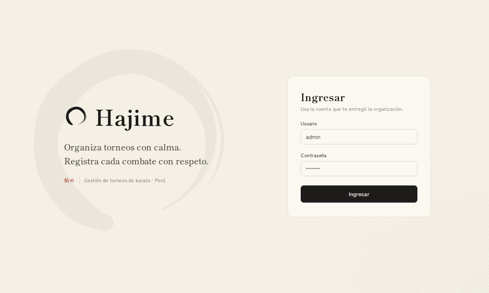

1. Abre Hajime.
2. En **Usuario o correo**, escribe tu usuario o el correo de tu cuenta.
3. Escribe tu **Contraseña**.
4. Toca **Ingresar**.

Según tu rol, la app te lleva a tu pantalla de inicio: **Torneos** (administrador y
organizador), **Mi tatami** (operador de un tatami), **Mis competidores** (sensei) o
**Mis perfiles** (competidor o familia).

Si te equivocas varias veces seguidas, verás «Una pausa breve»: por seguridad, los
intentos se detienen unos minutos. Espera y vuelve a intentar.

### Cambiar la contraseña la primera vez

Si el administrador creó tu cuenta o reseteó tu contraseña, al ingresar la app te
pedirá una nueva («Tu contraseña fue asignada por el administrador; elige una
nueva»).

1. En **Contraseña actual**, escribe la que te entregaron.
2. Escribe la **Nueva contraseña** (mínimo 8 caracteres) y repítela.
3. Toca **Guardar nueva contraseña**.

Al cambiarla se cierran tus sesiones abiertas en otros equipos. Puedes volver a
cambiarla cuando quieras desde el menú de usuario → **Cambiar contraseña**.

### ¿Olvidaste tu contraseña?

Solo funciona si tu cuenta tiene un correo confirmado.

1. En la pantalla de ingreso, toca **¿Olvidaste tu contraseña?**
2. Escribe el **Correo** de tu cuenta y toca **Enviar enlace**.
3. Revisa tu correo (y la carpeta de spam). El enlace vale **1 hora**.
4. Abre el enlace, escribe la **Contraseña nueva**, repítela y toca **Guardar
   contraseña**. Se cierran todas tus sesiones abiertas.

Si tu cuenta no tiene correo, pide a la organización que te asigne una contraseña
temporal.

### Mi cuenta

Menú de usuario → **Mi cuenta**. Aquí puedes:

- **Correo:** agregarlo o cambiarlo (pide tu contraseña actual). Te llega un enlace
  para confirmarlo; mientras tanto figura «Sin verificar». Si no llegó, toca
  **Enviar otro enlace**. Sin correo confirmado no puedes recuperar la contraseña ni
  reclamar perfiles.
- **Nombre visible:** cómo te ve el resto en la app.
- **Idioma** de este equipo.
- Accesos a **Mis perfiles deportivos**, **Avisos en este dispositivo**, **Cambiar
  contraseña**, **Privacidad** y **Borrar mi cuenta**.

**Borrar mi cuenta:** escribe tu contraseña, marca «Entiendo que mi cuenta se
borrará de forma definitiva» y toca **Borrar mi cuenta**. Los resultados de los
torneos no cambian; si además quieres que tu nombre deje de aparecer, pídelo a la
organización.

### Tu sesión

- La sesión se renueva sola mientras usas la app. Si pasas mucho tiempo sin usarla
  (unos 30 días), te pedirá la contraseña otra vez.
- Si la sesión está por vencer, aparece un aviso «Tu sesión vence en N min» con
  **Volver a iniciar sesión**: ingresas la contraseña y sigues **en la misma
  pantalla**, sin perder lo que estabas haciendo.
- En la mesa, una sesión vencida no cierra nada (ver [Sesión vencida en plena
  mesa](#sesion-mesa)).

### Menú, tema claro u oscuro y salir

- En computadora el menú está a la izquierda; en celular, abajo.
- Tu **menú de usuario** está al pie del menú lateral (en celular, arriba a la
  derecha). Allí eliges el **tema** (**Claro**, **Oscuro** o **Sistema**), y
  encuentras **Mi cuenta**, **Mis perfiles**, **Cambiar contraseña**, **Borrar mi
  cuenta** y **Salir**.

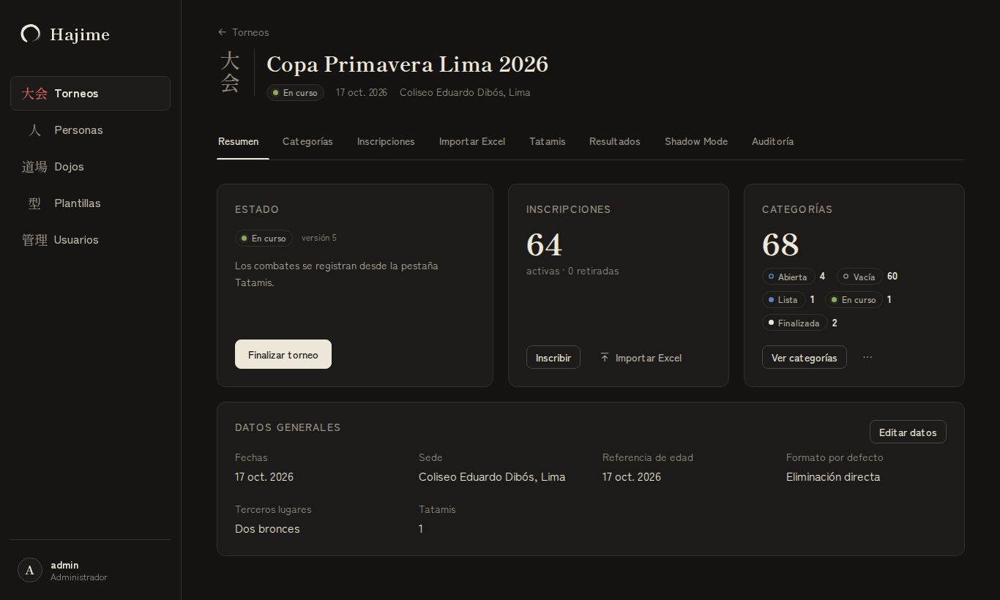

### Avisos en este dispositivo

Hajime puede avisarte en el celular o la computadora: «Te toca en ~3 combates»,
«¡A tatami!», el resultado de un combate, medallas y, si tienes cuenta,
inscripciones revisadas y perfiles aprobados.

1. Abre **Mi cuenta** → **Avisos en este dispositivo** (o el enlace «ajustes de
   avisos» de la página de un torneo).
2. Toca **Activar avisos en este dispositivo** y acepta el permiso del navegador.
3. En **Qué avisos recibir**, marca: *Te toca pronto*, *Resultados*, *Medallas*,
   *Mi cuenta*. Toca **Guardar**.

A quién seguir se elige con la campana **Avisarme**: en la página pública del torneo,
en «Mis perfiles» o en «Mis competidores». Cada equipo se configura por separado:
activar avisos en el celular no los activa en la computadora.

> **Importante (iPhone y iPad):** los avisos solo llegan con Hajime **instalado** (Safari
> → Compartir → «Agregar a pantalla de inicio») y con iOS 16.4 o superior. Abre Hajime
> desde ese ícono y activa los avisos allí.

Para dejar de recibirlos: **Dejar de recibir avisos en este dispositivo**.

---

## 3. Administrador

**Qué puedes hacer:** todo lo del organizador en cualquier torneo, más crear cuentas,
dar roles, crear organizaciones, fusionar y anonimizar personas, administrar
plantillas y reabrir torneos finalizados.

Tu menú: **Torneos**, **Personas**, **Dojos**, **Plantillas**, **Ranking**,
**Organización**, **Reclamos** y **Usuarios**.

### 3.1 Crear una cuenta de usuario

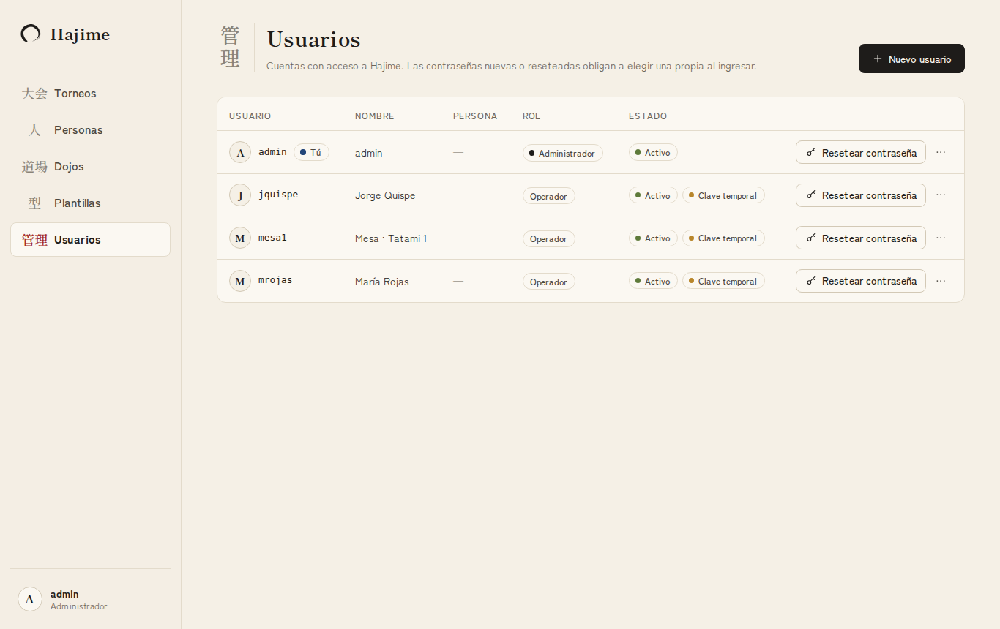

1. Menú **Usuarios** → **Nuevo usuario**.
2. Completa **Usuario**, **Nombre visible** y, si lo tienes, **Correo (opcional)**.
3. En **Contraseña temporal** escribe una o toca **Generar**.
4. Marca **Administrador global** solo si esa persona debe administrar todo.
5. Toca **Crear**. Entrega la contraseña temporal en persona: **no se volverá a
   mostrar**. Al primer ingreso deberá elegir una propia.

Desde el menú de cada fila puedes: **Resetear contraseña**, **Asignar correo** o
**Cambiar correo**, **Vincular persona**, **Hacer administrador** / **Quitar rol de
administrador** y **Desactivar cuenta…** (no podrá ingresar y se cierran sus
sesiones; se puede reactivar con **Activar cuenta**).

### 3.2 Vincular la cuenta a una persona

Los roles se dan a la **persona**, no a la cuenta. Por eso, cada cuenta que vaya a
tener un rol debe estar vinculada a su ficha.

1. En **Usuarios**, menú de la fila → **Vincular persona**.
2. Busca por nombre o documento y toca **Vincular**.

### 3.3 Dar un rol

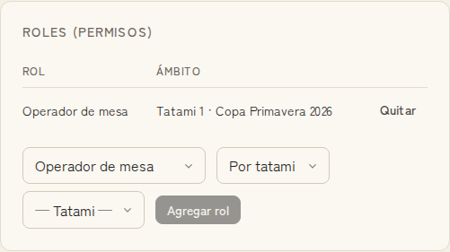

1. Menú **Personas** → abre la ficha de la persona.
2. En la tarjeta **Roles (permisos)**, elige el rol:
   - **Organizador:** prepara y conduce torneos.
   - **Operador de mesa:** registra combates.
   - **Administrador de dojo:** administra su dojo en «Mis competidores».
   - **Árbitro**.
   - **Sensei:** revisa los reclamos de perfil de su dojo.
3. Elige el **ámbito**: **Global**, **Por torneo**, **Por dojo** o (solo para el
   operador de mesa) **Por tatami**, y el torneo, dojo o tatami.
4. Toca **Agregar rol**. Para quitarlo, **Quitar**.

Recomendación para el día del torneo: un **Operador de mesa Por tatami** por cada
tablet. Así solo puede registrar los combates de su tatami, entra directo a «Mi
tatami» y no ve documentos ni fechas de nacimiento.

### 3.4 Organizaciones y miembros

Cada torneo pertenece a una **organización** (liga, dojo u organizador).

**Crear una organización** (solo el administrador):

1. Menú **Organización** → **Nueva organización**.
2. Escribe el nombre, el identificador (opcional) y el tipo. Toca **Crear**.
3. Invita a su dueño desde **Miembros**.

**Invitar miembros:**

1. En **Organización** → **Miembros**, escribe el **Usuario a invitar** (debe tener
   cuenta) y elige el **Rol**: **Dueño**, **Administrador** o **Miembro**.
2. Toca **Invitar**.

Dueño y administrador gestionan la organización y **todos sus torneos**; un miembro
solo los consulta. En **Datos** se editan nombre, tipo, logo, país, zona horaria y
moneda.

### 3.5 Plantillas de categorías

Una plantilla es el conjunto de categorías que se copia a un torneo nuevo.

1. Menú **Plantillas**. A la izquierda eliges la plantilla; a la derecha ves sus
   categorías.
2. **Nueva plantilla:** escribe nombre y descripción; puedes **Importar Excel** o
   **Crear vacía**.
3. **Editar tabla:** agrega, quita u ordena filas (código, nombre, modalidad, por
   equipos, sexo, edad mínima y máxima, grado desde y hasta, peso, formato y
   duración). Toca **Guardar … categorías**. Si hay errores, la app te dice en qué
   fila.
4. En **Más**: **Exportar a Excel**, **Reemplazar filas desde Excel…**, **Cambiar
   nombre y descripción**, **Duplicar**, **Archivar…** o **Borrar…**.

Una plantilla que ya usó un torneo no se puede borrar, solo archivar (deja de
ofrecerse) y restaurar; cambiarla no afecta a los torneos que ya la usaron.

### 3.6 Personas y dojos

**Personas** (competidores, entrenadores y oficiales):

- Busca por nombre o documento y filtra por dojo. **Nueva persona** para crear una.
- Si la app detecta que ya existe alguien con ese documento, ofrece **Usar esta
  persona**.
- En la ficha: **Datos personales**, **Situación deportiva** (dojo y grado
  vigentes), **Consentimientos de datos** y **Roles**. Pestañas **Historial
  deportivo** y **Diplomas y ranking**.
- **Registrar grado** y, en **Más**: **Cambiar dojo** (el historial conserva el dojo
  de cada inscripción anterior) y **Agregar consentimiento**.

**Dojos:** menú **Dojos** → **Nuevo dojo** (nombre, abreviatura, ciudad, sedes o
«Competidor independiente»). En cada fila: **Ver historial**, **Editar datos** y
**Agregar sede**. La ficha del dojo muestra su medallero histórico.

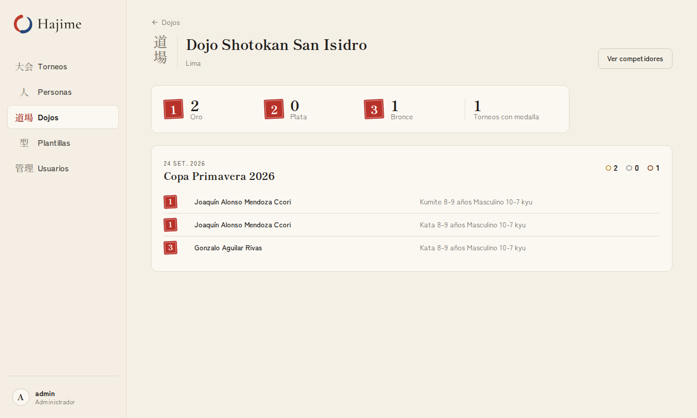

### 3.7 Fusionar personas duplicadas

1. Abre la ficha que quieres **conservar**.
2. **Más** → **Fusionar duplicado…**
3. Busca a la otra persona (la app sugiere posibles duplicados) y toca **Fusionar
   en esta ficha**.
4. Confirma. La otra ficha queda «Fusionada» y sus inscripciones, grados y
   documentos pasan a esta.

¿Te equivocaste? **Personas** → **Más** → **Revertir fusión…** e ingresa el número
de la fusión (se muestra al fusionar y en la Auditoría).

### 3.8 Anonimizar a una persona

Para cumplir un pedido de borrado de datos personales:

1. Ficha de la persona → **Más** → **Anonimizar datos…**
2. Escribe el **Motivo (obligatorio)** y toca **Continuar**.
3. Confirma con **Anonimizar definitivamente**.

Se borran de forma **irreversible** nombres, documentos, fecha de nacimiento y
consentimientos. Los resultados deportivos se conservan sin identificar.

### 3.9 Auditoría

Cada torneo tiene la pestaña **Auditoría**: quién hizo qué, cuándo (hora de Lima),
sobre qué y con qué motivo. Usa el filtro para buscar por entidad, acción, usuario o
motivo, y abre «N cambios» para ver cada campo **Antes** y **Después**.

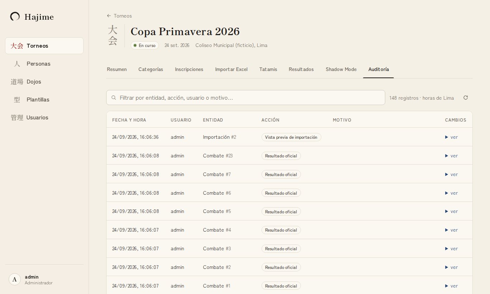

### 3.10 Reabrir un torneo finalizado

Solo el administrador puede hacerlo: **Resumen** → **Reabrir torneo (auditado)** y
escribe el motivo.

---

## 4. Organizador

**Qué puedes hacer:** crear y conducir torneos de tu organización: categorías,
inscripciones, autoinscripción de dojos, acreditación, llaves, tatamis, árbitros,
resultados, diplomas, reportes, seguimiento en vivo y ranking.

Cada torneo tiene estas pestañas: **Resumen**, **Categorías**, **Inscripciones**,
**Solicitudes**, **Importar Excel**, **Acreditación**, **Tatamis**, **Árbitros**,
**Resultados**, **Líderes**, **Shadow Mode** y **Auditoría**.

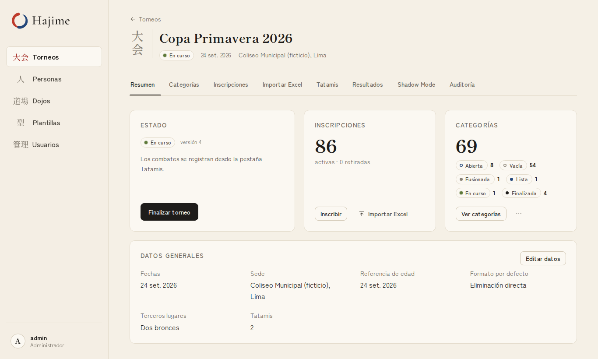

### 4.1 Crear un torneo

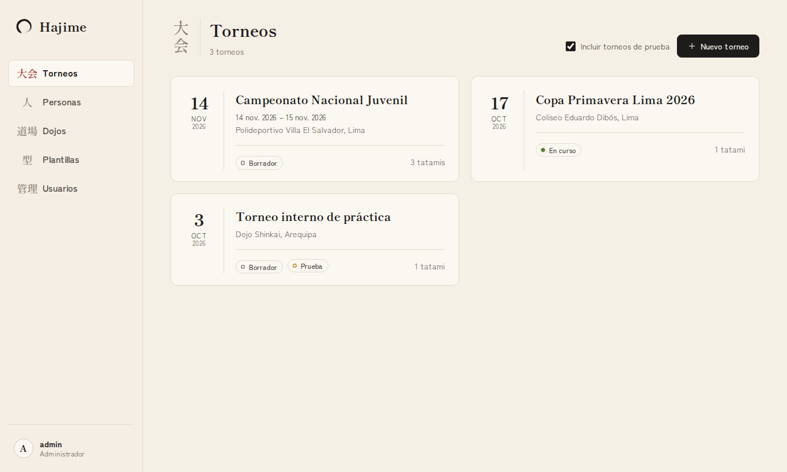

1. Menú **Torneos** → **Nuevo torneo**.
2. Elige la **Organización** y escribe el **Nombre** y la **Fecha de inicio**
   (opcional: **Fecha de fin**, **Local / sede**, **Ciudad**).
3. Elige la **Plantilla de categorías** (las copia al crear el torneo).
4. Indica el **Número de tatamis**, el **Formato por defecto** (Eliminación directa,
   Round robin o Grupos + eliminación) y los **Terceros lugares** (Dos bronces,
   Combate por el 3.º o Repechaje).
5. Marca **Torneo de prueba** si es un ensayo: no cuenta en historiales, medallero ni
   estadísticas.
6. Toca **Crear torneo**.

¿Primera vez? Con la lista vacía aparece **Crear torneo de prueba** con la «Plantilla
base (borrador)».

### 4.2 Estados del torneo

En **Resumen** → tarjeta **Estado**, el botón principal te lleva al paso siguiente:

| Estado | Qué significa | Botón |
| --- | --- | --- |
| Borrador | Preparas categorías y datos. | **Abrir inscripciones** |
| Inscripciones abiertas | Se inscribe (tú, por Excel o los dojos). | **Cerrar inscripciones** |
| Inscripciones cerradas | Generas llaves y ordenas tatamis. | **Iniciar torneo** (o **Reabrir inscripciones**) |
| En curso | Se registran los combates desde **Tatamis**. | **Finalizar torneo** |
| Finalizado | Resultados y medallero publicados. | **Reabrir torneo (auditado)** (solo administrador) |
| Cancelado | — | — |

**Cancelar torneo** está en el menú «Más acciones del torneo».

En **Datos generales** → **Editar datos** cambias nombre, fechas, sede, ciudad,
referencia de edad, terceros lugares y la marca de prueba.

### 4.3 Reglas deportivas

En **Resumen** → **Reglas deportivas** → **Editar reglas**. Valen para todas las
categorías; cada categoría puede cambiarlas.

- **Cálculo de la edad:** a la fecha de referencia o por año de nacimiento.
- **Kumite:** duración, tiempo efectivo o corrido, victoria por diferencia, empate
  (**Hantei (jueces)**, **Punto de oro** o **Senshu y luego hantei**), duración del
  punto de oro, puntos válidos, faltas en **Una escalera** o **Dos categorías
  (contacto / resto)** y si el senshu se pierde automáticamente.
- **Kumite por equipos:** combates por enfrentamiento (3 o 5), qué pasa si empatan en
  victorias, combate extra, puesto vacío, orden declarado y mínimo de titulares.
- **Kata:** **Banderas** o **Puntuación**, **Llave (aka vs ao)** o **Rondas**, preset
  WKF, jueces, descartes, notas técnico/atléticas, nota mínima y máxima, cuántos pasan
  por ronda, grupos y orden de salida, «No repetir kata».
- **Llaves y clasificación:** desempate de round robin, bronces en round robin,
  quiénes no pasan al repechaje, separación **Por dojo** (y además por ciudad),
  grupos, y si un shikkaku en la mesa propone descalificar del torneo.

Toca **Guardar reglas**. Cambiar reglas no altera las llaves ya generadas.

### 4.4 Categorías

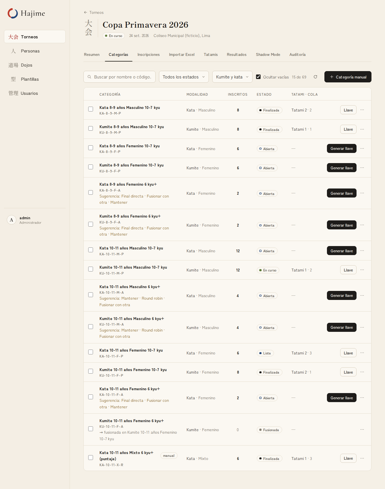

**Crear desde una plantilla:** **Resumen** → tarjeta **Categorías** → **⋯** →
**Generar desde plantilla** → elige la plantilla → **Generar**.

**Crear una a mano:** pestaña **Categorías** → **Categoría manual** (código, nombre,
modalidad, por equipos, sexo, edades, grados, peso, formato y jueces) → **Crear**.

En la pestaña **Categorías** puedes buscar, filtrar por estado y modalidad y
**Ocultar vacías**. Las categorías con pocos inscritos muestran una **Sugerencia**
(fusionar, final directa, round robin, dividir si supera el cupo…).

**Editar una categoría:** menú **⋯** de la fila → **Editar categoría**. En **Datos
básicos** cambias nombre, sexo, edades, grados, peso, duración y formato; en
**Reglas**, cada campo vacío hereda la regla del torneo; además **Terceros lugares**,
**Cupo (máx. inscritos)** y **Peso desde / Hasta (kg)**. Toca **Guardar cambios**.
Cambiar edades o peso no mueve a los inscritos: revísalos si ya no encajan.

**Fusionar:**

1. Marca las categorías con la casilla de cada fila.
2. Toca **Fusionar seleccionadas**.
3. Elige el **Destino** (una de ellas o **Crear una categoría nueva**) y escribe el
   motivo. Toca **Fusionar**.

Las de origen quedan «Fusionada». Se deshace con **Separar (deshacer fusión)**
mientras no haya combates iniciados.

**Dividir:** **⋯** → **Dividir categoría…** → elige el criterio (**Por peso
declarado**, **Por grado** o **Por sorteo (separando dojos)**), los nombres de las dos
partes y el motivo → **Dividir**. Se deshace con **Deshacer división** mientras no
haya combates.

Otras acciones del menú **⋯**: **Generar llave**, **Asignar tatami**, **Cancelar
categoría** (con motivo) y **Reabrir categoría** (para corregir resultados de una
categoría finalizada; el torneo no se reabre).

### 4.5 Inscripciones

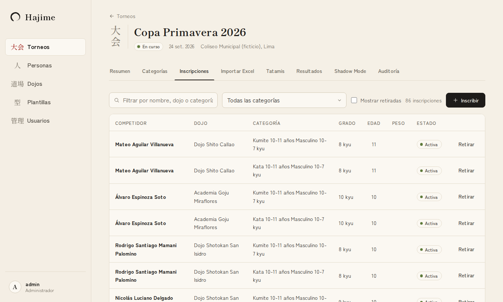

**Inscribir a mano:**

1. Pestaña **Inscripciones** → **Inscribir**.
2. Busca a la persona por nombre o documento. Si no existe, **Nueva persona**.
3. La app muestra las **Categorías sugeridas** según edad, sexo y grado. Marca una o
   varias, o agrega **Otra categoría (manual)**.
4. Si corresponde, escribe la **Categoría de peso declarada** (por ejemplo `-60`) y el
   **Grado** si difiere del vigente.
5. Toca **Inscribir en N categorías**.

Si algo no calza (edad, grado, peso, cupo), aparece la ventana **Advertencias**:
escribe el **Motivo para continuar** y toca **Continuar de todos modos**. La excepción
queda registrada con tu usuario.

**Editar una inscripción:** **Editar** en la fila. Cambias la categoría, la categoría
de peso, el grado o la **Cabeza de serie** (1 = primer cabeza de serie; se separan en
la llave). Si la categoría actual o la nueva ya tienen llave, la app te advierte y,
al confirmar con un motivo, lo saca de una llave y lo pone en la otra (ocupa un bye
libre de la primera ronda).

**Retirar a alguien:**

1. **Retirar** en la fila y escribe el **Motivo del retiro**.
2. Si su categoría ya tiene llave, la app pregunta **¿Qué hacemos con la llave?**
   - **Regenerar la llave:** nuevo sorteo sin él (solo si no empezó ningún combate).
   - **Dar walkover en sus combates pendientes:** su rival gana cada uno; la llave
     sigue igual.
   - **Decidir después:** vuelve luego con **Resolver llave** en la fila.

**Equipos:** **Equipo** → elige la **Categoría por equipos**, el **Dojo** y el
**Nombre del equipo**; marca a los integrantes como **Titular** o **Suplente** (puedes
**Agregar a alguien de otro dojo…**, con advertencia) → **Inscribir equipo**.

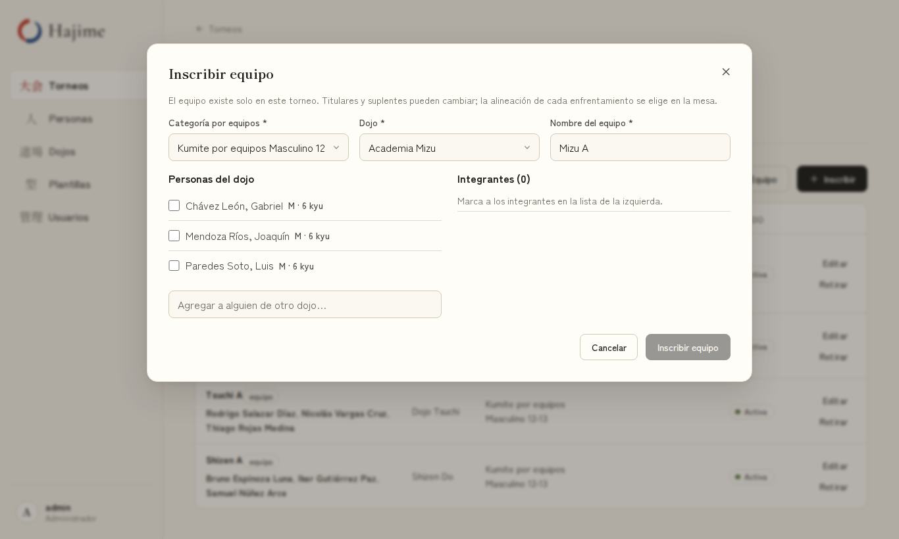

**Inscripción tardía (con la llave ya hecha):** inscríbelo en la categoría y luego,
en la llave, **Más** → **Añadir a la llave…** (ver [Llaves](#llaves)).

### 4.6 Importar inscripciones desde Excel

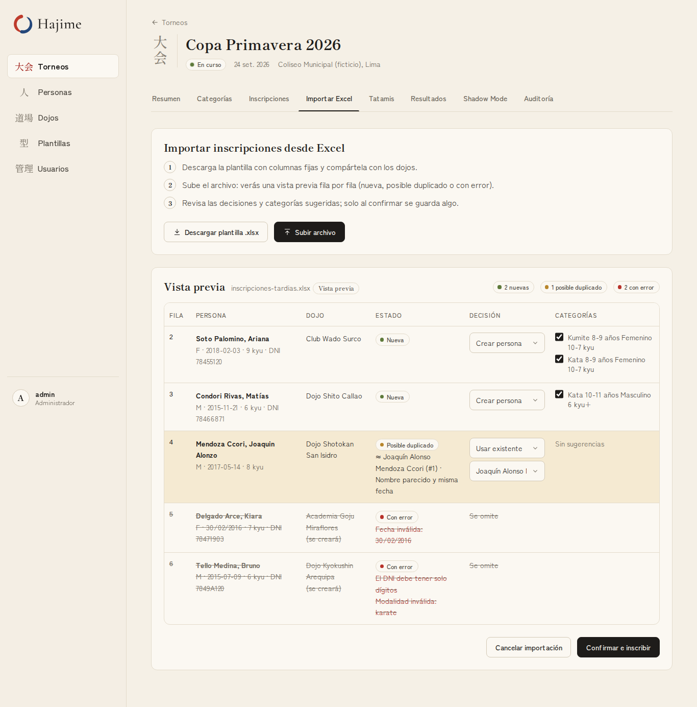

1. Pestaña **Importar Excel** → **Descargar plantilla .xlsx** y compártela con los
   dojos. Columnas: nombres, apellidos, fecha de nacimiento, sexo (M/F), grado, peso,
   tipo y número de documento, modalidades y rol (para registrar árbitros).
2. **Subir archivo**. Verás una **vista previa** fila por fila: **Nueva**, **Posible
   duplicado** o **Con error**. Todavía no se guarda nada.
3. Revisa cada fila:
   - En un posible duplicado elige **Usar existente**, **Crear persona** u **Omitir**.
   - En una fila con error toca **Corregir**, arregla los datos y **Guardar y
     revalidar**.
   - Si una fila no tiene categoría sugerida, elígela en su columna **Categorías**.
4. Toca **Confirmar e inscribir**. O **Cancelar importación** para no guardar nada.

Si recargas la página, la vista previa se retoma donde la dejaste. Sin documento se
puede inscribir: la persona queda como «Identidad incompleta».

### 4.7 Autoinscripción de dojos

Los senseis inscriben a sus alumnos desde su cuenta, con las mismas sugerencias y
advertencias que ves tú. Sus inscripciones quedan **pendientes** hasta que las
apruebes.

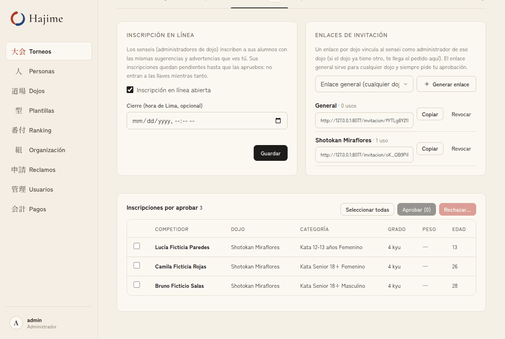

**Abrir la inscripción en línea:**

1. Pestaña **Solicitudes** (el torneo debe estar en borrador o con inscripciones
   abiertas).
2. Marca **Inscripción en línea abierta** y, si quieres, un **Cierre (hora de Lima,
   opcional)**. Toca **Guardar**.

**Invitar a los dojos:**

1. En **Enlaces de invitación**, elige el **Dojo del enlace** (o **Enlace general
   (cualquier dojo)**) y toca **Generar enlace**.
2. Toca **Copiar** y envíalo al sensei (por WhatsApp, por ejemplo).
3. Un enlace de dojo deja al sensei como administrador de ese dojo. Si el dojo ya
   tiene otro administrador, o si usó el enlace general, te llega un pedido en
   **Pedidos para administrar un dojo** → **Aprobar** o **Rechazar**.
4. **Revocar** desactiva un enlace (quien ya lo usó conserva su acceso).

**Aprobar o rechazar inscripciones:**

1. En **Inscripciones por aprobar**, marca las filas (o **Seleccionar todas**).
2. Toca **Aprobar (N)**, o **Rechazar…** y escribe el motivo (el sensei lo verá).

Las pendientes y rechazadas no entran a las llaves ni a los conteos. No se aprueba en
una categoría fusionada, cancelada o que ya tiene llave: muévela o recházala.

### 4.8 Acreditación y pesaje

Todo es **opcional**: si nadie acredita, el torneo funciona igual.

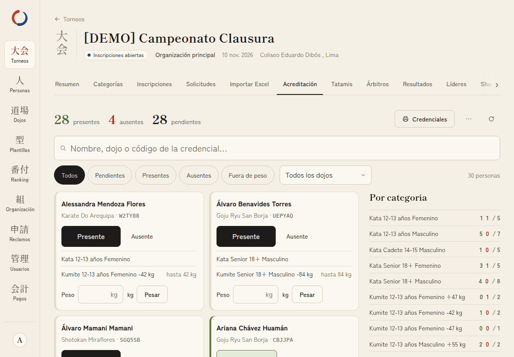

**Imprimir las credenciales (día anterior):**

1. Pestaña **Acreditación** → **Credenciales**.
2. Filtra por dojo si quieres ensobrarlas por dojo.
3. Toca **Abrir PDF para imprimir** (8 por hoja A4, con línea de corte). Cada
   credencial lleva nombre, dojo, categorías y un **QR con su código**.

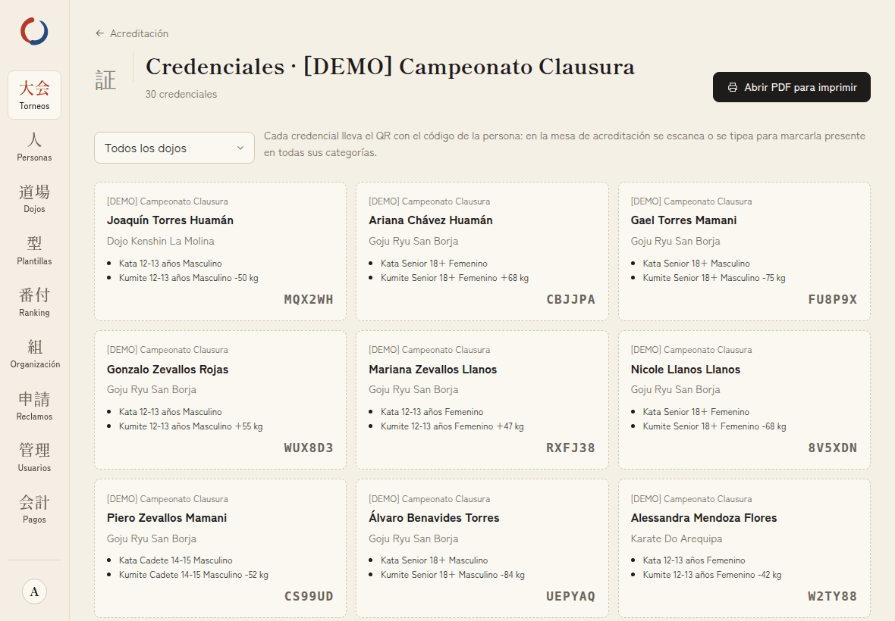

**Ajustes:** en **Acreditación** → **⋯** → **Ajustes de acreditación** decides si el
**Check-in obligatorio** está activo y la **Tolerancia de peso (kg)**. Con check-in
obligatorio, la verificación «listo para iniciar» y la generación de llaves te avisan
de los inscritos sin acreditar.

**Acreditar en la entrada (tablet):**

1. Abre la pestaña **Acreditación**.
2. Busca a la persona por nombre, dojo o código, o toca **QR** y apunta la cámara a la
   credencial. Un lector USB también sirve. Si la búsqueda deja a una sola persona,
   **Enter** la marca presente.
3. Toca **Presente** (marca **todas** sus categorías) o **Ausente**. Tocar otra vez lo
   deshace.
4. Para kumite, escribe el **Peso** en kg (acepta coma, por ejemplo 45,3) y toca
   **Pesar**. El peso vale para todas sus categorías de kumite individual y de paso lo
   acredita.

Usa los filtros **Pendientes**, **Presentes**, **Ausentes**, **Fuera de peso** y el de
dojo. A la derecha, **Por categoría** muestra presentes y ausentes.

**Fuera de peso:** la tarjeta dice «Pasado de peso» o «Bajo el peso» y se abre
**Peso fuera de rango**:

- Toca la categoría que corresponde al peso → escribe el motivo (viene «Peso en la
  balanza oficial») → **Mover**; o
- **Dejarlo en «…» con motivo…** → **Aceptar**: compite donde está, como advertencia
  aceptada.

Hasta resolverlo, la tarjeta muestra **Resolver peso…**.

**Ausentes:**

- **Sin llave:** al generar la llave, la app avisa «Hay inscritos ausentes» y ofrece
  **Excluir ausentes** (se retiran con «No se presentó») o **Incluirlos igual** (con
  motivo).
- **Con llave:** al marcarlo ausente se ofrece **Dar walkover ahora** o **Más tarde**.
  También está el botón **Walkover** en su tarjeta.

Quien «no se presentó» no recibe certificado de participación ni puntos de ranking.

### 4.9 Árbitros (opcional)

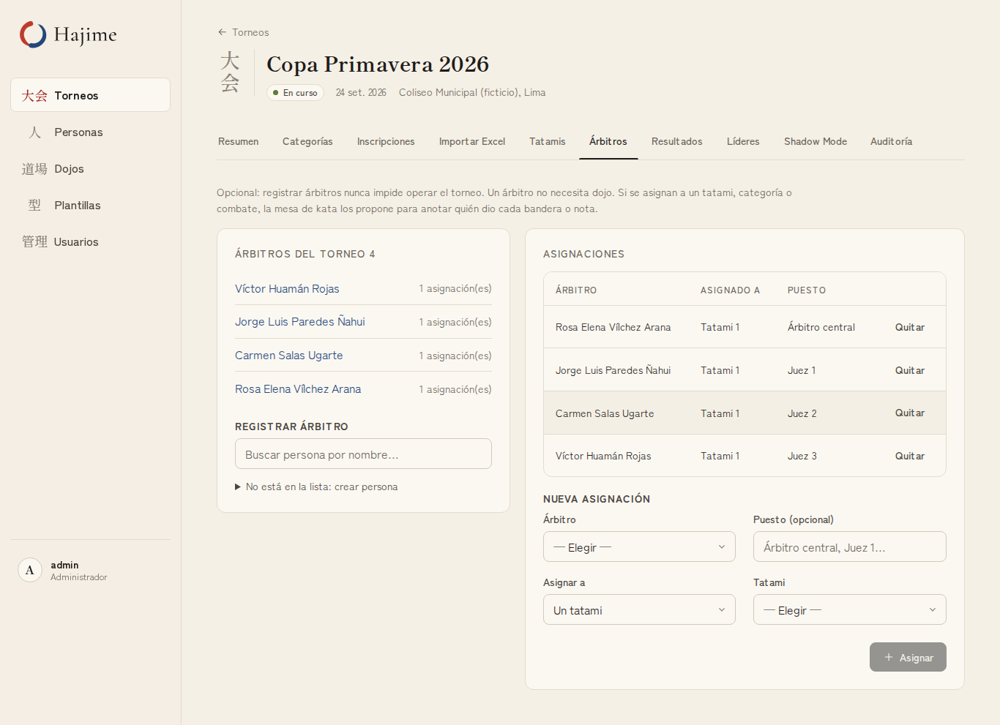

Registrar árbitros nunca impide operar el torneo.

1. Pestaña **Árbitros** → **Registrar árbitro**. Busca a la persona o **No está en la
   lista: crear persona** (no necesita dojo).
2. En **Nueva asignación**, elige el árbitro, el **Puesto (opcional)** (Árbitro
   central, Juez 1…) y a qué se asigna: **Un tatami**, **Una categoría** o **Un
   combate**. Toca **Asignar**.

En kata, la mesa propone a los jueces asignados para anotar quién dio cada bandera o
nota. En la pestaña **Tatamis** se ven los árbitros de cada tatami.

### 4.10 Llaves

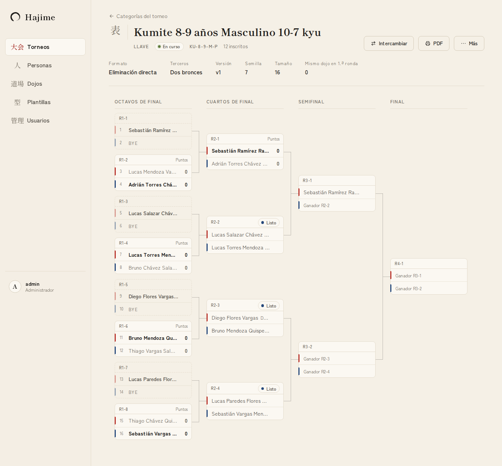

**Generar todas de una vez:** pestaña **Categorías** → **Generar todas las llaves
(N)**. La app muestra la lista y pide confirmación. Cada llave queda como versión
nueva; puedes regenerarla después.

**Generar una:** **⋯** de la categoría → **Generar llave**, o abre la llave y toca
**Generar llave**. Puedes elegir el formato, los terceros lugares, una **Semilla
(opcional)** (la misma semilla reproduce la misma llave) y el motivo.

Formatos: **Eliminación directa**, **Round robin**, **Grupos + eliminación** y, en kata,
**Rondas de kata**. La app separa a los del mismo dojo en la primera ronda (la llave
muestra «Mismo dojo en 1.ª ronda»).

En la página de la llave:

- **Intercambiar:** toca la posición A y luego la B de la primera ronda. **Terminar
  intercambio** para salir.
- **PDF:** imprime la llave. **Más** → **PDF en blanco** para llenar a mano.
- **Más** → **Historial de versiones:** todas las versiones anteriores.
- **Más** → **Añadir a la llave…:** para un inscrito tardío. Ocupa un bye de primera
  ronda que aún no se disputó (en round robin se agregan sus combates).
- **Más** → **Quitar de la llave…:** si su primer combate no empezó, su lugar queda
  como bye; si ya ganó, pierde por walkover su combate pendiente.
- **Más** → **Regenerar llave…:** solo si no hay combates iniciados (el servidor
  advierte).
- Toca un combate para **Abrir mesa**.

**Kata por rondas:** la llave muestra el **Orden de ejecución y notas**. Ordena con
**Subir / Bajar en el orden**; en cada competidor toca **Puntuar** (o **Corregir**),
escribe el **Nombre del kata** y la nota de cada juez, y **Guardar**. Las notas
descartadas aparecen tachadas. La ronda siguiente se arma sola; si hay un empate en
el corte, ordena a los empatados, escribe el motivo y toca **Registrar desempate**.

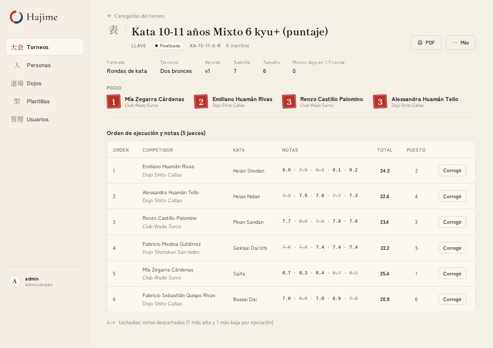

### 4.11 Tatamis, colas y horarios

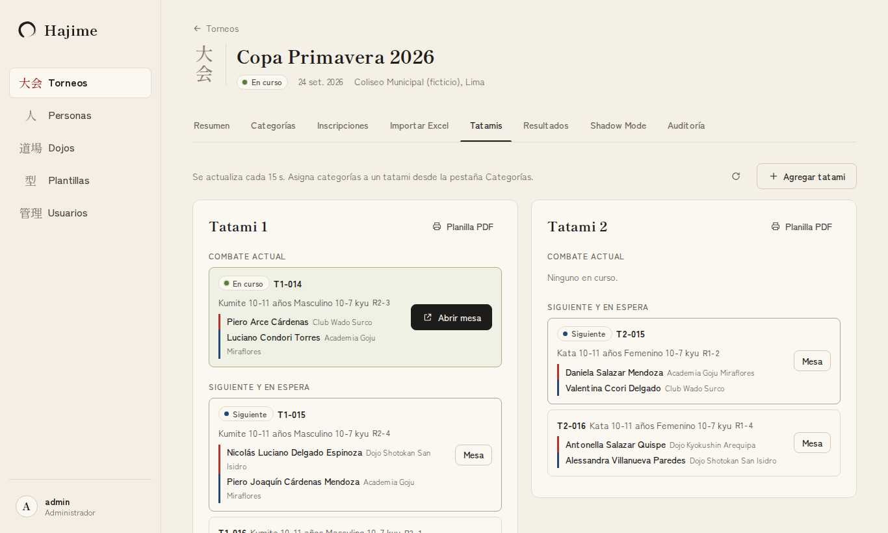

**Organizar colas:**

1. Pestaña **Tatamis** → **Organizar colas**.
2. Marca las categorías **Sin tatami** (o **Seleccionar todas**), elige el **Tatami
   destino** y toca **Asignar**.
3. En cada tatami, ordena con ↑ ↓ (o quita con ✕) y toca **Guardar cola**. Cada
   categoría muestra los combates estimados.

**Horarios estimados:** **Horarios** → escribe la hora de inicio de cada tatami, el
**Margen entre combates (segundos)** y la **Zona horaria** → **Guardar**. La app
estima a qué hora empieza cada combate y se ajusta al ritmo real del tatami. Esa hora
aparece en la página pública, en «¿Cuándo pelea?» y en «Mi tatami».

**Durante el torneo**, cada tatami muestra el avance, el combate actual con su
marcador, **Siguiente y en espera** con la hora estimada, quién está **Operando
ahora** (con aviso si hay «varias tablets») y sus operadores y árbitros. Se actualiza
cada 15 s. **Abrir mesa** abre el combate.

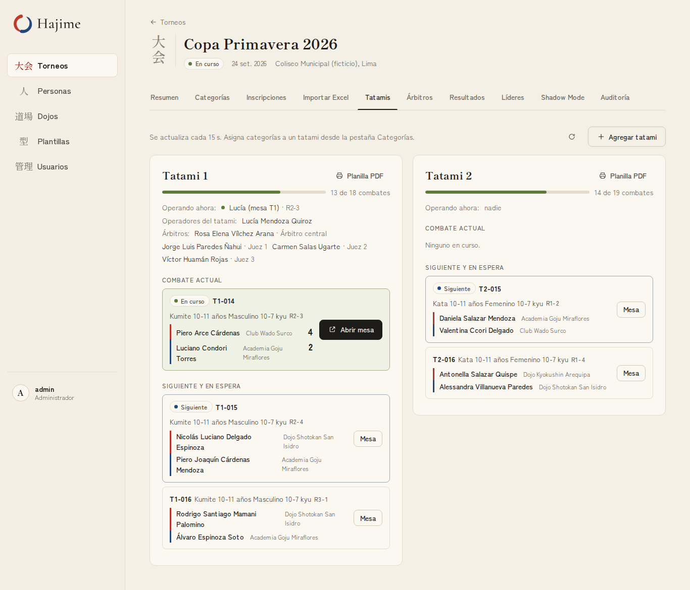

- **Planilla PDF:** la planilla en papel del tatami, el registro oficial.
- **Agregar tatami:** suma uno más.

### 4.12 Antes de iniciar: «listo para iniciar»

Al tocar **Iniciar torneo**, la app revisa y lista lo que falta: categorías con
inscritos sin llave o sin tatami, con un solo inscrito, tatamis sin operador, menores
sin consentimiento de datos, inscritos sin acreditar (si el check-in es obligatorio) y
pesos fuera de rango sin resolver.

- Cada punto tiene su enlace (**Ir a Categorías**, **Organizar colas**, **Ir a
  Inscripciones**…).
- Puedes **Revisar primero** o **Iniciar igual**. Si hay problemas importantes, se
  pide una confirmación extra.

### 4.13 Shadow Mode: comparar con el papel

Hajime nace para usarse **en paralelo** con la mesa oficial en papel. Al terminar:

1. Pestaña **Shadow Mode**.
2. Para cada combate, anota lo que dice la planilla: **Ganador oficial** y **Marcador
   oficial (aka–ao)**. Toca **Guardar**.
3. La app calcula el porcentaje de **coincidencia de ganador** y resalta las
   diferencias (≠ ganador, ≠ marcador).
4. En cada diferencia, escribe el **Hallazgo** y el **Origen del error** (**Sin error**,
   **App** o **Papel**).

Marca **Mostrar solo diferencias** para revisar rápido.

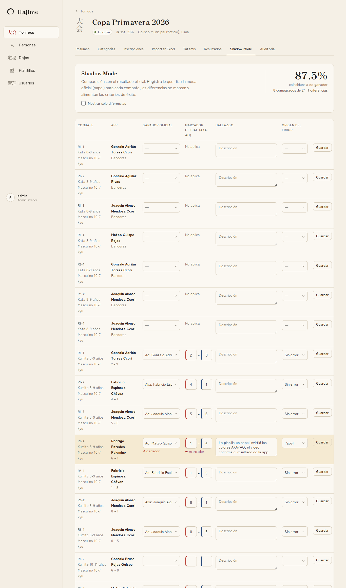

### 4.14 Resultados, medallero, diplomas y reportes

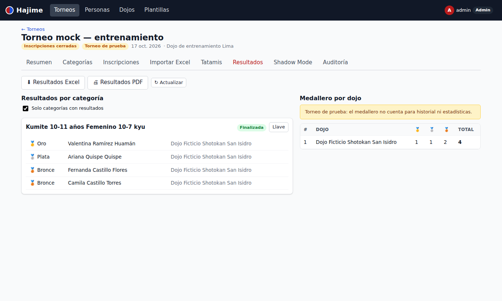

Pestaña **Resultados**:

- Podio de cada categoría finalizada, con enlace a su **Llave**.
- **Medallero por dojo** (oro, plata, bronce y total).
- **Excel** y **PDF**: reportes de resultados y medallero.
- **Diplomas**:
  - **Diplomas de esta categoría** (en cada podio).
  - **Diplomas por dojo…**: elige el dojo e **Incluir** (**Podio y participación**,
    **Solo podio** o **Solo participación**) → **Abrir PDF**.
  - **Todos los diplomas del torneo**.
  - **Firma y organizador…**: nombre del organizador, de quien firma y su cargo.
    Aparecen al pie de cada diploma.

Otros PDF: la llave (**PDF**), la **Planilla PDF** de cada tatami y las
**Credenciales**.

### 4.15 Líderes

Pestaña **Líderes**: **Premios del torneo** automáticos (competidor del torneo, rey
del ippon, victoria más rápida, primera ventaja, mejor kata) y la **Tabla de líderes**
con el **Índice Hajime**. Aparecen solos a medida que se cierran combates. Un torneo de
prueba no genera premios. El índice sirve para reconocer; no es un ranking oficial.

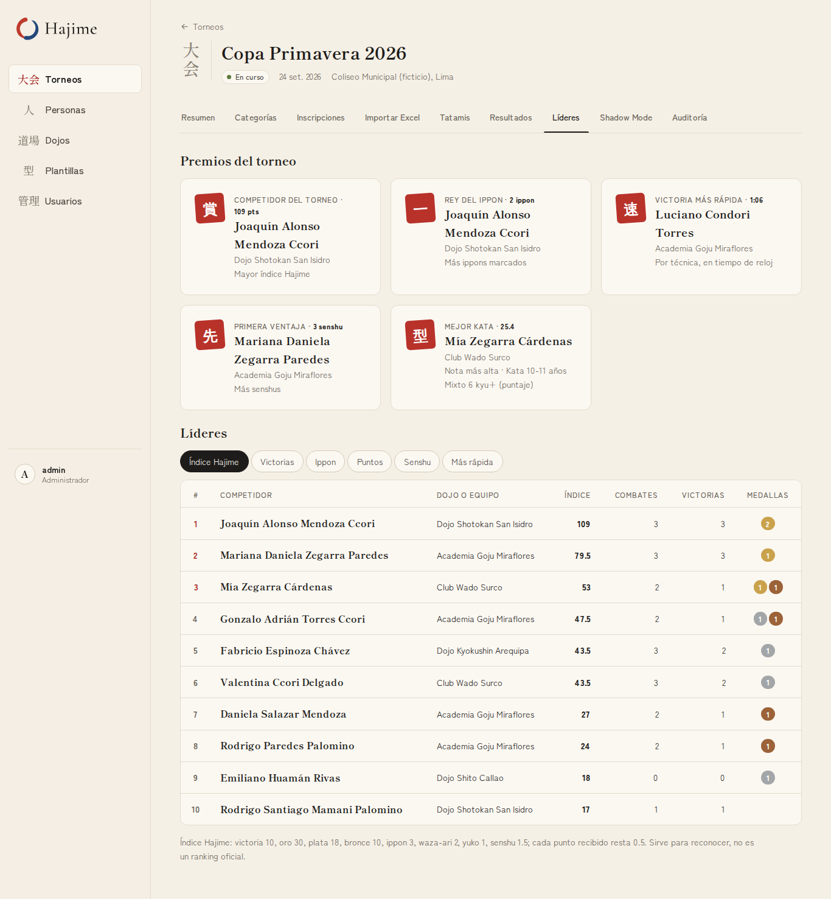

### 4.16 Activar el vivo público

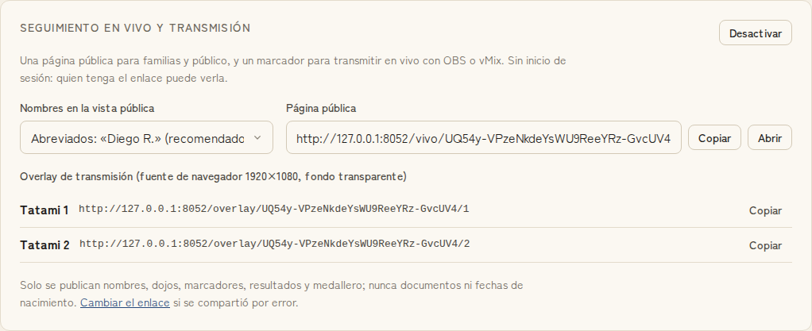

1. **Resumen** → tarjeta **Seguimiento en vivo y transmisión** → **Activar**.
2. En **Nombres en la vista pública**, deja **Abreviados: «Diego R.»** (recomendado
   para menores) o elige **Completos**.
3. Copia los enlaces:
   - **Página pública (dirección fija, para compartir):** por ejemplo
     `…/t/copa-lima-2026`. Con **Cambiar** eliges otra dirección (minúsculas sin
     tildes, números y guiones).
   - **Enlace secreto del vivo** (el de siempre; sigue funcionando).
   - **Pantallas del coliseo:** **Todos los tatamis** (mosaico para la entrada) o uno
     por tatami, a pantalla completa en un TV. Sin cursor ni interacción; la pantalla
     no se apaga.
   - **Overlay de transmisión:** para OBS o vMix, como fuente de navegador de
     1920×1080 con fondo transparente, uno por tatami.
4. El torneo aparece en **Torneos públicos** (salvo los de prueba).

Solo se publican nombres, dojos, marcadores, horarios estimados, llaves, resultados y
medallero; **nunca** documentos ni fechas de nacimiento. Si el enlace secreto se
compartió por error, usa **Cambiar el enlace secreto** (los anteriores dejan de
funcionar). **Desactivar** apaga todo; al reactivarlo, vuelve la misma dirección fija.

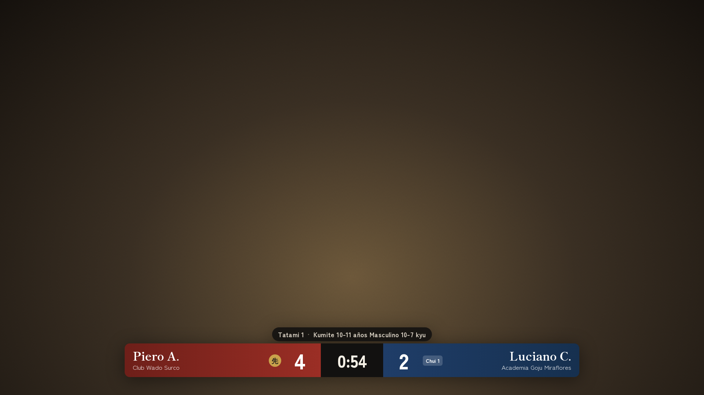

### 4.17 Ranking por temporada

Menú **Ranking** (administrador y organizadores):

1. **Nueva temporada**: **Nombre** (por ejemplo «Liga Lima 2026»), **Año** y,
   opcional, **Desde / Hasta**.
2. En **Torneos**, marca los que cuentan (sin marcar ninguno, cuentan todos los que no
   son de prueba del rango o del año) y ponles un multiplicador si valen más (un
   nacional ×2).
3. **Puntos por lugar** (oro, plata, bronce, participación) y el **Mínimo de
   competidores para puntuar un podio sin combate**.
4. Marca **Publicar en /ranking/…** para que se vea sin iniciar sesión (menores con
   nombre abreviado). Toca **Guardar**.

La tabla tiene **Competidores** y **Mejor academia** (dojos), con filtros de modalidad
y categoría. Se recalcula sola al cerrar categorías; también con **Más** →
**Recalcular ahora**. **Copiar enlace público** para compartirla.

---

## 5. Operador de mesa

**Qué puedes hacer:** registrar los combates de tu tatami (kumite, kata y equipos),
aunque la señal sea mala.

### 5.1 Mi tatami

Si tu rol es **Operador de mesa Por tatami**, al entrar llegas a **Mi tatami**.

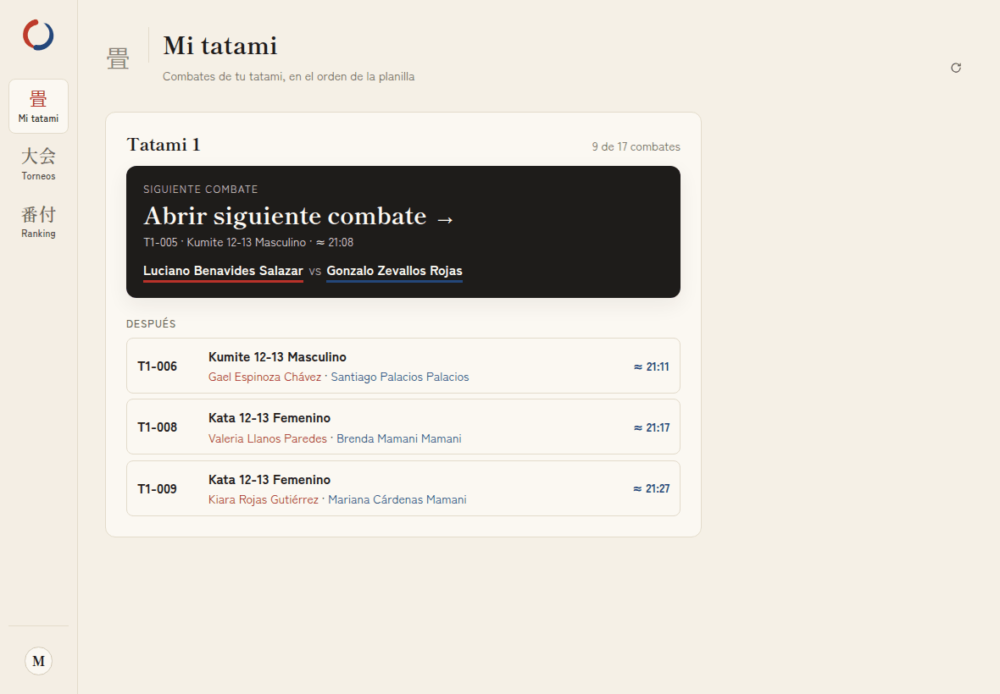

- Arriba, un botón grande: **Abrir combate en curso** o **Abrir siguiente combate**,
  con el número (`T1-005`), la categoría, la hora estimada y los dos competidores.
- En **Después**, los combates que siguen, en el orden de la planilla.
- **Con combates pendientes en otro tatami:** avisa si alguien de tu cola también debe
  pelear en otro tatami.
- **↻** actualiza la lista.

El número del combate en la app es **el mismo** de la planilla en papel.

Si no tienes tatami asignado, verás «No tienes un tatami asignado»: pídeselo al
organizador. Un organizador abre la mesa desde **Tatamis** → **Abrir mesa**.

### 5.2 Preparar la tablet

1. Instala Hajime en la tablet y deja tu sesión abierta.
2. Carga la batería.
3. **Toca la pantalla una vez** al abrir la mesa: así se activa el sonido.
4. En el botón **🔔** del encabezado revisa los **Avisos de tiempo**:
   - **Sonido en este dispositivo** (desmárcalo para silenciar; el botón pasa a 🔕).
   - **Detener el reloj automáticamente al terminar (yame)**.
   - **Probar sonido**.

La mesa pita corto a los 15 s (atoshi baraku) y largo al llegar a 0:00, vibra y hace
parpadear el reloj. Estas opciones se recuerdan en cada tablet.

### 5.3 La mesa de kumite, paso a paso

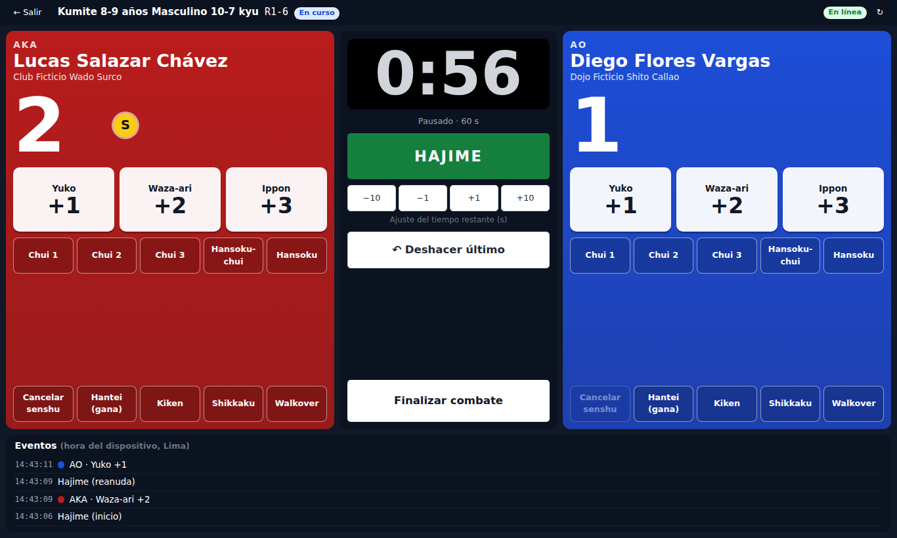

La pantalla tiene tres partes: **AKA** (rojo) a la izquierda, **AO** (azul) a la
derecha y el **reloj** al centro. Abajo, la línea de **Eventos**. Arriba a la derecha,
el estado de la conexión (**En línea**) y **↻ Recargar marcador**.

1. **Empezar:** toca **HAJIME**. El reloj corre.
2. **Detener:** toca **YAME**. Con tiempo efectivo, el reloj también se detiene solo
   al marcar un punto (según la regla del torneo).
3. **Puntos:** en el lado de quien marcó, toca **+1 Yuko**, **+2 Waza-ari** o **+3
   Ippon**.
4. **Senshu:** la primera ventaja se marca sola con el sello **先** junto al puntaje.
5. **Sanciones:** toca el círculo de la falta en la escalera (**Chui 1**, **Chui 2**,
   **Chui 3**, **Hansoku-chui**, **Hansoku**).
6. **Ajustar el reloj:** **−10**, **−1**, **+1**, **+10** segundos.
7. **Equivocación:** toca **↶ Deshacer último**. El marcador se corrige y el evento
   queda tachado («anulado») en la lista.
8. **Terminar:** toca **Finalizar combate** (o **Revisar y cerrar** cuando la app ya
   sugiere un ganador). Ver [Cerrar el combate](#cerrar-combate).

Al centro, **Último evento** te recuerda lo último que registraste.

**Tipos de falta (dos escaleras).** Si el torneo usa faltas en **Dos categorías**, al
tocar una sanción se abre **Tipo de falta**: elige **Categoría 1** (contacto) o
**Categoría 2** (resto de faltas, como jogai o mubobi). Cada categoría tiene su propia
escalera y la tarjeta muestra «Cat. 1» y «Cat. 2». Con una sola escalera, la falta va
directo.

**Menú «Más ⋯» de cada lado:**

- **Cancelar senshu:** retira la primera ventaja.
- **Hantei (gana):** decisión de los jueces. Elige **Gana AKA** o **Gana AO** y, si
  quieres, **Registrar el voto de cada juez** (3 o 5). Toca **Registrar hantei**.
- **Kiken:** abandona el combate.
- **Shikkaku:** descalificación. Según la regla del torneo, la app puede proponer
  **Descalificar del torneo** (se retiran sus demás inscripciones).
- **Walkover:** no se presenta.

**Empates y punto de oro.** Si el tiempo termina empatado, la app sugiere **hantei** o,
si la regla lo dice, **Iniciar punto de oro**: empieza el periodo extra y gana el
primero que marque. Si termina sin puntos, se sugiere hantei.

### 5.4 Cerrar el combate y pasar al siguiente

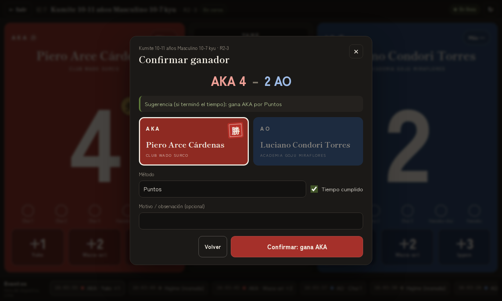

1. Toca **Finalizar combate**. Se abre la hoja de cierre con el marcador.
2. Marca **Tiempo cumplido** si terminó el tiempo: la app sugiere el ganador y el
   método.
3. Revisa o elige el **Ganador** y el **Método** (Puntos, Diferencia de 8, Hantei,
   Punto de oro, Kiken, Shikkaku, Walkover, Decisión…).
4. Si quieres, escribe un **Motivo / observación**.
5. Toca **Confirmar: gana AKA** (o AO).

Aparece **Combate cerrado** con el ganador y el método. Toca **Siguiente combate →**
para abrir el próximo del mismo tatami.

**Corregir un combate cerrado:** toca **Desbloquear para corregir** (pasa a **Modo
corrección**) y **Corregir resultado**. Escribe el motivo. Si el ganador ya avanzó en
la llave, la app lista los **Combates siguientes afectados**. Los cambios quedan
auditados. **Volver a bloquear** para salir.

### 5.5 Kumite por equipos

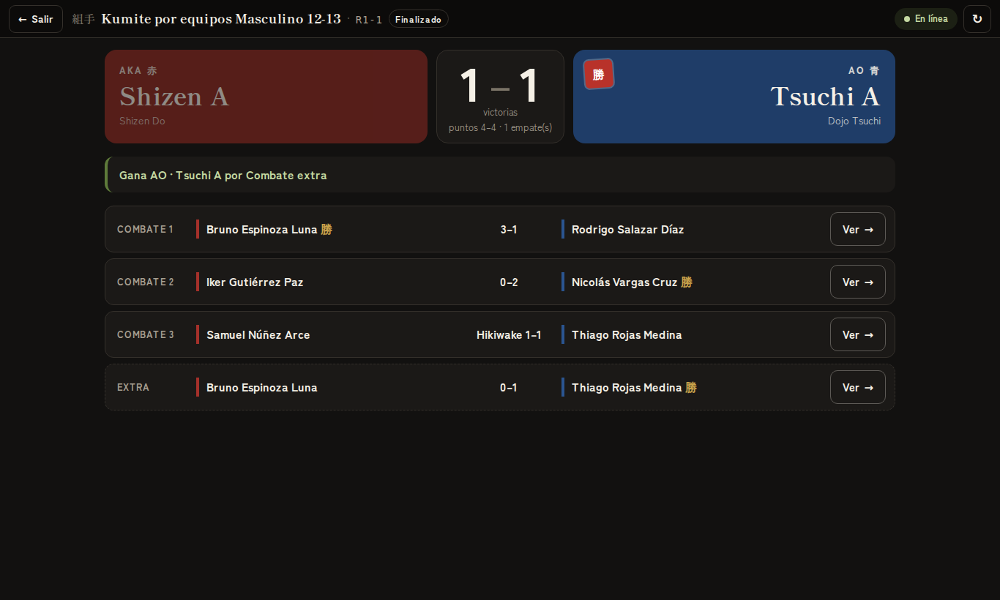

1. Abre el enfrentamiento. Arriba ves **Victorias** y puntos de cada equipo.
2. **Alineación:** elige quién pelea cada combate y toca **Confirmar alineación**. Un
   puesto vacío es walkover para el rival. Según la regla, el orden queda fijo al
   empezar el primer combate.
3. En cada combate toca **Operar**: se abre la mesa normal. Arriba aparece «Combate N ·
   Equipo A 1–1 Equipo B» para volver (**Volver al enfrentamiento →**).
4. Un combate por equipos puede cerrarse en **Hikiwake · empate**.
5. Cuando un equipo ya ganó, el enfrentamiento se decide solo y la llave avanza.
6. Si empatan en victorias (y en puntos, según la regla), toca **Agregar combate
   extra**, elige a los representantes y opéralo.
7. Si un equipo no llega: **Un equipo no se presenta** → **AKA no se presenta** o **AO
   no se presenta** → **Registrar walkover**.

### 5.6 Kata por banderas

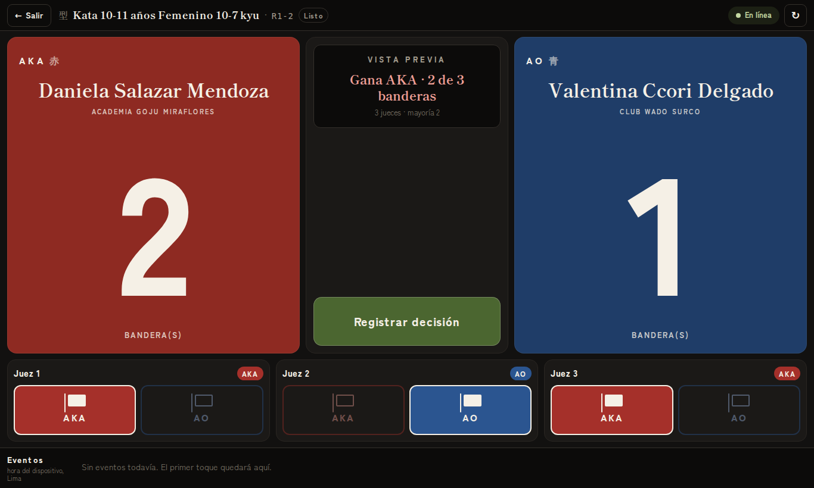

1. Abre el combate de kata (AKA contra AO).
2. En cada juez, toca la bandera **AKA** o **AO**. Si hay árbitros asignados, puedes
   elegir quién es cada juez.
3. Al centro, la **Vista previa** muestra quién gana y con cuántas banderas.
4. Si hay empate o faltan votos, marca el **Voto del juez principal**.
5. Toca **Registrar decisión**.

### 5.7 Kata por puntaje

**En llave (AKA contra AO):** la mesa muestra, para cada lado, el **Nombre del kata** y
la nota de cada juez (un decimal; si el torneo usa técnico/atlético, dos notas por
juez). Las notas descartadas se tachan y la app calcula el total. Toca **Registrar
notas**. Si todo empata, decide el juez principal.

**Por rondas:** las notas se registran desde la llave de la categoría (ver
[Llaves](#llaves)): **Puntuar** en cada competidor.

### 5.8 Qué pasa si no hay red

Sigue marcando como siempre. La app guarda cada toque en la tablet.

- El indicador cambia de **En línea** a **Sin conexión · N pendientes**. Cuando vuelve
  la señal, pasa a **Enviando…** y los eventos se envían solos, al instante y **sin
  duplicarse**.
- En la lista de eventos, los que faltan enviar dicen «pendiente».
- Si sales de la mesa con eventos sin enviar, la app te avisa: quedan guardados en la
  tablet y se envían al volver a abrir ese combate.

**Cerrar sin señal:** en la hoja de cierre aparece «Sin señal. Anota el resultado en la
planilla; se cerrará cuando vuelva la señal» y el botón pasa a **Dejar el cierre en
cola**. Anota el resultado en papel. Al volver la red se envían primero los eventos y
luego el cierre, una sola vez. Mientras tanto se ve «Cierre en cola» y los controles
quedan bloqueados.

**Evento bloqueado:** si el servidor rechaza un evento, el indicador dice **Evento
bloqueado · N pendientes**. Toca **Reintentar**. Solo si no se resuelve, **Descartar
este evento** (si era del reloj, revisa el tiempo y corrígelo con ±1 s o ±10 s).

> **Importante:** si la app falla, **el torneo sigue en papel**. Anota la hora y qué
> pasó para revisarlo después.

### 5.9 Dos tablets en el mismo combate

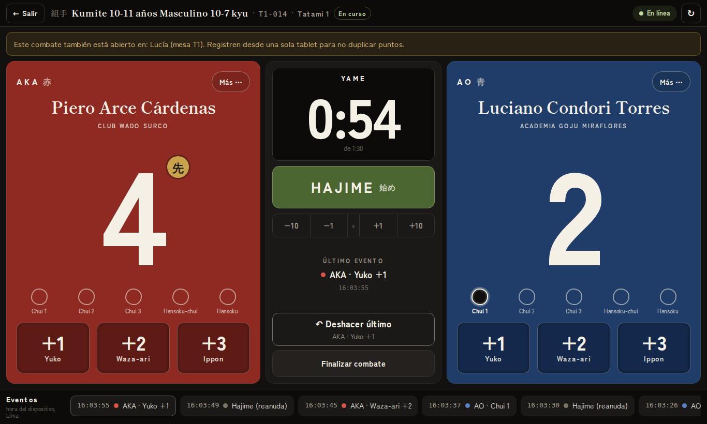

Solo una tablet registra cada combate.

- La que lleva la mesa ve «Este combate también está abierto en: …».
- La otra queda en **Solo lectura**: ve el marcador en vivo con los botones
  deshabilitados.
- Para pasar a registrar desde la segunda tablet, toca **Tomar la mesa** y confirma.
  La primera pasa a solo lectura. Hazlo **solo si la otra tablet ya no se usa**. Si la
  segunda tenía eventos sin enviar, se envían al tomar la mesa.

### 5.10 Sesión vencida en plena mesa

La mesa **no se cierra** ni se pierde nada. Aparece **Inicia sesión para seguir
enviando** con **Usuario** y **Contraseña**. Toca **Ingresar y seguir**: la cola
pendiente se envía sola.

### 5.11 Mesa en el celular

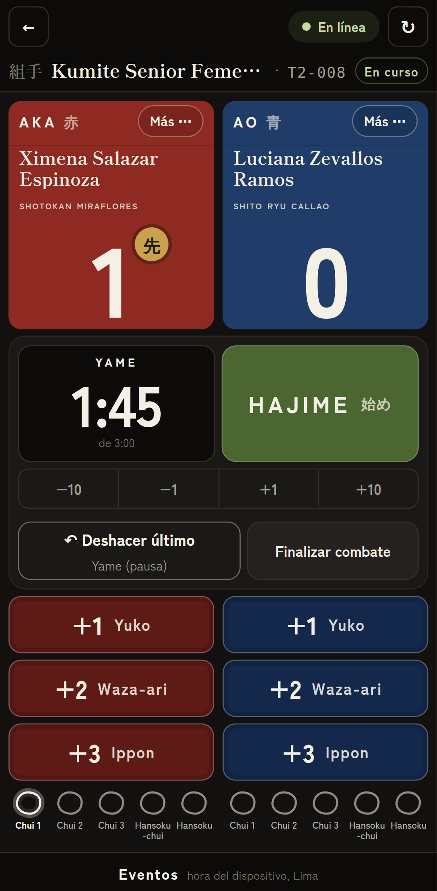

- **Vertical:** marcadores arriba, reloj y HAJIME al centro, puntos al alcance de los
  pulgares y sanciones abajo, sin desplazarte.
- **Horizontal:** tres columnas compactas.
- Mientras la mesa está abierta, la pantalla no se apaga.

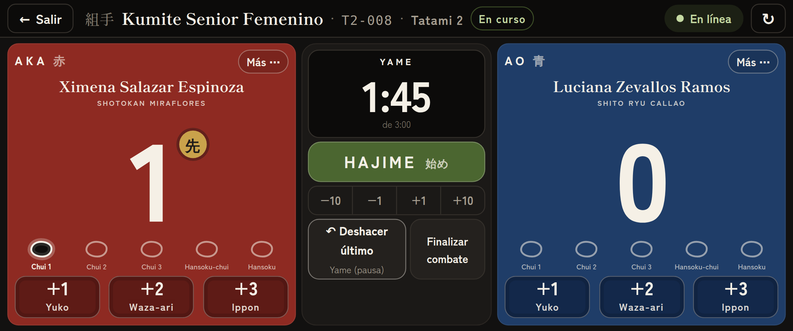

---

## 6. Sensei o administrador de dojo

**Qué puedes hacer:** administrar a los competidores de tu dojo, inscribirlos en los
torneos con inscripción en línea abierta, seguir tus solicitudes, revisar los reclamos
de perfil de tus alumnos y recibir avisos de todo el dojo.

### 6.1 Aceptar la invitación

Necesitas una cuenta de Hajime (te la crea el administrador o puedes crearla tú si el
registro está abierto).

1. Abre el enlace de invitación que te envió el organizador e ingresa con tu cuenta.
2. Lee la invitación: organización, torneo y dojo.
3. Si es un enlace general, elige **Tu dojo**.
4. Toca **Aceptar invitación**.

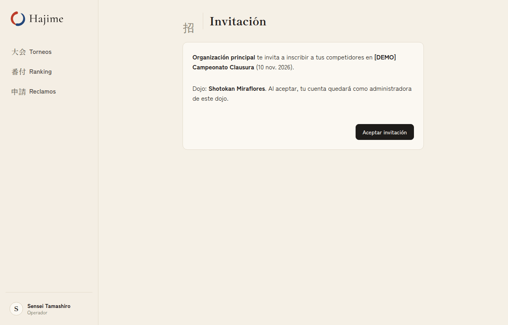

- Si el dojo no tenía administrador, ya puedes inscribir: toca **Ir a Mis
  competidores**.
- Si el dojo ya tenía otro administrador, o usaste el enlace general, tu pedido queda
  registrado y el organizador debe aprobarlo.

### 6.2 Mis competidores

Menú **Mis competidores**. Tiene tres pestañas: **Competidores**, **Inscribir en
torneo** y **Mis inscripciones**.

- **Nuevo competidor:** nombres, apellidos, fecha de nacimiento, sexo, documento y
  grado → **Guardar**. La app detecta duplicados; de un posible duplicado de otro dojo
  solo verás el nombre.
- **Editar** en la fila para corregir sus datos. Tú y el organizador son los únicos
  que ven documento y fecha de nacimiento.
- Si administras más de un dojo, cámbialo con **Elegir dojo**.

### 6.3 Inscribir en un torneo abierto

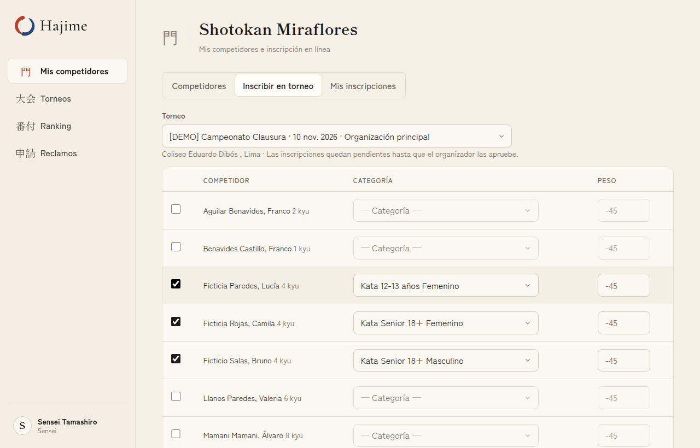

1. Pestaña **Inscribir en torneo**.
2. En **Torneo**, elige uno con la inscripción en línea abierta (se ve la fecha de
   cierre, si tiene).
3. Marca a cada competidor y elige su **Categoría** (arriba salen las **Sugeridas**).
   En kumite, escribe el **Peso** declarado.
4. Toca **Enviar N inscripciones**.
5. Si hay advertencias (edad, grado, peso…), las verás igual que el organizador:
   escribe un motivo y continúa.

Las inscripciones quedan **pendientes** hasta que el organizador las apruebe.

### 6.4 Seguir tus solicitudes

Pestaña **Mis inscripciones**: cada inscripción con su **Estado** (Pendiente, Activa o
Rechazada, con el motivo). Mientras está pendiente puedes **Retirar** la solicitud.
Cuando el organizador revisa el lote, te llega un correo (y un aviso, si los
activaste).

### 6.5 Revisar reclamos de perfil de tus alumnos

Cuando un alumno adulto, o el padre, madre o apoderado de un menor, pide ligar su
cuenta a un perfil de tu dojo, te llega un correo «Nueva solicitud de perfil».

1. Menú **Reclamos** (página «Solicitudes de perfil»). Filtra por **Estado**
   (Pendientes, Aprobadas, No aprobadas, Todas).
2. Revisa **Competidor**, **Quién lo pide**, **Relación** (Mi perfil, Padre o madre,
   Apoderado) y la **Comprobación** («Documento coincide», «Documento no coincide» o
   «Sin documento»).
3. Toca **Aprobar** (confirma que conoces a esa persona) o **Rechazar** con un motivo
   que recibirá quien lo pidió.

> **Importante:** aprobar le da a esa cuenta acceso al **historial completo** del
> competidor. En el caso de un menor, confirma que quien lo pide es de verdad su padre,
> madre o apoderado.

### 6.6 Historial de tus alumnos

«Mis competidores» todavía no muestra el historial deportivo de cada alumno. Puedes
ver sus medallas y torneos en su perfil público (enlace desde la página pública del
torneo) o pedir el detalle al organizador.

### 6.7 Avisos para todo el dojo

En **Mis competidores**, la campana **Avisarme** de arriba sigue a **todo el dojo**; la
campana de cada fila sigue a un alumno. Recibirás «te toca pronto», resultados y
medallas en ese equipo. Ver [Avisos](#avisos).

---

## 7. Competidor y familia

**Qué puedes hacer (gratis):** ver tu historial completo o el de tu hijo o hija, la
hoja de cada combate, estadísticas, insignias, diplomas, ranking, compartir tu tarjeta
y recibir avisos de sus combates.

### 7.1 Crear tu cuenta

Si tu organización tiene el registro abierto, la pantalla de ingreso muestra
«¿Compites o tienes hijos que compiten? **Crea tu cuenta**».

1. Toca **Crea tu cuenta**.
2. Escribe **Tu nombre**, **Correo** y **Contraseña** (mínimo 8 caracteres).
3. Marca «Leí cómo se usan mis datos en la página de Privacidad. Soy mayor de edad.»
4. Toca **Crear cuenta**.

La cuenta es para competidores adultos y para padres, madres o apoderados de
competidores menores.

### 7.2 Confirmar tu correo

1. Abre el correo «Confirma tu correo» y toca el enlace (vale 48 horas).
2. Verás «¡Listo! Tu correo quedó confirmado.»

Si no llegó, ingresa y en **Mi cuenta** toca **Enviar otro enlace**. Sin correo
confirmado no puedes reclamar perfiles.

### 7.3 Reclamar tu perfil o el de tu hijo o hija

1. Menú **Mis perfiles** → **Reclamar un perfil**.
2. En **¿De quién es el perfil?** elige: **Es mío (soy mayor de edad)**, **De mi hijo
   o hija** o **De un menor del que soy apoderado**.
3. Escribe **Nombre y apellido**, elige el **Dojo** (o «Cualquiera») y toca
   **Buscar**. Verás solo el nombre abreviado, el dojo y los torneos disputados.
4. Elige el perfil correcto.
5. Opcional: los **Últimos 4 dígitos del documento** (se comparan y no se guardan;
   hacen la revisión más rápida) y un **Mensaje para quien revisa** (por ejemplo
   «entrena los martes con el sensei Luis»).
6. Si es un menor, marca la autorización para publicar sus resultados deportivos y
   usar sus datos en estadísticas.
7. Toca **Enviar solicitud**.

**Quién aprueba:** el dojo del competidor (sensei o administrador del dojo), un
organizador o el administrador. Los perfiles de **menores siempre los revisa una
persona**. El estado se ve en **Mis solicitudes** (con el motivo, si no se aprobó).
Te llega un correo y, si los activaste, un aviso.

### 7.4 Mis perfiles

Arriba eliges el perfil: **Mi perfil** o **Familia** (cada hijo o hija a cargo). Para
cada uno:

- **Historial deportivo:** medallero personal, grados y cada torneo con sus categorías
  y combates (color, rival, resultado, marcador). Los torneos de prueba no aparecen.
- **Hoja del combate:** toca el ícono de un combate para ver el marcador, la línea de
  tiempo del puntaje, las técnicas por lado y los momentos del combate.
- **Perfil deportivo (estadísticas):** combates, victorias, puntos por combate, senshu,
  racha de victorias, victoria más rápida, mejor nota de kata, técnicas marcadas y
  recibidas, cómo gana y el **índice Hajime**.
- **Insignias:** Primer combate, Primera victoria, Ippon, Podio, Oro, Invicto, Diez y
  Cincuenta victorias, Senshu y Constancia.
- **Ranking:** su puesto en cada temporada.
- **Diplomas y certificados:** toca **Diplomas** para descargarlos (salen de las
  categorías finalizadas).
- **Perfil público**, **Compartir tarjeta** y la campana **Avisarme**.
- **Dejar de seguir** (solo perfiles de familia): dejas de ver su historial completo;
  para volver a verlo hay que pedirlo otra vez.

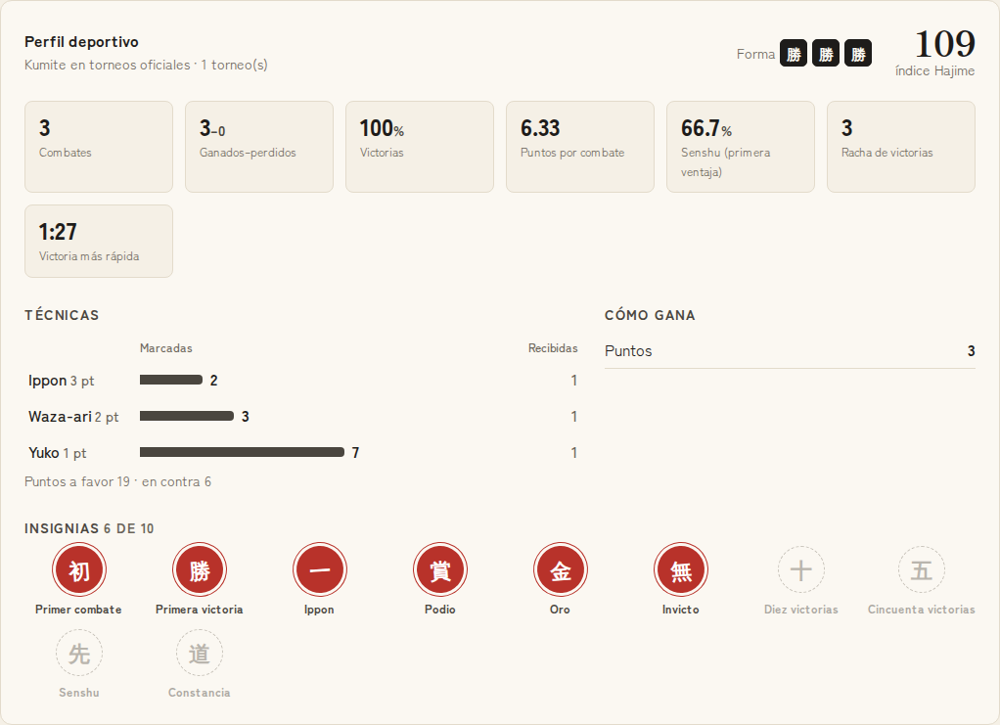

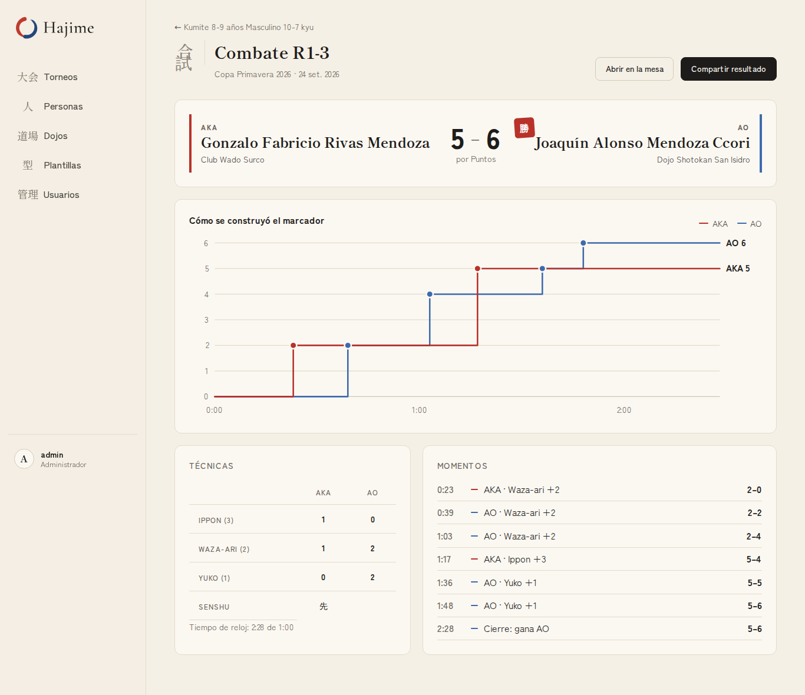

### 7.5 Compartir un resultado

- En la **Hoja del combate**, toca **Compartir resultado**: se genera una imagen
  cuadrada lista para WhatsApp o redes.
- En **Mis perfiles** o en el perfil público, **Compartir tarjeta** hace lo mismo con
  el resumen del perfil.

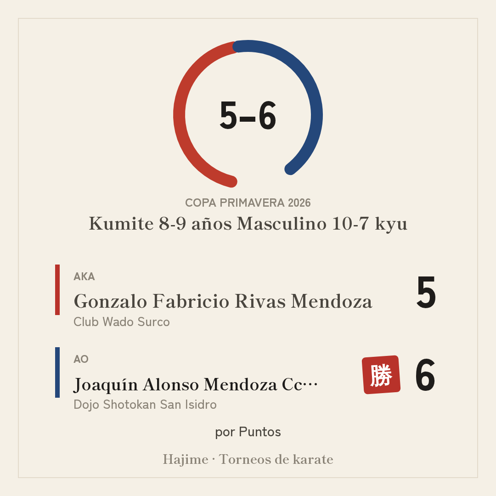

### 7.6 Avisos de sus combates

En **Mis perfiles**, toca **Avisarme** en el perfil. Recibirás «Te toca en ~3
combates», «¡A tatami!», el resultado y las medallas **en todos los torneos**. Primero
activa los avisos en ese equipo (ver [Avisos](#avisos)).

---

## 8. Público y espectadores

**Qué puedes hacer, sin cuenta:** buscar torneos, seguirlos en vivo, saber cuándo pelea
tu competidor, recibir avisos y ver llaves, resultados y perfiles públicos.

### 8.1 Directorio de torneos

Abre `…/torneos-publicos`: torneos **En curso**, **Próximos** y **Recientes**, con
buscador por nombre o ciudad. Toca un torneo para abrir su página.

### 8.2 Página del torneo y el vivo

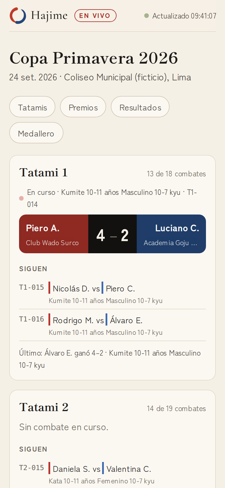

La página del torneo (`…/t/<nombre-del-torneo>`) tiene secciones: **¿Cuándo pelea?**,
**Tatamis**, **Premios**, **Resultados**, **Llaves** y **Medallero**.

- **Tatamis:** el combate en curso con su marcador, los que **Siguen** y el último
  resultado. Se actualiza sola; arriba dice «Actualizado HH:MM:SS».
- **Resultados:** podios de las categorías finalizadas y **Ver la llave completa →**.
- **Llaves:** cada categoría, en solo lectura.
- **Medallero por dojo.**

### 8.3 ¿Cuándo pelea?

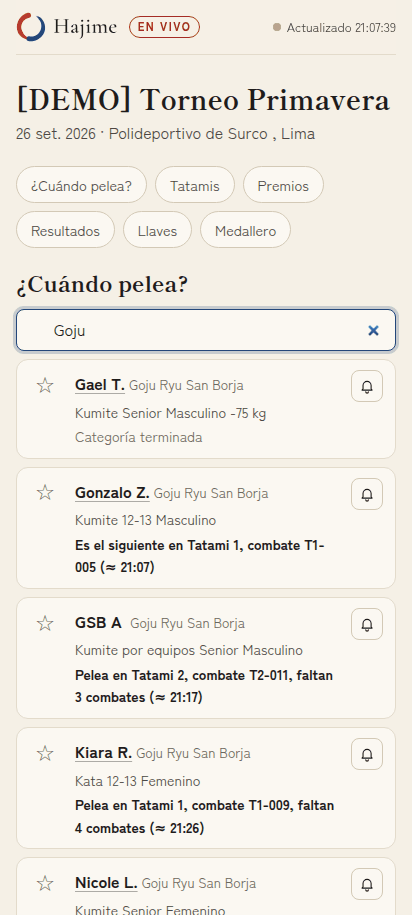

1. En **¿Cuándo pelea?**, escribe al menos dos letras del nombre o del dojo (por
   ejemplo «Diego» o «Kaze»).
2. Cada competidor muestra su categoría y su próximo combate: «Es el siguiente en
   Tatami 1, combate T1-005 (≈ 21:07)» o «Pelea en Tatami 2, combate T2-011, faltan 3
   combates (≈ 21:17)». Al terminar, su puesto.
3. Toca su nombre para abrir su perfil público.

La hora es **estimada** (≈) y se ajusta al ritmo real del tatami.

### 8.4 Favoritos y «Avisarme»

- Toca la **★** para marcarlo como favorito: aparece arriba en **Mis favoritos**. Se
  guarda solo en ese equipo.
- Toca la **campana** para que te avise: «te toca en ~3 combates», «¡A tatami!», su
  resultado y sus medallas. No necesitas cuenta. Sigue a ese competidor solo en ese
  torneo.
- Tocar el aviso abre la página con el competidor resaltado en **Siguiendo**.

### 8.5 Perfil público del competidor

`…/competidor/<código>`: nombre, dojo, medallas y torneos ya disputados, con
**Compartir tarjeta**. El historial completo solo lo ven la propia persona, su familia
y su dojo.

### 8.6 Pantalla grande en el coliseo

El organizador te da el enlace de **Pantallas del coliseo**:

- **Uno por tatami:** nombres, dojo, puntos, faltas, senshu, reloj, categoría y
  siguiente combate, en letra grande.
- **Todos los tatamis:** mosaico para la entrada.

Ábrelo en el navegador del TV y ponlo a pantalla completa (tecla F11 en una
computadora). No necesita mouse ni teclado y la pantalla no se apaga.

### 8.7 Privacidad de los menores

- Por defecto los nombres se publican **abreviados** («Diego R.»). Los menores (o
  quien no tiene edad registrada) siempre salen abreviados en perfiles, ranking y
  avisos.
- Nunca se publican documentos, fechas de nacimiento ni datos de contacto.
- El perfil público de un menor no anuncia torneos futuros.

Más detalle en la página **Privacidad** de la app.

---

## 9. El día del torneo: lista de control

### Una semana antes

- [ ] Torneo creado con sus categorías, reglas y tatamis. **Desmarcado** «Torneo de
      prueba» si es oficial.
- [ ] Cuentas creadas y roles dados: organizadores y un **Operador de mesa Por
      tatami** por tablet.
- [ ] Inscripción en línea abierta y enlaces enviados a los dojos, o plantilla Excel
      compartida.
- [ ] Un ensayo completo con un torneo de prueba y las mismas tablets.

### El día anterior

- [ ] Inscripciones cerradas y solicitudes de dojos aprobadas o rechazadas.
- [ ] Decidido si el check-in es obligatorio y la tolerancia de peso (**Acreditación**
      → **⋯** → **Ajustes de acreditación**). Avisado a los senseis.
- [ ] **Credenciales** impresas y ensobradas por dojo.
- [ ] **Firma y organizador** de los diplomas cargados (**Resultados** → **Diplomas**).
- [ ] Horarios de inicio de cada tatami (**Tatamis** → **Horarios**).
- [ ] Vivo público activado y enlaces listos para compartir.

### Al abrir el coliseo

- [ ] La app abre en cada tablet, con la app instalada y la sesión del operador
      abierta. Tablets cargadas.
- [ ] En cada mesa: tocar la pantalla (activa el sonido) y **Probar sonido**.
- [ ] Prueba de red: apagar el wifi en una mesa, marcar un punto, volver a encenderlo y
      ver que se envía solo.
- [ ] Tablet de **Acreditación** en la entrada, con cámara (o lector USB) y balanza.
      Acreditar y pesar **antes** de generar las llaves.
- [ ] Llaves generadas (**Generar todas las llaves**), excluyendo ausentes.
- [ ] Colas organizadas (**Tatamis** → **Organizar colas**).
- [ ] **Llaves** y **Planilla PDF** de cada tatami impresas: son el registro oficial.
- [ ] **Iniciar torneo** con la verificación «listo para iniciar» revisada.
- [ ] Pantallas del coliseo y overlay abiertos, si se usan.

### Durante

- [ ] Mesa oficial en papel con cronómetro, y la app en paralelo.
- [ ] El número del combate de la app es el de la planilla (`T1-001`…).
- [ ] Si la app falla, el torneo sigue en papel: anotar la hora y qué pasó.
- [ ] Revisar de vez en cuando la pestaña **Tatamis** (avance, quién opera, varias
      tablets).

### Al cerrar

- [ ] Todas las categorías finalizadas; corregir lo que haga falta con motivo.
- [ ] **Shadow Mode:** cargar los resultados oficiales del papel y anotar hallazgos.
- [ ] **Finalizar torneo**.
- [ ] Exportar **Resultados** (Excel y PDF) y generar **Diplomas** por categoría o por
      dojo.
- [ ] Revisar la **Auditoría**: cada corrección debe tener su motivo.
- [ ] Revisar el **Ranking** de la temporada (se recalcula solo).

---

## 10. Preguntas frecuentes y solución de problemas

**Se cayó el wifi en plena mesa. ¿Qué hago?**
Nada especial: sigue marcando. El indicador muestra «Sin conexión · N pendientes» y
todo se envía solo al volver la señal, sin duplicarse. Si tienes que cerrar el combate
sin señal, usa **Dejar el cierre en cola** y anota el resultado en la planilla. Ver
[Qué pasa si no hay red](#sin-red).

**Abrí el combate en la tablet equivocada (o en dos a la vez).**
Solo la primera tablet registra; la otra queda en **Solo lectura**. Si la tablet
correcta es la segunda, toca **Tomar la mesa** en ella. Si marcaste algo en el combate
equivocado, **Deshacer último** y sal con **Salir**.

**Marqué un punto al color equivocado.**
**↶ Deshacer último**. El evento queda tachado y el marcador se corrige.

**Aparece «Demasiados intentos fallidos. Espera unos minutos».**
Por seguridad, después de varios intentos fallidos el ingreso se detiene unos minutos.
Espera, revisa tu usuario y contraseña, y vuelve a intentar. Si no la recuerdas, usa
**¿Olvidaste tu contraseña?** o pide al administrador que la resetee.

**Un competidor no aparece en la llave.**
Revisa, en este orden:
1. **Inscripciones:** ¿está activo en esa categoría? Marca **Mostrar retiradas**.
2. **Solicitudes:** ¿su inscripción del dojo sigue pendiente? Las pendientes no entran
   a las llaves.
3. **Acreditación:** ¿quedó como ausente y se excluyó al sortear?
4. Si la llave ya estaba hecha, añádelo con **Más** → **Añadir a la llave…** (ocupa un
   bye de primera ronda) o, si ningún combate empezó, **Regenerar llave…**.

**Tengo que corregir un resultado ya cerrado.**
Abre el combate en la mesa → **Desbloquear para corregir** → **Corregir resultado** y
escribe el motivo. Si la categoría ya está finalizada, primero **Categorías** → **⋯** →
**Reabrir categoría**. Si el torneo está finalizado, el administrador debe usar
**Reabrir torneo (auditado)**. Todo queda en la Auditoría.

**El primer acceso del día dice «La base de datos está despertando, reintenta en unos
segundos».**
En algunos servidores la base de datos se pausa cuando nadie la usa y tarda cerca de un
minuto en despertar. Espera unos segundos y vuelve a intentar. En producción, para los
torneos, la base queda siempre encendida.

**Los avisos no llegan en el iPhone.**
- Instala Hajime: Safari → Compartir → «Agregar a pantalla de inicio».
- Ábrelo **desde ese ícono** y vuelve a activar los avisos y a tocar **Avisarme**.
- Necesitas iOS 16.4 o superior. El modo de bajo consumo o «No molestar» pueden
  retrasarlos.

**Los avisos no llegan en Android.**
- Revisa que no bloqueaste las notificaciones: toca el candado junto a la dirección →
  permisos del sitio.
- La **APK** no recibe avisos: instala Hajime desde Chrome.
- El ahorro de batería puede demorarlos unos minutos.
- En navegación privada no hay avisos.

**Un sensei no puede inscribir.**
Revisa que la **Inscripción en línea abierta** esté marcada y que no haya pasado la
fecha de cierre, y que el sensei haya aceptado la invitación (o que su pedido para
administrar el dojo esté aprobado en **Solicitudes**).

**Un padre no puede reclamar el perfil de su hijo.**
Primero debe **confirmar su correo**. Luego lo aprueba el dojo, un organizador o el
administrador en **Reclamos**.

**Una persona está repetida.**
El administrador la une con **Fusionar duplicado…** en la ficha que se conserva. Se
puede revertir.

**La hora estimada no aparece.**
El organizador debe poner la hora de inicio de cada tatami en **Tatamis** →
**Horarios**. Sin hora planificada ni combates en curso, no se estima nada.

**No suena la mesa.**
Toca la pantalla una vez (los navegadores exigen un toque para activar el sonido) y
revisa en **🔔** que el **Sonido en este dispositivo** esté marcado. Prueba con
**Probar sonido**.

**Cambié de idioma y algunos textos siguen en español.**
Es normal: PDF, correos y algunos avisos del servidor todavía están solo en español.

---

## 11. Glosario

### Términos de karate

| Término | Significado |
| --- | --- |
| **Aka / Ao** | Rojo / azul: los dos lados del combate. |
| **Atoshi baraku** | «Queda poco»: aviso a los 15 segundos del final. La mesa pita. |
| **Chui** | Advertencia (Chui 1, 2 y 3). |
| **Dan / kyu** | Grados: los kyu son grados de color; los dan, cinturón negro. |
| **Dojo** | Escuela o club de karate. |
| **Hajime** | «Comiencen». Pone en marcha el reloj. |
| **Hansoku-chui** | Última advertencia antes del hansoku. |
| **Hansoku** | Descalificación del combate por sanciones. |
| **Hantei** | Decisión de los jueces cuando hay empate. |
| **Hikiwake** | Empate (en combates por equipos). |
| **Ippon** | Técnica de 3 puntos. |
| **Jogai** | Salida del área de combate (falta de categoría 2). |
| **Kata** | Forma: secuencia de técnicas que se evalúa por banderas o por puntaje. |
| **Kiken** | Abandono del combate. |
| **Kumite** | Combate. |
| **Mubobi** | Falta por no protegerse (categoría 2). |
| **Punto de oro** | Periodo extra tras un empate: gana el primero que marca. |
| **Sensei** | Maestro o entrenador del dojo. |
| **Senshu** | Primera ventaja: quien marca primero sin respuesta. Desempata. |
| **Shikkaku** | Descalificación (del combate o, según la regla, del torneo). |
| **Tatami** | Área de combate. Cada tatami tiene su mesa. |
| **Waza-ari** | Técnica de 2 puntos. |
| **Yame** | «Alto». Detiene el reloj. |
| **Yuko** | Técnica de 1 punto. |

### Términos de la app

| Término | Significado |
| --- | --- |
| **Acreditación** | Marcar quién llegó y pesar a los competidores. |
| **Advertencia (y motivo)** | Aviso de algo que no calza. Se puede continuar escribiendo un motivo, que queda en la Auditoría. |
| **Apoderado** | Adulto responsable de un menor. |
| **Auditoría** | Registro de quién cambió qué, cuándo y por qué. |
| **Autoinscripción** | Inscripción hecha por el sensei desde «Mis competidores», que el organizador aprueba. |
| **Bye** | Pase directo a la siguiente ronda sin rival. |
| **Cabeza de serie** | Competidor que se separa de los otros cabezas de serie en la llave. |
| **Cola** | Orden de categorías y combates de un tatami. |
| **Credencial** | Tarjeta con el código y el QR de cada competidor. |
| **Dirección fija** | Enlace público estable del torneo (`…/t/nombre-del-torneo`). |
| **Enlace secreto** | Enlace alternativo del vivo; se puede cambiar si se filtró. |
| **Evento** | Cada toque de la mesa (punto, sanción, hajime…). Nunca se borra: se anula con otro. |
| **Índice Hajime** | Puntaje de reconocimiento que suma victorias, podios y técnicas. No es un ranking oficial. |
| **Llave** | Cuadro de combates de una categoría. |
| **Marcha blanca** | Etapa de pruebas: todo está incluido sin costo. |
| **Overlay** | Marcador con fondo transparente para transmitir con OBS o vMix. |
| **Planilla** | Registro oficial en papel de la mesa. |
| **PWA** | Hajime instalado desde el navegador, como una app. |
| **Repechaje** | Ronda para definir los bronces entre quienes perdieron ante los finalistas. |
| **Round robin** | Todos contra todos. |
| **Semilla** | Número que reproduce el mismo sorteo de una llave. |
| **Shadow Mode** | Usar Hajime en paralelo al papel y comparar después. |
| **Solo lectura** | Tablet que ve el marcador pero no registra (otra lleva la mesa). |
| **Torneo de prueba** | Ensayo que no cuenta en historiales, medallero ni estadísticas. |
| **Walkover** | Victoria porque el rival no se presenta o fue retirado. |
