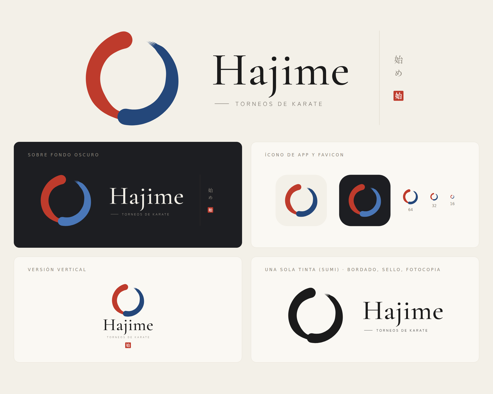

# Marca Hajime

El **ensō** (円相) se traza con dos pinceladas: **aka** en bermellón (shu) y
**ao** en índigo (ai), los dos lados del combate que se completan en un solo
círculo. El trazo ao termina seco, con las cerdas abiertas: el círculo queda
abierto, como pide el ensō. Junto a él, «Hajime» (始め, «¡comiencen!») en
Cormorant Garamond y el sello 始.

## Archivos

| Archivo | Uso |
| --- | --- |
| `hajime-logo-horizontal.svg` | Logotipo principal, con kanji y sello |
| `hajime-logo-horizontal-sin-kanji.svg` | Cuando falta espacio a la derecha |
| `hajime-logo-oscuro.svg` | Sobre fondo oscuro (el trazo ao se aclara para leerse) |
| `hajime-logo-vertical.svg` | Formatos cuadrados o verticales |
| `hajime-logo-sumi.svg` | Una sola tinta: bordado, sello, fotocopia |
| `hajime-icono-app.svg`, `hajime-icono-app-oscuro.svg` | Ícono de app |
| `favicon.svg`, `hajime-enso.svg` | Ensō solo (favicon, avatar) |
| `png/` | Las mismas piezas en PNG para redes y documentos |

El texto está convertido a trazos: los SVG se ven igual en cualquier equipo,
sin instalar fuentes.

## Colores

| Color | Hex | Uso |
| --- | --- | --- |
| Aka · shu (bermellón) | `#BE3B2C` | Trazo izquierdo del ensō, sello |
| Ao · ai (índigo) | `#24477A` | Trazo derecho del ensō |
| Ao sobre fondo oscuro | `#4A77B8` | Trazo derecho en fondos oscuros |
| Sumi | `#1B1B1B` | Palabra «Hajime», versión a una tinta |
| Washi | `#F3F0E8` | Fondo |
| Nezumi | `#6E6860` | Eslogan |

## Tipografías

- **Cormorant Garamond 500** para «Hajime».
- **Zen Kaku Gothic New 400** para «TORNEOS DE KARATE», con mucho espaciado.
- **Shippori Mincho B1** para los kanji 始め y el sello.

## Uso

- Deja alrededor del logotipo un margen libre de al menos la mitad del alto del ensō.
- No cambies los colores de los trazos ni los inviertas: aka va a la izquierda y ao a la derecha.
- Por debajo de 24 px usa solo el ensō (favicon), sin la palabra.

## Regenerar

`generador/enso.py` dibuja los dos trazos a partir de medidas (radio y grosor
por ángulo). `generador/brand.py` arma todas las variantes y convierte el texto
en trazos. Necesita Python con `fonttools`, `brotli` y `uharfbuzz`, y las
fuentes de npm (`npm pack @fontsource/cormorant-garamond
@fontsource/zen-kaku-gothic-new @fontsource/shippori-mincho-b1` dentro de
`generador/fonts/`, descomprimidas). En la app, la marca vive en
`frontend/src/app/shared/enso.ts`.
